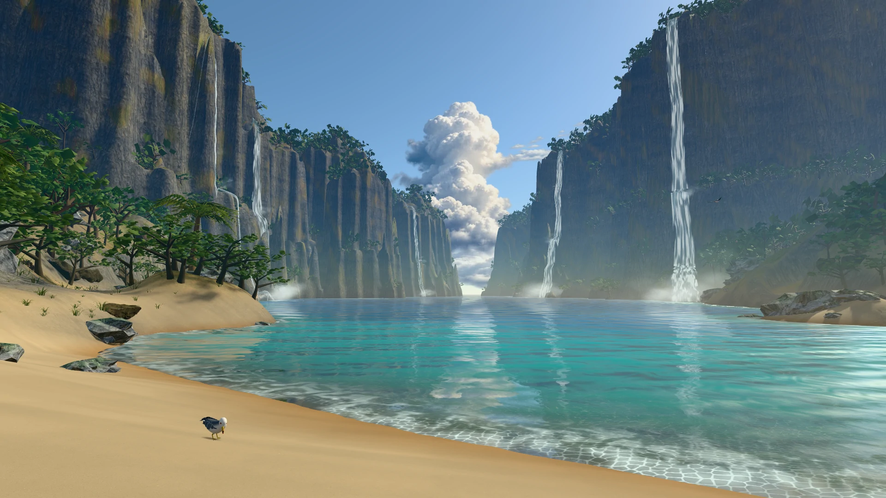
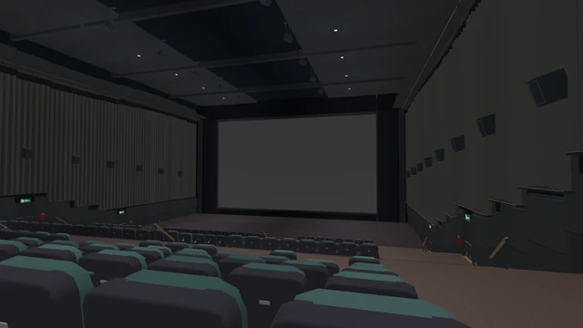
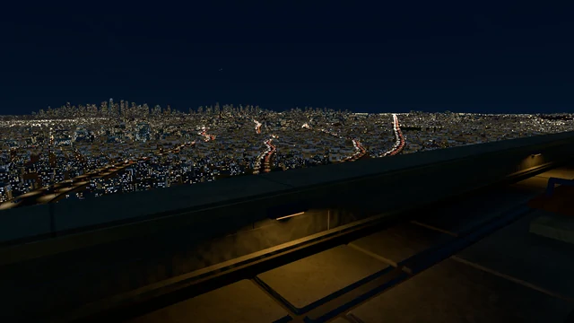
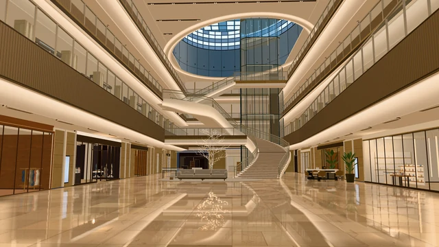
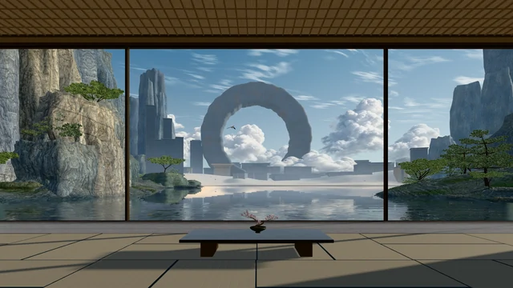
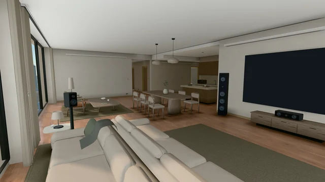

# Lumen Pilgrimage

Lumen Pilgrimage は、景色の中を歩き、気に入った場所で過ごすブラウザー向けの景観探索プロトタイプです。自然の散策路、街を望む展望台や住戸、映画館、商業アトリウム、湖畔の広間を巡ります。

[](docs/gallery/coast.md)

昼夜、照明、環境音を切り替えながら探索できます。仮想モニターには端末の画面共有を表示できます。Three.js と TypeScript で開発し、開発サーバーとプレビューに Vite を使います。

## 過ごせる空間

写真はデスクトップブラウザーの実描画です。「高品質」で撮影しています。

| 自然と眺望 | 建築と室内 |
| --- | --- |
| [](docs/gallery/coast.md)<br>**[入り江と山道](docs/gallery/coast.md)**<br>浜から密林、山中の湖、朱の参道、稜線へ続く散策路。 | [](docs/gallery/cinema.md)<br>**[映画館シアター](docs/gallery/cinema.md)**<br>大型スクリーンの前に座り、館内を歩いて席を選ぶ。 |
| [](docs/gallery/overlook.md)<br>**[丘陵展望台](docs/gallery/overlook.md)**<br>高さと方角を変えて、街並みと夜の灯りを眺める。 | [](docs/gallery/atrium.md)<br>**[商業アトリウム](docs/gallery/atrium.md)**<br>曲階段と回廊を巡り、店先とガラス越しの光庭を眺める。 |
| [](docs/gallery/lake.md)<br>**[湖畔の広間](docs/gallery/lake.md)**<br>畳の広間から湖と石の環を望み、昼夜の景色の中で過ごす。 | [](docs/gallery/residence.md)<br>**[都心の70階住戸](docs/gallery/residence.md)**<br>窓外の街を眺め、リビング、茶室、書斎を行き来する。 |

[すべてのスクリーンショットを見る](docs/gallery/README.md)

## 起動と操作

CI と同じ Node.js 22 系（22.18 以降）を使います。

```sh
npm ci
npm run dev
```

Vite が表示したローカル URL を Chrome で開くと、入り江の砂浜から始まります。`W` `A` `S` `D` で移動し、景観をクリックするとマウスで視点を動かせます。操作パネルに戻るには `Esc` を押してください。設定で環境音・歩行音を切り替え、全体音量や音の種類ごとの音量を調整できます。

「ファストトラベル」から都心の70階住戸へ移動できます。ローカル URL の末尾に `?world=residence` を付けると、夜のリビング南窓から始まります。

映画館はファストトラベルから選ぶか、ローカル URL に `?world=cinema` を付けます。「上映設定」から場内灯を切り替え、「試映を再生」で幕と場内音を体験できます。 [映画館の操作](docs/exploration.md#映画館シアター)

商業アトリウムは `?world=atrium` で奥のソファから始まります。ショーウィンドウ沿いの通路と曲階段からつながる上階を散策できます。 [商業アトリウムの操作](docs/exploration.md#商業アトリウム)

湖畔の広間は `?world=lake` で畳敷きの中央から始まります。広間の左右の窓辺で湖を見下ろし、夜に切り替えると星空を眺められます。 [湖畔の広間の操作](docs/exploration.md#湖畔の広間)

右上の「仮想モニター」から「配信画面を開く」を押すと、同じ Chrome の別タブに画面共有を開始するページが開きます。元の景観でコードを入力し、確認番号を照合して配信元で許可すると映像が浮かぶ面に映ります。[共有・配置・音声の操作](docs/exploration.md#仮想モニター)

Meta Quest 3 のブラウザーで信頼済みの HTTPS URL を開き、「VRを開始」を押すと、Touch Plus で探索できます。 [Quest 3 の接続と操作](docs/exploration.md#meta-quest-3-で探索する)

## 文書案内

| 知りたいこと | 読む文書 |
| --- | --- |
| 各ワールドの景色と昼夜・別視点 | [ワールドギャラリー](docs/gallery/README.md) |
| キー操作、散策路、視野角、描画・環境音の設定、仮想モニター | [探索ガイド](docs/exploration.md) |
| ワールド切替、地形、描画、音響の設計 | [設計](docs/architecture.md) |
| 映画館ワールドの上映音響設計 | [入力・スピーカー・非VRとPC VRでの検証](docs/cinema/cinema-sound-design.md) |
| 70階住戸の間取りと窓からの眺望 | [基本設計](docs/residence/residence-70f-design.md) · [寸法入り設計図 PDF](docs/residence/residence-70f-drawings.pdf) |
| 映画館シアター（大）の客席・光・音の計画 | [基本設計 PDF](docs/cinema/cinema-floor-plan.pdf) · [音響・照明設計 PDF](docs/cinema/cinema-light-sound-design.pdf) |
| 商業アトリウム1階の店舗内装 | [詳細設計](docs/atrium/tenant-interior-design.md) · [寸法図 PDF](docs/atrium/tenant-interior-drawings.pdf) |
| 商業アトリウムのソファ正面 | [光庭・専門店・上階コモンズの施設設計](docs/atrium/sofa-facing-facility-design.md) |
| 湖畔の広間の配置と環境設計 | [湖畔の広間の設計](docs/lake/lake-hall-design.md) |
| 建築・造形・照明・音響を学ぶ | [専門書「歩ける空間の設計」](docs/learning/README.md) |
| テストの実行、実機での確認、配布ビルド | [検証と配布ビルド](docs/verification.md) |
| 開発時の契約、変更に応じた文書の更新先 | [AGENTS.md](AGENTS.md) · [正本と更新先](docs/agent-harness.md#正本と更新先) |
| 旧ゲームの計画と進捗 | [旧ゲームの履歴](plans/README.md#旧ゲームの履歴) |

## 開発者の作業から探す

| 作業 | 読む文書 |
| --- | --- |
| 開発環境を用意して作業を再開する | [開発環境と起動](docs/development.md) |
| コードを変更・レビューする | [コーディング規約](docs/coding-standards.md) |
| ワールドの構成、到着地点、移動と昼夜の引き継ぎを変更する | [ワールド案内](docs/worlds.md) · [実装設計](docs/architecture.md) |
| 仮想モニターの共有、接続、音声、対応環境を変更する | [仮想モニター仕様](docs/monitor.md) · [検証手順](docs/verification.md#仮想モニターの実機確認) |
| 素材を追加・加工し、出典や再現手順を記録する | [素材ガイド](docs/assets.md) · [素材の出典](docs/exploration.md#素材の出典) |
| 配布と運用の確認手順を調べる | [運用ガイド](docs/operations.md) |
| 文書の正本、更新先、受け入れ基準を確認する | [文書の責務と更新基準](docs/documentation-structure.md) |
