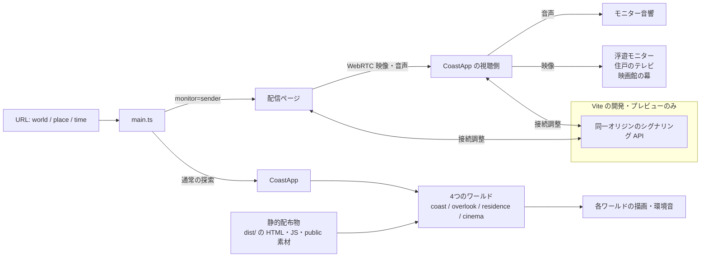

# Lumen Pilgrimage の設計

探索の実装上の責務と接続をまとめます。利用者向けの操作や設定は [探索ガイド](exploration.md)、ワールドごとの構成と接続先は [ワールド案内](worlds.md)、開発作業の入口は [README](../README.md#開発者の作業から探す) を参照してください。

## 全体構成とデータの流れ

| 責務 | 主な担当 | 主な受け渡し |
| --- | --- | --- |
| 起動とアプリの進行 | [main.ts](../src/main.ts) が URL から起動先を選び、[CoastApp](../src/coast/CoastApp.ts) が描画、カメラ、入力、画面、フレーム更新を接続します。 | URL の `world`・`place`・`time` と利用者の操作を、現在のワールドと移動状態へ反映します。 |
| ワールド固有の環境 | [CoastWorld](../src/coast/CoastWorld.ts)、[OverlookWorld](../src/coast/world/overlook/OverlookWorld.ts)、[ResidenceWorld](../src/coast/world/residence/ResidenceWorld.ts)、[CinemaWorld](../src/coast/world/cinema/CinemaWorld.ts) が地形や建物、配置、描画と環境音を組み立てます。 | 各ワールドの地形・配置定義を描画、歩行判定、移動先の計算で共有します。詳細は [ワールド案内](worlds.md) とこの文書の各設計節に記録します。 |
| 移動と共通状態 | [CoastControls の CoastPose / CoastNavigation](../src/coast/CoastControls.ts) が入力、現在の姿勢、接地を扱います。 | 姿勢、ワールドの支持面、時間帯をフレーム更新へ渡し、描画と音響が同じ位置・昼夜に追従します。 |
| 仮想モニター | [配信ページ](../src/monitor/monitorSender.ts)、[シグナリング](../server/virtual-monitor-signaling.mjs)、[セッション](../src/monitor/monitorSession.ts) が接続とメディアの受け渡しを担います。 | 視聴側は受け取った映像をワールド内の表示先へ渡し、音を専用のモニター音響へ渡します。シグナリングと直接通信の契約は [仮想モニター仕様](monitor.md) を参照してください。 |

## 起動と状態遷移

- [main.ts](../src/main.ts) が `#app` を取得し、[CoastApp](../src/coast/CoastApp.ts) で入り江と山道を起動する。`?world=overlook` は丘陵展望台、`?world=residence` は都心の70階住戸、`?world=cinema` は映画館シアター（大）を遅延読み込みする。 [OverlookWorld](../src/coast/world/overlook/OverlookWorld.ts) · [ResidenceWorld](../src/coast/world/residence/ResidenceWorld.ts) · [CinemaWorld](../src/coast/world/cinema/CinemaWorld.ts)
- `CoastApp` はレンダラー、カメラ、UI、フレームループ、操作を接続する。ファストトラベルでは各ワールドの着地点と到着時の向きを使う。選択した移動先と時間帯は URL の `world`、`place`、`time` に反映される。同一ワールド内では位置と入力状態をリセットして移動し、ワールドを移ると移動先と時間帯を渡してページを読み込み直す。 [CoastTravelPanel](../src/coast/CoastTravelPanel.ts) · [移動先の定義](../src/coast/coastDestinations.ts)

## 仮想モニターの設計

ここでは主要な実装接続を示します。遷移・権限・接続期限・対応ブラウザーの詳細は [仮想モニター仕様](monitor.md) を正本として参照してください。

- `?monitor=sender` は [配信ページ](../src/monitor/monitorSender.ts) を起動する。共有ボタンの操作から `getDisplayMedia()` を呼び、ブラウザが選択と許可を管理する。macOSとWindowsは同じ [画面取得](../src/monitor/monitorCapture.ts) とトラック契約を使う。保護コンテンツは共有元の制限に従う。[W3C Screen Capture](https://www.w3.org/TR/screen-capture/) · [ChromiumのmacOSウィンドウ音声対応](https://chromium.googlesource.com/chromium/src/+/c27d9c73c94555e3ec51dcec1317aedd539537fb)
- [シグナリング](../server/virtual-monitor-signaling.mjs) はViteの開発・プレビューで同一オリジンのPOSTを受ける。配信元が視聴先を許可してからセッションを接続し、一時情報はプロセス内に保持して接続終了時に破棄する。録画・保存は行わない。接続の役割、期限、メディア経路は [仮想モニター仕様](monitor.md) にまとめています。
- [視聴パネル](../src/monitor/monitorView.ts) を初めて開くと、一枚の [映像面](../src/monitor/monitorObject.ts) を景観に追加できる。映像面の位置・向き・大きさはワールド座標に保持する。映像の縦横比に合わせて同じ平面を描き、映像を失ったらそこに状態を表示する。配置編集時はFPSのマウスロックを解除し、ドラッグを映像面に渡す。
- 住戸のテレビは同じ映像テクスチャを壁の固定画面に描く。表示先と音の出力方式は別に選べる。5.1ch出力では、受信したチャンネルを音声の数に応じて割り当て、住戸内のスピーカーの位置から頭部伝達関数で定位させる。 [テレビとスピーカーの配置](../src/coast/world/residence/residenceTheater.ts) · [ITU-R BS.775-4](https://www.itu.int/rec/R-REC-BS.775-4-202212-I/en) · [Web Audioのチャンネル順序](https://www.w3.org/TR/webaudio/#ChannelOrdering)
- [VR入力](../src/monitor/monitorXR.ts) はWebXRの `local-floor` に接続する。コントローラーの `squeeze` と手の関節座標によるピンチを個別に扱う。追跡を失った場合は掴みを解除し、その時点の姿勢に固定する。デスクトップの視点とFOVはVRセッションから独立している。[W3C WebXR](https://www.w3.org/TR/webxr/) · [WebXR Hand Input](https://www.w3.org/TR/webxr-hand-input-1/)
- [モニター音声](../src/monitor/monitorAudio.ts) は受信音声専用のWeb Audioコンテキストを持つ。音量とミュートを滑らかに変更し、頭部固定ステレオとHRTFによる定位・距離減衰・指向性を切り替える。映像要素はミュートし、Web Audioに再生を集約する。描画品質は自然環境音・共有音声の処理に影響しない。

## 地形と移動

- [CoastWorld](../src/coast/CoastWorld.ts) と [CoastControls](../src/coast/CoastControls.ts) は、[地形、散策路、沢の水位](../src/coast/terrain.ts) を共有する。道の縦断勾配を滑らかにつなぎ、周囲の地面に応じて横断勾配を付ける。西の岩棚、東の潮棚、林内の分岐と沢は、地形と [岩・シダの配置](../src/coast/world/coastLandmarks.ts) を合わせて組む。素材は [景観素材のクレジット](../public/coast-materials/ATTRIBUTION.md) を参照。
- 地上の登坂判定に引っかかったときは横方向の移動を試す。急な下りとジャンプは重力で接地させる。遊泳と潜水は海・沢・湖の水位を参照し、潜水時に水底への進入を止める。水底が浅くなると浮上し、岸で接地する。水中の視界は深さで減衰し、水面の裏側と水底に届く光を描く。
- 地上で `C` を押すと、カメラの眼高が立位としゃがみで切り替わる。足元の位置、衝突判定、水平速度は共通で、足音の接地判定とWebXR開始時の床位置は現在の眼高を参照する。
- 密林の高所から峠、湖の周回路、稜線へつながる。[朱の参道](../src/coast/world/coastInariTrail.ts) は湖の周回路から分かれ、地形の二つの歩行路に沿って石段と鳥居を置く。山の鞍部と樹冠の高さを調整し、南東から楼門や前庭、石段の入口に日が入る。小社からの下り道は稜線への道に合流する。路肩の地形、ベンチと屋外休憩所の座標、視界を空ける範囲を地形定義に持つ。[休憩所](../src/coast/world/coastRestAreas.ts) は地形に合わせて木製ベンチと低い石の縁を置く。
- [2階展望デッキ](../src/coast/world/overlook/overlookUpperDeck.ts) は東側の階段と踊り場をパビリオンの屋外デッキにつなぐ。階段の滑らかな歩行面と各踊り場の高さを共有し、手すりの位置で歩行を止める。ファストトラベルで選んだ着地点にも同じ高さを適用する。1階はテラスの縁、建物、望遠鏡に沿って歩行を制限する。夜は石の縁と段鼻の灯りが足元を照らす。展望台の高品質設定では、石材の凹凸と床に接する部分の影、手すりに反射する夜空の光、斜面の植生と露岩を描き分ける。夜の街路には道路面と周囲への光の広がりを加える。各ワールドのベンチは通り抜けられる。

## 景観と描画

- 丘陵展望台は標高データに展望デッキの擁壁と、その外側に落ちる斜面を接続する。手前の街区から約15 km先の都心へ向けて建物を段階的に高くし、西・東・さらに奥へ複数の高層街区を広げる。高層棟と周囲の低・中層街区は同じ基準位置を使う。既存の街路沿いの建物から向きと間隔を求め、遠方の低・中層街区を補う。幹線と高層棟の敷地を空け、延伸先でも車体・前照灯・尾灯を道路の高さと線形に合わせる。 [街区の基準位置](../src/coast/world/overlook/overlookDistricts.ts) · [高層業務街区](../src/coast/world/overlook/overlookSkyline.ts) · [幹線交通](../src/coast/world/overlook/overlookTraffic.ts) · [地理データの出典](../public/coast-overlook/ATTRIBUTION.md)
- [空と大気](../src/coast/world/coastAtmosphere.ts) は太陽光の色、空の散乱、距離霞を計算する。昼と夜の切替を空、環境光、距離霞、各ワールドの描画に反映する。入り江と山道の海・湖は、両品質で同じ空と光源を反射に使う。[湖面](../src/coast/world/coastUplandLake.ts) は地形の浅瀬を参照する。高品質では海岸と湖の水面付近で、反射用カメラを間隔を空けて描画する。丘陵展望台では、夜間に街灯と窓、デッキの照明が点く。
- [入り江の星空](../src/coast/world/coastMilkyWay.ts) は天の川の星の密集と暗黒帯を手続き生成する。空の方角に固定して星と銀河の帯を描き、地平線近くと月の周囲では弱める。軽量と高品質で同じ星の配置を使う。[天の川の暗黒帯の解説](https://science.nasa.gov/solar-system/skywatching/night-sky-network/augusts-night-sky-notes-the-great-rift/)
- 起動時は「軽量」。[照明](../src/coast/world/coastLighting.ts) は広域の影と林の間接光を共有する。高品質では視点近くを追従する影、地表の凹凸、近くの植生の詳細と内部解像度を追加する。軽量の広域影は視点が別の場所へ移るまで再利用する。
- [海面](../src/coast/world/coastOcean.ts) は海底の深さを使い、浅瀬で波が盛り上がる位置と崩れた泡を計算する。[波の周期](../src/coast/world/coastSwell.ts) を [CoastAudio](../src/coast/CoastAudio.ts) と共有し、砕波音の位置と強さを寄せ引きに合わせる。
- 入江の滝は岩に沿った流路と着水地点を地形から求める。飛沫の虹は観察者から水滴へ向かう方向を対日点から測り、外側の赤約42°から内側の紫約40°の帯を描く。日が当たる飛沫だけに出て、地形が太陽を遮る箇所は抑える。 [滝の描画](../src/coast/world/coastWaterfall.ts) · [飛沫の虹](../src/coast/world/coastSprayRainbow.ts) · [WMOの主虹](https://cloudatlas.wmo.int/en/primary-rainbow.html)

## 都心の70階住戸

窓のある居間・個室は室内の壁スイッチでカーテンを動かす。部屋の内側から近づいたときに操作でき、バルコニー引戸の近くでは距離で操作対象を選ぶ。布のひだに沿った長さを保ちながらレール方向の幅を変え、動いている間は窓の反射と影の更新を要求する。 [カーテン](../src/coast/world/residence/residenceCurtains.ts)

- 図面の P1 を基準に、東を `x`、北を `-z`、70階の仕上げ床を `y=0` とし、単位をメートルにそろえる。部屋、壁、開口、手すりを描画と歩行判定で共有する。室内家具の外形は間接光の遮蔽に使い、歩行では通り抜けられる。主寝室の引戸は開き量を描画と音響に渡し、人が敷居を通れる幅まで開いてから通行できる。 [設計図 PDF](residence/residence-70f-drawings.pdf) · [平面](../src/coast/world/residence/residencePlan.ts) · [歩行判定](../src/coast/world/residence/residenceNavigation.ts)
- 街路面は `y=-246`。南窓から大通り沿いの屋上と約277 m南の交差点を見下ろす。南北幹線を住戸の塔の東に通し、横断街路と沿道への出入りを担う街路をつなぐ。車道・歩道・走行経路と敷地は同じ道路網から決める。幹線を街区の外へ延ばし、車道とその先の見通しに建物や基壇が重ならないことを描画形状で確認する。夜は走行中の車両の灯りが舗装を照らす。 [基本設計](residence/residence-70f-design.md#街区と視線) · [高さ](../src/coast/world/residence/residenceFloor.ts) · [都市の描画](../src/coast/world/residence/residenceCity.ts)
- 夜の街は建物の用途、部屋、ロビーに応じて窓の点灯と色を変える。住戸から見える遠方の高層棟は、窓が画面上の1画素より小さくなる距離で、まとまりのある小さな窓明かりに移行する。 [近景の外壁](../src/coast/world/residence/residenceCityMaterials.ts) · [遠景の高層棟](../src/coast/world/overlook/overlookCity.ts)
- 住戸周辺のビルも、画面に投影された窓の大きさに合わせて個別の窓明かりを数室のまとまりへ連続的に移行させる。小さい窓の点灯が画素の境界を横切る際の明滅を減らし、遠くでの平均の明るさを保つ。 [近景の窓明かり](../src/coast/world/residence/residenceCityMaterials.ts)
- 室内はオークや漆喰、織物の実寸の色・凹凸・粗さを使う。窓からの日射、間接光、夜の照明を組み合わせる。高品質では家具の実形状から床際の影を作る。デスクトップでは視点に応じて窓・鏡の反射を描き、高品質では室内の深度を使った近接陰影と、床材の粗さに応じた平面反射も加える。 [室内照明](../src/coast/world/residence/residenceLighting.ts) · [反射](../src/coast/world/residence/residenceReflections.ts) · [内装材の出典](../public/residence-materials/ATTRIBUTION.md)
- 録音した交通音を南と東の街路に分散する。壁や扉を通る音と開口を回る音の低域・高域の強さを別々に見積もり、到来方向と室内の反射へ反映する。室内の反射は部屋の寸法に合わせ、扉を開けると接続先の残響を滑らかに混ぜる。歩行音には室内履きの柔らかな接地音と擦れを加え、床材ごとに音を変える。閉じた建具の係数はこの住戸モデル向けの推定値。 [住戸の音響](../src/coast/world/residence/residenceAudio.ts) · [開口の伝搬に関する実測・解析](https://gakui.dl.itc.u-tokyo.ac.jp/cgi-bin/gazo.cgi?no=124544) · [動的開口の研究](https://arxiv.org/abs/2107.11548) · [録音の出典](../public/coast-overlook/ATTRIBUTION.md)

- 住戸から見える遠方の旅客機は展望台と機体・灯火の描画を共有する。住戸の機体は南と東に通過経路を持ち、都市の地形を反転する変換から独立した座標に置く。機体は視覚だけで表現する。 [航空機の描画](../src/coast/world/overlook/overlookAirTraffic.ts) · [衝突防止灯の資料](https://www.govinfo.gov/content/pkg/CFR-2025-title14-vol1/xhtml/CFR-2025-title14-vol1-sec25-1401.html)

## 映画館シアター

- 幕面を `z=0`、客席方向を正とする。室内40 × 57 × 22 m、幅30 m、固定画高12.55 m。床・座席・扉・音響の経路は配置データを共有する。588席のうち8席が同伴席で、車いすスペース8か所を含む収容人数は596。座席の背は歩行を止め、縦通路は段差の位置に合わせた支持面でつなぐ。 [平面と断面 PDF](cinema/cinema-floor-plan.pdf) · [配置](../src/coast/world/cinema/cinemaLayout.ts) · [歩行判定](../src/coast/world/cinema/cinemaNavigation.ts)
- 受信した映像テクスチャを固定画高で投影し、線形光量から映写系の散乱と室内の戻り光を求める。幕から壁・床へ届く光の分布はGPUで更新する。軽量と高品質で解像度と更新頻度が異なる。露出を固定し、暗順応は入退場時の場内灯の遷移へ適用する。段鼻・誘導灯は別系統で点灯する。 [照明](../src/coast/world/cinema/cinemaLighting.ts) · [光の伝達](../src/coast/world/cinema/cinemaLightTransport.ts)
- 共有音から直接音、幕の透過、鏡像法の反射、帯域別の後期残響を合成する。直接音には座席までの距離に応じたゲインを使い、反射に経路差の遅れを加える。高品質は頭部伝達関数と最大12本、軽量は等電力パンと最大4本の初期反射を使う。足音、扉、空調、試聴の音声は共有音と独立する。 [音響](../src/coast/world/cinema/cinemaPlayback.ts) · [光と音の技術設計 PDF](cinema/cinema-light-sound-design.pdf)
- 清掃・非常点検では現行の投影と共有音の出力を一時停止する。場内の扉は客席側で開き、退出操作で入り江へ移る。実施設計に必要な屋外避難・廊下以降の設備は、基本設計PDFに建物側の条件として記録した。
- 同じシアター内で座席を変えると、デスクトップとWebXRで全画面を短時間暗くして着地点を変える。WebXRは座位と頭の向きを追跡し、スクリーンの投影を停止した状態で入っても停止を維持する。 [座席移動](../src/coast/world/cinema/cinemaSeatTransition.ts)

## 音響

- 音響は明示操作で開始する。[海岸の発音点](../src/coast/coastShore.ts) は海につながる浅瀬と陸の境界から求め、波が打つ方向へ動かす。再生中の発音点はクロスフェードで入れ替える。[伝播の計算](../src/coast/coastAcoustics.ts) は岩壁による遮蔽と短い反射、開口を経由する到達音を扱う。[足音と水音](../src/coast/CoastFoley.ts) は移動・潜水と地表の材質から選ぶ。カメラが潜ると、水中にいる深さに応じてミックスの高域を下げる。
- [丘陵展望台の音響](../src/coast/world/overlook/overlookAudio.ts) は幹線の高さを含む中心線を分割し、各区間の距離と丘による遮蔽で音の強さと高域の減衰を求める。道路ごとに合成した音を頭部伝達関数（HRTF）で定位させる。昼は低木に鳥声、夜はデッキ前方の草地と斜面に虫の声を間隔をずらして配置する。虫の音も高低差と地形の遮蔽を反映する。 [録音の出典と伝搬の資料](../public/coast-overlook/ATTRIBUTION.md)
- `CoastApp` は描画と音響に同じ時間帯を渡す。自然景観では昼の鳥声と夜の虫声をなじませ、丘陵展望台と住戸の夜は交通の発音量を下げる。静穏な昼と弱い夜間逆転層を想定し、伝搬経路の曲がり方を地形遮蔽に反映する。遠方の低域を補正し、近くの波や落水、潜水時の処理は各音源の位置と水深に従う。[大気による吸収と屈折の資料](https://www.fhwa.dot.gov/ENVIRonment/noise/noise_barriers/design_construction/design/design03.cfm)
- [落水](../src/coast/world/coastWaterfall.ts) は水の加速と岩に沿った流れを描く。泡と霧の起点は海・湖ごとの水位に合わせ、音響は描画と同じ着水点を参照する。
- [鳥](../src/coast/world/coastBirdLife.ts) が種類・個体・鳴いた位置を音響へ渡す。表示距離の外にいる鳥や、林と尾根に置いた止まり場からも、[鳥種ごとの減衰距離](../src/coast/coastBirdCue.ts)に応じて声を届ける。音響は録音を選び、飛行中は再生中の音源を動かす。距離による到達時間と地形による遮蔽を適用する。 [録音のクレジット](../public/coast-audio/ATTRIBUTION.md)
