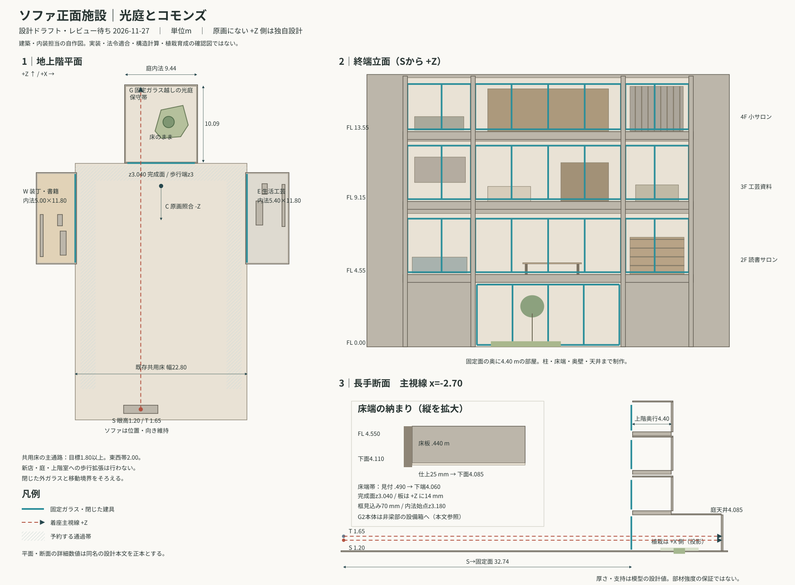

# 商業アトリウム・ソファ正面の施設設計

設計仕様 2026-11-27。対象読者は建築、内装、植栽、照明、音響、実装、受け入れ確認の担当者。**独立設計査読R1〜R5を是正し、2026-11-27に入力を凍結した設計資料である。実装の達成はPRの検証結果と区別する。** 基準スナップショットは `31a37ae66fdaf08f66dfc2e24ab9f9eb2ed78f68`。

この資料と[自作の平面・断面図](sofa-facing-facility-plan-section.svg)を建築・内装の正本とする。専門稿は[照明・素材・展示](sofa-facing-light-material-design.md)、[植栽](sofa-facing-landscape-design.md)、[音響](sofa-facing-acoustic-design.md)。実装入力は[共通寸法](../../src/coast/world/atrium/atriumFrontPlan.ts)で共有し、設計過程と査読の採否は[Issue #269](https://github.com/stillshore-chirp/lumen-pilgrimage/issues/269)へ記録する。

## 目的と観察の境界

ソファに座り、写真と反対の `+Z` を向いたときにも、商業施設の中で休んでいると分かり、無人の落ち着いた滞在空間が成立することを目的とする。床に小物や鉢を増やすのではなく、空白になっている店先、中央終端、上階の返しを、実際の奥行きと用途を持つ建築としてつなぐ。

| 区分 | 確認した内容 | 設計での扱い |
| --- | --- | --- |
| 原画の直接観察 | 長い店舗列、石床、ガラス回廊、暖色の軒裏、大階段、楕円の天井、ソファの位置関係。原画原本から表示用に縮小した全景も実見した。 | 大階段、天井、ソファ、既存テナントの構成を保存する。 |
| 原画から不明 | 写真の背後である `+Z` 側の実施設、用途、窓、出入口、敷地外の景観。 | 以下は仮想施設の独自設計であり、実施設を再現した事実とはしない。 |
| 現況画像の直接観察 | 着座正面では、中央の閉じた前室、左右の未用途の板面、各階の同型の平たい壁が重なる。左斜めと上階からも奥行きの不足を確認した。 | 店舗の奥まり、透明な境界、支持される上階室、遠い受光面へ置き換える。 |
| 現行コードの確認 | ソファ `(-2.7,-29.7)`、眼高1.20、床レベル `0/4.55/9.15/13.55`、歩行上限 `z=3`。前室は約10 mの閉じた立体を持つ。 | ソファ・初期向き・既存の移動先を維持。前室の床、側壁、天井を転用する。 |

参照した現況は `before/atrium-sofa-center.png`、`atrium-sofa-left.png`、`atrium-upper-facing-front.png`、`atrium-views.json`。作業時の一時保存先は `/private/tmp/lumen-atrium-facility.mzsbfP/before/`。公開用証拠へ回収する責務は統合担当にある。原画の固有名、ロゴ、写真の画素は制作物へ転写しない。

## 調査から採った設計判断

一次資料は2026-11-27に本文を読んだ。次の知見を用途・寸法・境界に対応させる。商業施設の実証実験で本案の快適性を測定したものではない。

| 一次資料・読んだ箇所 | この設計への反映 | 適用の限界・権利 |
| --- | --- | --- |
| [Gensler, Retail Design for Better Consumer and Employee Experiences](https://www.gensler.com/blog/retail-design-for-better-consumer-and-employee-experiences)、2023-11-17、First Impression / Customer Journey / 最終段落 | 店先の透明・不透明、内装の前後の構成、機能、光、音を一緒に決める。左右の店を別の用途にし、共用床を展示で埋めずに内側へ段階を作る。 | 設計者による実務的な論考。記載された購買行動の数値は根拠の条件を追えていないため採用しない。記事・写真は転載しない。 |
| [NYC HPD, Retail Design](https://www.nyc.gov/site/hpd/services-and-information/retail-design.page)、Critical Success Factors 1 / 2 / 7 / 8 | 見通せる店先、用途の区別、内装に必要な高さ、柱の整った間隔を採用。入口の表層だけで終わらず、床・棚・奥壁まで閉じた区画を作る。 | 米国の住宅複合用途の地上階向け。国内商業施設の法令や内装仕様には置き換えない。リンク先大容量PDFは取得制限で通読できず、読めた公式HTMLの範囲だけを採用。図版は転載しない。 |
| [国土交通省、設計のUDポイント・移動空間（建物内部）](https://www.mlit.go.jp/gobuild/shukan/ud_point/%281%29-2.pdf)、2/11・3/11・4/11頁 | 平坦な床、障害物を置かない通路、座位・立位の両視線、認識できるガラス、明快な動線を採用。開き戸を共用通路へ出さない。 | 官庁営繕の設計参考資料である。今回は実建築の法令適合を評価しない。主動線1.80 mは本制作の設計目標であり、この資料から法定値として引用した値ではない。図版・文章の転載なし。 |
| [既存の吹抜け設計章](../learning/atrium-case.md)、合わせる視点 / 実装事例 | 写真照合視点と着座視点を分ける。店先の奥行き、歩ける境界、透明材の位置を同じ座標で扱う。 | 章の計算例は仮定値。今回の寸法・構造性能・照明・残響の実測として流用しない。 |

図面はこの資料の座標から新規に描いた模式図で、参考資料の図形、図版、テクスチャ、建築意匠を複写していない。特許実施を伴う専有工法や製品機構を採用せず、一般的な床・壁・固定ガラス・枠の構成を設計する。実施設の名称・商標は使わない。

## 2案と選定

| 案 | 空間・用途 | 着座視界と施設の成立 | 変更・残る問題 | 判定 |
| --- | --- | --- | --- | --- |
| A 光庭とコモンズ | 中央前室を固定ガラス越しの室内光庭へ。左右は装丁・書籍と生活工芸の店。上階は読書・資料展示・小サロン。 | 店先の袖と棚が中景、ガラスの後ろの庭と受光壁が遠景、上下の用途室が施設の断面を作る。無人でも庭・展示が成立する。 | 既存壁の分割、上階床と閉じた奥行きの制作が必要。植物単独で大壁の空白を埋める計画にはしない。 | **採用案** |
| B 中央サービスホール | 前室を案内・受け渡しのサービスホールへ。中央にカウンター、左右に待機・案内。上階は事務・相談室。 | 商業施設らしい用途は明快。窓口とサービス背面を遠い焦点にできる。 | 無人の窓口を正面にすると営業停止した印象が強い。標識や小物に説明を依存し、ソファ前の静かな個人利用と相性が弱い。 | 今回は見送る |

A案の主役は建築の奥行きと受光する鉛直面である。緑はその中の生命の細部とする。庭、棚、光を別々の飾りとして等間隔に配らない。

## 座標、保存範囲と視線

単位はm。`Y`が上、`X/Z`が床面。`+Z`がソファ正面で、着座画面の左は `+X`、右は `-X`。西・東の表記はそれぞれ `-X/+X` とする。FL±0は既存共用床の上面。

### 分野共通の完成面・板厚

新設ガラスの「面」は板芯ではなく、共用側の完成面を指す。音の反射、見える境界、寸法図も同じ完成面を使う。

| 対象 | 共用側完成面 | 描画する板厚の範囲 | 枠と内側の見込み |
| --- | --- | --- | --- |
| 庭・上階室の前ガラス | `z=3.040` | `z[3.040,3.054]`、厚さ14 mm、芯3.047 | 框は `z[3.040,3.110]`、見込み70 mm。石・木の内側見込みは `z[3.110,3.180]`。室内法の始点3.180へつなぐ。 |
| W店の外ガラス | `x=-11.400` | `x[-11.414,-11.400]`、厚さ14 mm、各店の+dへ | 内側門型まで0.65 m。共用側へ枠・把手を突出させない。 |
| E店の外ガラス | `x=11.400` | `x[11.400,11.414]`、厚さ14 mm、各店の+dへ | 内側門型まで0.80 m。共用側へ枠・把手を突出させない。 |

庭の移動上限 `z=3.000` と完成面3.040の差40 mmは固定した前面余裕である。前面は閉じていると分かる巾木・枠を持たせ、先に入れると誤認する開口を残さない。庭ガラスの上下端 `y[.12,3.92]` と `x±4.48` は完成面上の内法寸法である。Wは `-X=着座右` の装丁・書籍、Eは `+X=着座左` の生活工芸へ固定する。

- 主確認眼は `S=(-2.70,1.20,-29.70)`、yaw `π`、pitch `+.035 rad`。立位確認眼は同じ平面位置の `T=(-2.70,1.65,-29.70)`。統合担当が初期pitchにそろえて撮り直した現況を最終比較の基準とする。寸法検図では、これとは別に水平の視線も用いる。
- 原画照合眼は `C=(0,1.65,0)`、向き `-Z`。既存カメラのyaw、pitch、FOV、時刻・露出を最終比較で固定する。ソファ、階段、枝状造形、カフェ、楕円天井、既存のL/R/F店舗と展示島を動かさない。
- 新店の近い端は `|x|=11.40,z=-10.20`。Cからの平面角は `atan(11.4/10.2)≈48.2°`。垂直FOV42°、比率2944/1648なら水平半角は約34.5°なので、既定の原画カメラの外に置ける。これは平面での事前確認であり、最終画像照合の代用にはしない。
- 新しい造形を `z<-10.20` の共用部へ押し出さない。ソファから端部までの広い石床を保ち、手前に中央什器・鉢・大きな案内板を追加しない。

### 前景・中景・遠景

| 層 | 範囲 | 形と役割 |
| --- | --- | --- |
| 前景 | ソファ前から `z=-11` 付近 | 既存石床、左右の既存店舗、軒裏。床の大きな余白と連続した左右通路。 |
| 中景 | `z=-10.2〜3.04` | 左右の異なる店先。閉じた外ガラス→内側へ引いた門型枠→低卓→棚→奥壁。中央は庭の重い石袖と細い固定枠。 |
| 遠景 | `z=3.18〜13.27` | 手前の空き床、片寄せた植栽床、細い幹と葉、奥の受光壁。庭の床目地・側壁・天井が終端まで続く。 |
| 上方 | FL4.55 / 9.15 / 13.55 | 各階の床端、支持柱、窓の奥の部屋と背面。全階を同じ白いパネルや発光帯で埋めない。 |

庭ガラスまでの水平距離は32.74 m、奥壁まで42.97 m。高さ0.35 mの基盤はSから約−1.3°、Tから約−2.0°で低く見える。樹冠上端3.25 mはSから約+3.1°で、奥壁・上階を隠す量が小さい。主木を増やして壁を隠す方針は取らない。

## 寸法入り平面

### 地上階の区画

| ID・用途 | 内法範囲 `x / z` | 仕上げ床・天井 | 建具と閉じ方 |
| --- | --- | --- | --- |
| G 室内光庭 | `x[-4.72,4.72] / z[3.18,13.27]` | 床0.00、天井下面4.085 | 正面固定ガラスは `z=3.04,x[-4.48,4.48],y[0.12,3.92]`。石巾木、上枠、袖で隙間なく閉じる。出入口の把手・自動扉・出口サインは設けない。 |
| W 装丁・書籍の店 | `x[-16.40,-11.40] / z[-10.20,1.60]` | 床0.00、天井3.60 | 共用境界 `x=-11.40` に固定ガラスと閉じた外側建具。入口を示す内側門型枠は0.65 m奥。側壁180 mm、奥壁200 mm。 |
| E 生活工芸の店 | `x[11.40,16.80] / z[-10.20,1.60]` | 床0.00、天井3.60 | 共用境界 `x=11.40` に固定ガラスと閉じた外側建具。内側門型枠は0.80 m奥。側壁180 mm、奥壁200 mm。 |
| P 庭の前の共用床 | 既存の `x[-11.4,11.4],z≤3` | 既存FL0 | 庭前 `z[0.70,2.70]` に幅2.00 mの東西通過帯を確保。新しい段差や什器を置かない。 |

左右新店は既存の未用途のパネル・背板と、その区間を横切る下部の既存壁だけを割り直す。上階外壁・既存店舗の袖・軒・柱は、開口の外側で残す。壁の上にガラスを重ねる処理を避け、店内の見通しを遮る既存の背板が残っていないことを確認する。

### 新店の店内平面

ローカル `u=z+10.20`、`d=|x|-11.40`。uは `0〜11.80`、dは各店の奥方向。下表の矩形は `(u0,d0,u幅,d奥行)`、高さはFLから。店内は今回の歩行対象に含めないが、用途に合う1.80 m以上の主通路を図面上に通す。

| 要素 | W 装丁・書籍 | E 生活工芸 |
| --- | --- | --- |
| 閉じた外建具の有効幅 | `u[7.40,9.20]`、1.80 m、両引き戸型の閉鎖面 | `u[2.00,3.80]`、1.80 m、両引き戸型の閉鎖面 |
| 内側の引き込み | `d=.65`の濃色木の門型、開口高2.80 m | `d=.80`の淡石の門型、開口高2.85 m |
| 主通路の予約帯 | `u[7.40,9.20],d[0,4.40]` | `u[2.00,3.80],d[0,4.80]` |
| 手前の低卓 | `(1.00,1.20,3.20,.80)`、天端0.78 | `(5.00,1.20,3.20,.90)`、天端0.85 |
| 中間の展示 | `(4.90,1.70,1.50,.65)`、天端1.05 | `(9.10,2.00,1.40,.70)`、天端1.10 |
| 奥の棚 | `(0.80,4.25,5.60,.40)`、高さ2.35 | `(4.80,4.65,5.60,.40)`、高さ2.15 |
| 用途を示す造形 | 棚は本のまとまりと背表紙、低卓は紙見本と閉じた装丁。人物写真や既存の表紙図版を使わない。 | 陶器の器、木の盆、無地の箱を大きさを変えて少数の群に。各商品群と棚板の間に空きを残す。 |
| サービス背面 | `u[9.60,11.20],d[3.50,4.50]`、閉じた収納と会計台 | `u[0.30,1.60],d[3.70,4.70]`、閉じた収納と会計台 |

外側の閉じたガラス面を歩行境界に合わせる。引き込んだ内側枠だけを入口として描き、利用者が見えない面に0.65〜0.80 m手前で衝突する納まりにしない。巾木・門型・戸の細枠・敷居を分けて、閉じていることを斜めからも読めるようにする。敷居はFL±0、把手の張り出しを共用床へ出さない。

### 庭の床と制作境界

主木と低植栽は植栽担当の最終仕様を参照する。一体基盤は `x[-.80,3.60],z[6.35,10.70]` の外接範囲を持つ偏心六角形、角の丸み0.25〜0.40 m、縁天端0.35 m、土面0.30 m。樹木中心は `(1.00,8.50)`、樹体2.95 mを土面から取り、樹冠上端はFL3.25 m、幅1.35〜1.50 mを目安とする。主視線 `x[-3.60,-1.80]` の帯には植栽・小道具を置かない。

基盤の輪郭頂点 `(x,z)` は `(-.80,7.30),(.00,6.35),(2.60,6.55),(3.60,8.10),(2.90,10.70),(.00,10.10)`。図面でも同じ六角形を使い、図の都合で長方形や八角形へ置換しない。角丸はこの輪郭の内側へ納める。

根鉢セルは `x[.35,1.65],z[7.85,9.15],y[-.35,.30]` を設計前提とする。基盤0.35 mだけを高木の根域と見なさない。庭床下の設備・支持は仮想の設計補完であり、実施設の施工可能性を確認したものではない。庭は地上階なので、上階の薄い床板に根鉢を載せる形にはしない。根鉢セルと閉じた排水・給水の管理領域を残し、通路から配管を露出させない。

庭奥 `z[11.00,12.20]` は幅1.20 mの保守帯、側面 `x[-4.52,-3.32]` は幅1.20 mの保守帯として床を連続させる。保守扉は東側壁の `z[11.65,12.65]`、幅1.00 m、天端2.30 mの石目同材閉鎖面に納める。庭に向かう公開の通路や出口には見せない。水盤・噴水・音の鳴る装置は設けない。

## 寸法入り断面と上階

上階の室は共用吹抜けから見る閉じた室で、今回のプレイヤー移動範囲ではない。各階の中央返しをガラスと実際の床・天井・奥壁のある室に置換する。室の背面からの館内管理動線は設計上の仮定であり、自由に進入できる開口は正面に作らない。

| 階・用途 | 室の内法範囲 | ガラス内法 | 室内の前後と用途 |
| --- | --- | --- | --- |
| 2F 読書サロン | `x[-8.85,8.85],z[3.18,7.58]`、FL4.55、天井8.40 | `z3.04,y[4.70,8.07]` | 西ベイは背面本棚、中央は低い読書卓、東ベイは布張りの背もたれ付き席。入口側1.8 mは空け、棚をz7.1に寄せる。 |
| 3F 工芸資料ギャラリー | 同x/z、FL9.15、天井12.95 | `z3.04,y[9.30,12.67]` | 木の短い間仕切りをz5.8、低い資料台をz4.8、奥壁をz7.58へ。視線の一部が袖の後ろへ抜け、全幅を棚面にしない。 |
| 4F 小サロン | 同x/z、FL13.55、天井16.95 | `z3.04,y[13.70,16.55]` | 西に布のカーテン、中央に木の背面、東に低いベンチ。最高階の造形は細かくし過ぎず、深い軒と上部の影を終端にする。 |

各階の `z[3.18,4.98]` は幅1.80 mの室内前通路とし、以下の什器を置かない。什器は床板上に支持し、壁取付材は背面の下地へ納める。高さはその階のFLから。

| 階・部位 | 平面占有範囲 `x / z` | 高さと仕上げ |
| --- | --- | --- |
| 2F 西の書棚 | `[-8.55,-5.15] / [7.10,7.50]` | 高さ2.35、低彩度オーク、本のまとまりと棚の空きを分ける。 |
| 2F 中央の閲覧卓 | `[-2.10,1.60] / [5.10,6.00]` | 天端0.75、幅3.70、奥行0.90。卓上には閉じた資料2〜3冊程度。 |
| 2F 東の布張り席 | `[5.10,8.55] / [6.25,7.10]` | 座0.45、背上端1.10、脚を床へ接地。 |
| 3F 西の低ケース | `[-8.20,-5.50] / [5.20,6.10]` | 天端1.05。木と紙の独自の資料見本。 |
| 3F 中央西の短い間仕切り | `[-3.80,-.80] / [5.75,5.90]` | 高さ2.45。マット木面、脇に抜けを作る。 |
| 3F 中央東の資料台 | `[1.10,3.80] / [5.20,6.10]` | 天端0.95、低い陶器・木の素材見本。 |
| 3F 東の壁面資料 | `[5.20,8.40] / [7.28,7.40]` | 下端1.20、上端2.80。独自の無地の素材片。 |
| 4F 西のカーテン | `[-8.50,-5.15] / [6.80,6.95]` | 下端0.05、上端2.85、厚い布の非発光面。 |
| 4F 中央の木の背面 | `[-3.80,3.80] / [7.30,7.48]` | 高さ2.70、細い目地だけを持つ面。 |
| 4F 東のベンチ | `[5.30,8.40] / [6.20,7.10]` | 座0.45、背上端0.95。 |

### 支持、床、壁、天井、透明材

- 正面の支持線は `x=-8.99,-4.72,4.72,8.99`、柱は見付0.28 m、見込み0.45 m。後方支持線は `z=7.78` にそろえる。中央スパンは約9.16 m。柱は床端へ連続させ、ガラスを梁・柱の代わりにしない。これは模型の支持関係の設計で、構造計算・部材強度の保証ではない。
- 新設室の模型上の床板はFLから下へ0.44 m、下面へ25 mmの天井仕上げを納める。正面の床端化粧帯は既存回廊に連続する見付0.49 mとし、床板の厚さと区別する。新室は `z≥3.18` に床を持ち、下から見える床裏・側端・後端を閉じる。床を浮かせず、石袖・柱・梁まで形をつなぐ。
- 2Fでは床板下面が `4.55−.44=4.11 m`、25 mmの天井仕上げ下面が `4.085 m`。床端化粧帯の下端4.06 mは、天井より25 mm低い。仕上げを床板の上側へ置く説明にしない。既存前室の天井はこの仕上げ面へ統合し、新床と重複・交差させない。
- 新室の背面は200 mm、側壁は180 mm、天井仕上げは120 mmを想定。各階で目地と巾木を回し、横からのぞいても片面板の裏、無限の空、隙間が見えないようにする。z3.04の既存全面返し壁は新ガラス区間から除去し、柱・袖・梁以外を重ねない。
- 各階の前面は西・中央・東の3ベイ。ベイ間に柱 `x±4.72` が立つ。新設ガラスは低鉄合わせガラスを想定し、描画する厚さは14 mmとする。既存テナントの55 mm定数は流用しない。必要な枠の見込み70 mm、衝突用の境界、ガラス実厚は別の値として定義する。透明面の裏面まで閉じ、正面・横・上からの二重描画、不透明化、過大な端部の視差を制作時に確認する。
- 枠は見付40〜55 mm、見込み70 mm、端部の石袖は240 mm。ガラスの下枠は床と支持材へ、上枠は梁へ納める。透明材の認識用にy0.90と1.45付近へ、細い途切れた不透明マークを入れる。これは表示上の識別仕様で、実建築の安全ガラス認定ではない。
- 既存上階回廊の歩行終端には、床端に対応する手すり・固定ガラス・不透明袖を残す。新室へ入れるように見える切れ目、支えのない床、背後へ抜ける隙間を作らない。

## 仕上げ、光、音の受け渡し

詳細な照明・素材・植栽・音響は各分野の設計を統合する。建築の拘束条件は次のとおり。

| 分野 | 渡す条件 | 実装時に合わせる結果 |
| --- | --- | --- |
| 素材・光 | 庭奥の鉛直面 `z13.27`、天井4.085、庭の固定ガラス完成面z3.040。新店舗はu/d座標。上階室は上表。 | 暗い枠→葉の中間調→受光する奥壁の段階。奥壁を全面発光板にせず、石・左官の粒度を残す。枝影は必須とせず、実際に光路上へ枝が入る部分だけに限定。床に新しい白い主役を作らない。 |
| 植栽 | 上端3.25 m、樹冠幅1.50 m、基盤と根鉢セル、x−2.70の見通し。 | 木の枝と細い葉を透かし、奥壁を広く残す。左右の共用床、上階へ同じ鉢を繰り返さない。 |
| 音響 | 庭の固定ガラス有限面 `x±4.48,y.12〜3.92,z3.04`、各階の床・ガラス、庭に水景なし。 | 庭・展示は無音を基本。人声・群衆・店内商品音を足さず、既存空調・設備・足音を継続。新面による反射の扱いを共有座標から決める。 |
| 描画・移動 | 現boundsと上階支持を維持、固定ガラスは境界直後。 | 店内・庭の奥行きは視覚用に完結。見える閉鎖面と移動限界が一致し、既存通路の支持を変えない。 |

昼夜・照明消灯時にも同じ床・壁・開口を使う。植物の葉を発光させて暗い庭を埋めない。照明の強さと材の粗さは計測値ではなく、最終の同露出画像で分野間調整する。

観賞光と育成用の予約系統は分ける。観賞用G2は `(-.10,4.06,7.10)` から `(1.00,2.60,8.50)` を狙い、全角60°・半角30°。昼夜の通常VRで葉の形と奥行きを見せる系統で、葉面60〜100 lxは描画調整の開始目標であり、生育条件ではない。G4は `(1.00,4.06,8.50)`、開口600×300 mm、鉛直下向き全角100°・半角50°の育成用予約系統とする。通常VRの昼夜は消灯し、保守点検時の個別点灯を施設上の仮定とする。今回のために新しい利用者操作を増やさない。実施設化の光周期・PPFD・DLI・順化条件は別途測定設計が必要で、短時間の保守点灯や観賞光だけで生育するとはしない。天井下面4.085に対する光学開口4.06の25 mmは、埋込本体の下に出るルーバー・遮光口元の寸法である。

G1・G2・G4の発光素子は `y4.14`、本体は設備予約 `y[4.085,4.23]` に納め、25 mmの仕上げ層だけへ押し込まない。G1の `z11.94` とG4の `z8.50` は新しい上階室の奥端7.58より奥であり、既存前室の天井厚0.25 m（下面4.085・上面4.335）へ設ける設備用の局部箱に納まる。G2だけは新設床板側へ掛かるため、非梁部の `x[-.25,.05],z[6.95,7.25],y[4.085,4.23]` を局部設備箱として予約する。後方支持線 `z7.78` の柱・梁の手前端7.555へ届かず、柱・梁を切らない。器具周りを下面・側面とも閉じ、箱の裏から制作外が見えないようにする。これは模型の設備納まりの設計で、実構造の箱抜き可否は未検証である。

## 制作とレビューの受け入れ条件

設計の適否と実装の達成を分ける。このドラフトの凍結時点では、後半の実装検証は未実施である。

| ID | 合否条件 | 確認方法 |
| --- | --- | --- |
| D1 | ソファの位置・眼高・向き、既存階段・天井・店舗の構成が保存されている。 | 座標差分とC/S視点の最終画像。 |
| D2 | +Z終端が、固定枠・庭の床/植栽/側面/奥壁と、各階の異なる用途室として読める。 | SとT、同FOV、昼夜の画像。文章やサインを読まなくても用途の差が分かるかレビューする。 |
| D3 | 共用床に新規什器を置かず、新店内と庭前の主通路の目標1.80 m以上を確保。 | 表の予約帯と制作した全形状の占有矩形を照合。法令適合とは判定しない。 |
| D4 | 庭・店・上階室が床、袖、天井、奥壁で閉じ、裏板や制作外が露出しない。 | 端部を左右から斜めにのぞく、上下を見る、背を向ける巡回。 |
| D5 | 閉じた外ガラス・建具と移動限界が一致し、上階の手すりが連続。 | 庭前、店先、上階回廊端で前進・斜行・ジャンプ。新しい未制作領域へ入れないこと。 |
| D6 | 透明面の奥に、低卓→棚→奥壁の距離差があり、横移動で別々に動く。 | 各店前で1 m左右へ移動し、同距離の平面絵に見えないことを確認。 |
| D7 | 原画照合視点の主構図と反射が、新設計で変質していない。 | `C`で変更前後を同条件capture。新店や上階端の小さな入り込みも観察する。 |
| D8 | 一括消灯・時間帯変更・既存音量設定、既存着地点・階段移動を保つ。 | 統合後の対象ブラウザー検証と巡回。静的検査だけで成立を主張しない。 |

設計レビューでは、まず「庭が遠過ぎて小さい場合にも、建築の3ベイと上階室が視界を成立させるか」「店舗の引き込みが閉鎖面と矛盾しないか」「上階の床裏と柱が一続きか」を確認する。見栄えを理由にソファを回転させたり、庭を前へ出して原画視点へ侵入させたりする変更は採用しない。

## 確認した範囲と残るリスク

現地模型の原画全景、着座正面・斜め、上階正面を実見し、現行のlayout、shell、navigation、既存内装設計と専門書の関連箇所を読んだ。2案比較、区画・動線・視線・支持・閉鎖面の寸法を作成した。

新しい立体を描画した画像、実際の店内の視差、透明層の描画負荷、足元の支持・衝突、昼夜・点消灯、ブラウザー・実機VRは未確認。床・梁の寸法は仮想空間の整合のための設計値で、構造・防火・避難・法令の実施設計は対象外。庭の植物は生育環境の計算・実育成をしておらず、照明担当の植栽育成光と観賞光の区別を次工程で確認する。

設計の更新は共通寸法と各専門稿を同じ入力で照合する。一般化できる判断は[建築章](../learning/architecture.md)と[照明章](../learning/lighting.md)に記す。
