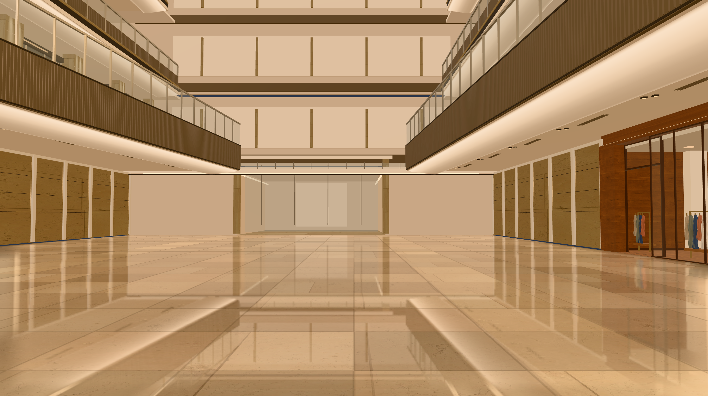
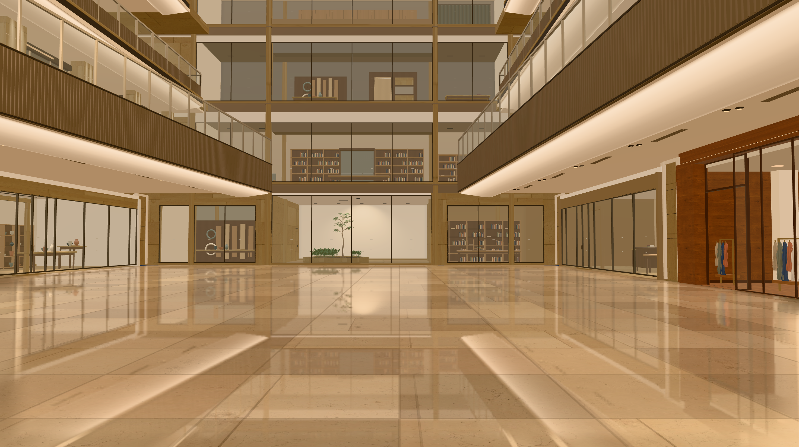
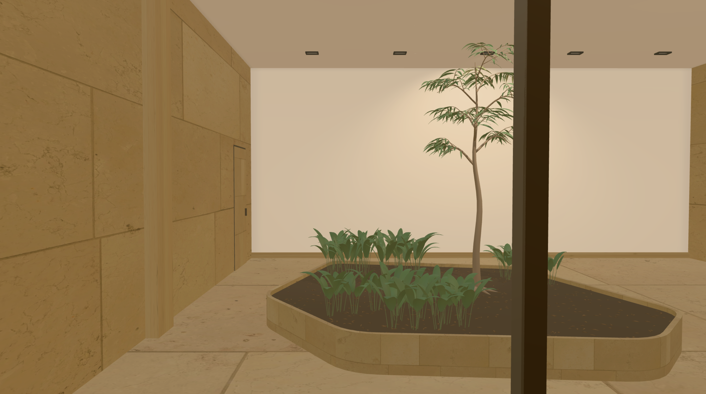

# ソファ正面の施設：比較と検証記録

2026-11-27の実装・検証スナップショット。設計の正本は[施設設計](sofa-facing-facility-design.md)と[平面・断面図](sofa-facing-facility-plan-section.svg)。写真に写っていない `+Z` 側は独自設計である。

変更前は `31a37ae66fdaf08f66dfc2e24ab9f9eb2ed78f68`、実装は `8ccb962a7d2f4378e39e004b21d3437a7a2f3555` へ回収した。実際に撮影したソース254入力のSHA-256、全21最終視点の位置・方向・投影・内部raster、変更前5視点、描画量、録音条件は[検証データ](evidence/sofa-facing-verification.json)に保存する。

## 同じ着座視点での変更前後

両画像は2944×1648、DPR1、縦FOV42°、眼高1.20 m、位置 `(-2.7,1.20,-29.7)`、初期pitchと固定時刻を共通にした。5比較視点すべてで実カメラのposition・direction差は0、内部rasterも一致した。画像は写真の転載ではなく、各版のアプリからの描画記録である。

**変更前** — 平たい終端、未用途の側面パネル、同じ明度の上階壁。

**変更後** — 庭・両翼資料室・左右の専門店・上階の書架と展示を、異なる距離と高さの用途として構成した。主床とソファの向きは維持した。

WebPは撮影PNGからの可逆変換で、7画像とも画素差0を確認した。原寸は各画像を開いて確認できる。元PNGとWebPのhashは検証データに記録している。

## 通常歩行・近接・昼夜

既定画質の巡回では、庭前の低姿勢1.15 mと立位、W/E店舗の斜視、上階端と振り返りを通常のキー・マウス操作で取得した。内部raster2355×1318を2944×1648の画面へ表示しており、高品質比較画像と区別する。ソファの座位1.20 mと低姿勢を混同しない。

| 確認点 | 結果・記録 |
| --- | --- |
| 庭の窓際 | 框の市松状の重なりをpane実クリア分割で除去。床・壁・天井・植床が閉じ、葉柄・根元と土の接続を確認。 |
| 店舗の斜視 | 枠、手前の卓、棚、奥壁の前後差、本の小口、器の口縁・内側・高台を確認。 |
| 上階端・振り返り | 支持床、床裏、ガード、側背面が連続し、未制作の外部を露出しない。 |
| 原画方向 | 階段・天窓・ソファ・既存店舗の主構成を同じ視点で照合。 |
| 夜・一括消灯 | 器具の発光、局所受光、強い暖色の床反射が連動して消え、形状は環境光で残る。 |

[W店の近接](evidence/sofa-facing-west-shop.webp) · [E店の近接](evidence/sofa-facing-east-shop.webp) · [夜・点灯](evidence/sofa-facing-night.webp) · [夜・一括消灯](evidence/sofa-facing-off.webp)

初回candidateの空室状の上階は設計へ戻し、RF1〜RF3の独立査読を閉じてから改訂した。包括コードレビューでは、連続天井の制作分割辺をAO接点と誤認したP2を1件検出し、同回で是正・閉鎖した。実面の補間uv1から取得したR値は内部3点が255、実外周217.64、灯具開口縁223.36。実外周の弱い陰影を残して偽の筋が消えたことを画像でも確認した。

## 自動検証と観測の範囲

| ゲート | 結果 |
| --- | --- |
| 必須 `npm run check` | 226 pass、0 fail、既存の映画館OfflineAudioContext検査1 skip。 |
| 天井AO是正後の関連再検証 | build成功、`npm run test:atrium` 25/25 pass。その他ワールドの入力閉包は不変のため、全checkは重複実行しない。 |
| アトリウム全ブラウザー | 6/6 pass。是正後は影の費用観測を追加した施設2件を再実行し2/2 pass。 |
| G2実GLライフサイクル | 初回512²→品質1024²→OFF中繰延→再点灯512²の3回だけ更新。各更新は床反射より先。通常移動・模擬XR左右眼で再生成しない。旧FBO破棄も確認。 |
| 探索全体のブラウザー | 13 pass、1 fail、1 skip。小横画面の既存UI失敗は下記で分離する。 |

既存UI失敗は667×375の音設定で、全体音量ボタンがdockの範囲外になり、`scripts/coast-browser.test.mjs:613` の `masterVisible` がfalseになるもの。作業前の `e81124d7913e45a289b951290a7a53227fd6ea96` でも同じ試験・行・assertionの失敗が保存されている。この版から今回までの共通UI・CSS・該当テスト30入力に差分がないことを確認した。本改修で海岸UIを変更したり、この失敗を成功扱いにしたりしていない。

### 形状と描画量

新設Commons全体は295,422 triangles。植物は112,078 triangles、61,001 vertices、形状buffer約3.23 MB、通常9 draws。接点AOはR8 atlas1枚2048²、全mip合計5,592,405 bytesをCPU/GPUそれぞれに使用する。

| 同条件の主画面 | 変更前draws / triangles | 変更後draws / triangles |
| --- | --- | --- |
| ソファ正面 | 277 / 96,539 | 675 / 390,617 |
| ソファ左 | 325 / 98,115 | 570 / 308,365 |
| ソファ右 | 290 / 106,785 | 478 / 208,365 |
| 原画方向 | 948 / 288,475 | 963 / 288,163 |
| 上階から終端 | 451 / 201,299 | 863 / 495,545 |

G2のdirty更新1回は83 draws・154,166 submitted triangles。512²/1024²/再点灯とも同数で、通常フレームの負担とは分ける。表の値はWebGLへ投入した描画量であり、固有三角形数やGPU時間・Quest/RTXのFPSではない。

### 音の記録

夜・既定mixで、座位3秒→立つ→庭前 `(-2.7,2.2)` で正面3秒→W店前 `(-10.8,-4)` で店向き3秒という経路のデジタル出力を記録した。27.36秒、48 kHz、2ch、RMS .00288579、peak .0205811、runtime error0。マイク・室内の録音ではなく、アプリ出力をMediaStreamDestinationへ分岐したもの。到来時間や帯域RTをこの混合音から分離計測していない。[伝搬と録音条件の正本](sofa-facing-acoustic-design.md)

## 再取得と残る限界

`ATRIUM_OUTPUT=/absolute/output/path npm run capture:atrium:facility` で5比較視点、`ATRIUM_CAPTURE_MODE=audit` で6巡回視点を取得する。`ATRIUM_TIME=day|night`、`ATRIUM_QUALITY=high|default`、`ATRIUM_LIGHTING=default|on|off` を指定できる。別ポートで起動した変更前ビルドを照合する場合は、現行utilityの `ATRIUM_ORIGIN` をそのローカルURLへ向ける。撮影条件の詳細は[検証手順](../verification.md#ブラウザでの回帰テスト)を参照する。

実HMD、機器・部屋・ヘッドホンの聴感、実照度/PPFD、生育、構造・法適合、利用者の情緒は未実証であり受入へ追加していない。植物用AOは未実装で、土面の局所陰影は弱い。G2の直達影と棚・床・天井の間接接触AO、制御画面の点消灯確認、専門所見、利用者の反応を区別する。完全な光輸送や実施設の性能を保証する資料ではない。
