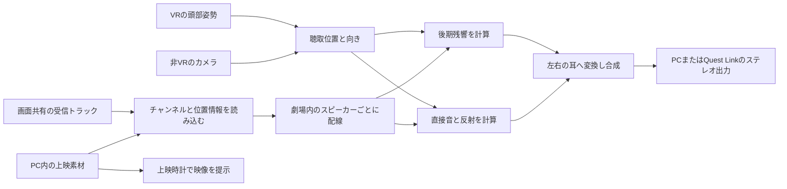

# 映画館ワールドの上映音響設計

[映画館の実画面](../gallery/cinema.md)。撮影条件はギャラリーを参照してください。

Windows PCで、音声素材のチャンネルと位置情報を保ったまま、映画館内のスピーカーごとの信号へ変換する。主観視点の位置と向きから耳に届く直接音・反射音・残響を計算し、左右2チャンネルの音声を作る。非VRでは画面のカメラを基準にPCの音声出力へ、PC VRでは頭部姿勢を基準にQuest Linkへ送る。PCは映像と音を同じ上映時刻で管理する。画面共有では、受信側で確認できた音声を同じ劇場の音響処理に渡す。

この設計の到達点は、台詞が幕に留まり、効果音が側壁から天井や後壁へ連続して移動し、座席を変えたときに距離・反射・包まれ方が変わること。[実装の受け入れ](#受け入れ条件)は自動試験とPCブラウザーで判定し、機材が使えるときは[参考測定](#品質調整の参考測定)で出力品質を評価する。既存の客席、幕、設備の位置は[基本設計](cinema-floor-plan.pdf)と[音響・照明設計](cinema-light-sound-design.pdf)を参照する。上映音の入力と配線は本設計で定める。

現行コードの共有再生は、ステレオで幕裏左右、6ch入力で幕裏3点・低域1点・側壁左右各1点を使う。天井と後壁の直接音は専用試映の音に使われている。本設計では、見えている筐体ごとの信号を上映用の音源から計算する。 [現行の共有再生](../../src/coast/world/cinema/cinemaPlayback.ts) · [現行の試映音](../../src/coast/world/cinema/cinemaAmbience.ts)

## スピーカーの配置

映画館の座標はメートル単位で、スクリーン面を `z = 0`、客席の後方を `+z`、スクリーンに向いて右を `+x`、鉛直上を `+y` とする。室内は幅40 m、奥行57 m、天井高22 m、幕は幅30 m・高さ16.875 m。音響校正の基準点はR11中央線の聴取点 `(0, 5.00, 35.85)` とする。幕から後壁までの距離の約2/3にあり、座席床に耳高1.15 mを足した点である。視聴を始める席は既存のR09とする。 [座席・スクリーンの座標](../../src/coast/world/cinema/cinemaLayout.ts) · [Dolby Atmos劇場仕様 §2.1・§4](https://professional.dolby.com/siteassets/cinema/dolby-audio-products/dolby-atmos-specifications.pdf)

| 配置 | 台数 | 音響中心と用途 |
| --- | ---: | --- |
| 幕裏 | 5 | `L / LC / C / RC / R`。`x = −13.31, −6.655, 0, 6.655, 13.31`、`y = 12.6125`、`z = −1.4`。中央の台詞と、幕の横方向を移動する音を担当する。 |
| 側壁 | 20 | 左右10台。既存グリルの面中心 `x = ±19.042`、`y = 7.985 + 4i/9`、`z = 6 + 43i/9`（`i = 0–9`）。 |
| 後壁 | 12 | 既存グリルの面中心 `x = −17.60 + 35.2i/11`（`i = 0–11`）、`y = 12.38`、`z = 52.999`。 |
| 天井 | 16 | 左右8台。既存グリルの面中心 `x = ±6.655`、`y = 20.381`、`z = 8 + 6i`（`i = 0–7`）。 |
| スクリーン低域 | 2 | 幕裏 `(±4.0, 1.0, −1.4)`。LFEと幕裏の低域補完を、別のバスで受けて合成する。 |
| サラウンド低域 | 2 | 後壁側 `(±13.0, 11.0, 53.0)`。側壁・後壁・天井から振り分けた低域を受ける。 |

幕裏の音響中心は幕の下端から高さの2/3に置く。ドルビーの劇場向け資料は幅12 mを超える場合に左右の中間スピーカーを追加する設計を推奨している。側壁・後壁・天井は現行の48台を使い、幕裏5台と低域4台を含めて、最大57個の出力点を持つ。配置の採否は本ワールドの客席での到達レベルと定位で判定する。 [既存筐体の配置](../../src/coast/world/cinema/cinemaAuditorium.ts) · [Dolby Atmos劇場仕様 §2・§4・§5](https://professional.dolby.com/siteassets/cinema/dolby-audio-products/dolby-atmos-specifications.pdf)

台ごとに安定したID、筐体とグリルの位置、音響中心、照準、担当帯域、校正ゲイン、固定遅延を一つの定義に持たせ、描画と再生が参照する。左右の照準は鏡写しとし、側壁と後壁は担当する客席帯の耳高へ向ける。幕裏の各台は自分の前方に相当する客席帯を向き、天井の各台は真下から中央通路側への内向き成分を持つ。照準とゲインは客席の試験で調整し、座席を移動したときは伝搬経路が変わる。 [Dolby Atmos劇場仕様 §4.11–4.15](https://professional.dolby.com/siteassets/cinema/dolby-audio-products/dolby-atmos-specifications.pdf)

## 上映信号の配線

| 確認した入力 | 送り先 |
| --- | --- |
| 1ch・2ch | モノは幕裏C、ステレオは幕裏L/R。壁や天井からの成分は劇場の反射と残響で生じる。 |
| 5.1 | L/C/Rは幕裏。左のサラウンドは左側壁と後壁の左半分、右は右側壁と後壁の右半分。LFEは幕裏の低域用出力へ。 |
| 7.1 | 側壁の左右と後壁の左右を4群に分け、独立した信号で駆動する。 |
| 7.1.4 | 7.1に頭上の前左・前右・後左・後右を追加。天井は基準点の前5台・後3台ずつを各群へ割り当てる。 |
| 位置付き音源 | 担当する幕裏・壁・天井のスピーカーへ、位置と移動に応じて配分する。たとえば幕を横切る音はL → LC → C → RC → Rを通る。 |

側壁や頭上の群に同じ信号を送るときも、台ごとに音が届く時刻・強さ・方向が異なる。幕裏5台を使う専用の素材ではLC/RCに信号を明示してよい。サラウンドやオブジェクト音源が静かな場面では各出力も静かになる。 [Dolby Surround 7.1の配線図](https://professional.dolby.com/siteassets/pdfs/dolby-surround-7-1-for-theater-tech-paper.pdf#page=2) · [Dolbyの劇場用オブジェクト音響の説明](https://professional.dolby.com/ja/cinema/dolby-atmos-cinema-sound/)

位置付き音源は、映像時刻に対応する音声サンプル番号、位置、ゲインを持つ。各キー間は線形補間し、幕面の位置は隣り合う幕裏2台へ等電力で配分する。幕の外は基準点からの方向を用いてスピーカー方向の三角形を選び、非負の配分係数の二乗和を1にする。高さの範囲を外れた方向は配列の外縁へ投影する。配分は客席の移動に追従させず、各台から耳までの方向・経路を更新する。基準点で方向が定まらないキーは前後の有効方向で繋ぎ、有効方向のない素材は読込時に通知する。 [Pulkkiの振幅パンニング原著](https://aes.org/publications/elibrary-page/?id=7853)

## 入力と上映同期

### PC上の上映素材

WindowsのChromeで利用者がローカルの映像と音声素材を選び、ファイルをPC内で読む。基準の映像はMP4内のH.264。デマルチプレクサーで映像の提示時刻とキーフレームを取り出し、WebCodecsで映像をデコードする。登録時に使用するデコーダー設定で能力を確認し、実際のフレーム出力と処理時間を計測する。映像は編集リストを反映した提示時刻で並べる。フレームの時間軸とデコード順は区別する。音声は48 kHz・24 bitのPCMをWAVEで受け、RIFFの32 bitのサイズ欄に収まらないデータはRF64またはBW64で扱う。12chの2時間は約12.44 GBとなるため、必要範囲を読み込んでリングバッファへ渡す。 [W3C WebCodecs](https://www.w3.org/TR/webcodecs/) · [WAVEFORMATEXTENSIBLE](https://learn.microsoft.com/en-us/windows-hardware/drivers/ddi/ksmedia/ns-ksmedia-waveformatextensible) · [EBU RF64](https://tech.ebu.ch/publications/tech3306) · [ITU-R BS.2088](https://www.itu.int/rec/R-REC-BS.2088)

上映情報は版を持つJSONとする。上映の0秒をサンプル0とし、共通の時間単位は48,000サンプル/秒。映像の最初の提示時刻と音声ファイルの先頭サンプルを、それぞれ符号付きの開始サンプルで記録する。前後へのずれと長さの差は素材の指定に従い、音声の有効範囲外は無音にする。WAVE/RF64/BW64からPCMの `fmt`・`data` を読み、拡張サイズは `ds64` で解決する。

上映情報に、素材ファイルの識別子、開始サンプル、ファイル内に入っている順のチャンネルIDを書き込む。位置付き音源はモノPCMの参照と、配列の座標で表した位置・ゲインのキーを、サンプル番号の昇順で持つ。内部では `L, R, C, LFE, Ls, Rs, Bsl, Bsr, Ltf, Rtf, Ltr, Rtr` を7.1.4の論理順に使う。読み込み時に実ファイルのサイズ・PCM形式・チャンネル順を照合し、WAVEのチャンネルマスクがある場合はマスクからIDへの対応を確認する。ラベルがない入力や矛盾した入力には、該当トラックと修正すべき項目を表示する。テスト素材ではチャンネルごとに別の時刻でインパルスを入れ、配線直前のバスとスピーカー出力を照合する。

以下は10秒のステレオ素材用の上映情報。JSON、映像、PCMの3ファイルを上映設定から一緒に選ぶ。素材名は選択したファイル名と合わせ、`channels` の順はPCMの格納順にする。

```json
{
  "version": 1,
  "durationSamples": 480000,
  "video": { "file": "film.mp4", "startSample": 0 },
  "bed": { "file": "film.wav", "startSample": 0, "channels": ["L", "R"], "lfeGainDb": 0 }
}
```

位置付き音源も使う場合は `objects` に、選択するモノPCMの `file`、`startSample`、軌跡を記録した `keys` を指定する。各キーには上映内の `sample`、メートル単位の `[x, y, z]` を入れた `position`、`gainDb` を書く。

上映位置は、音声処理が消費したPCMのサンプル番号を基準にする。動画のPTSをこの時間軸へ変換し、提示するフレームはその時点の上映位置から選ぶ。ブラウザー内の推定は `AudioContext.getOutputTimestamp()` と描画時刻を使い、音声と表示にかかる時間差は、非VRのPC出力とVRのQuest Link出力で光とクリックを同時記録して補正する。サウンドカードのサンプルレートが48 kHzと異なる場合は変換後も元のサンプル番号との対応を保つ。 [Web Audioの出力時刻](https://www.w3.org/TR/webaudio/#dom-audiocontext-getoutputtimestamp) · [WebCodecsのVideoFrame](https://www.w3.org/TR/webcodecs/#videoframe-interface)

館内の時間差は各経路に距離÷343 m/sで加える。映像の提示時刻は、音声の処理位置から「幕中央の校正後の直接到達時間」と「映像に対する音声出力の追加遅れ」の和を引いた時刻とする。PC内部で推定した差分は、使用する表示と音声出力で測定して補正する。出力時刻に含まれる遅れは一度だけ加える。上映開始時はあらかじめ音声を読み込み、最初の台詞が届く時刻に冒頭のフレームを提示する。側壁や天井と幕の間の到達差は各経路に残る。歩行時はオフセットを連続更新し、座席の瞬間移動時は短いフェード中に新しい席へ合わせる。再生操作で本人が選んだ位置に移動したときは、直前の動画キーフレームからデコードし直し、音声の開始サンプルと同じ提示時刻を持つフレームから再開する。

開始・シーク時は音声250 ms以上と提示に使う動画フレームを先読みする。音声は通常0.5秒を目安に先読みし、デコードした映像は必要な前後のフレームに絞る。読み込み不足や出力切替が起きた場合は、音を短く絞り、映像と上映時計を同じ位置で止め、先読みと出力が確保できた点から再始動する。シーク、入力差し替え、終了は世代番号で区別し、古い読み込み結果・動画フレーム・反射バッファは再利用前に解放する。

### 画面共有と試映

ブラウザーの画面共有は、許可された取得対象から返ったメディアトラックを現在のWebRTC接続で送る。通常の標準Opus経路で保証する音声は1chまたは2chで、受信側には確認できた形式を表示する。チャンネル数は診断に使い、上映用の配線は既知のレイアウトと順序が別に確かめられた入力に適用する。後方や頭上の音を作品の意図どおり独立に出す条件は、その信号または位置情報が入力に届いていること。共有では幕裏の直接音と室内の反射で場の広がりを作り、音声が取得できない場合も映像は続ける。元の音声とVR内の音を同時に出すかどうかは、現在の共有側の出力先設定に従う。 [仮想モニターの実装仕様](../monitor.md) · [W3C Screen Capture](https://www.w3.org/TR/screen-capture/) · [RFC 7587 §7](https://www.rfc-editor.org/rfc/rfc7587.html#section-7)

試映には、左→右の幕内移動、側壁→後壁、前→後の天井移動、LFE、無音後の残響を含む自作素材を作り、上映エンジンの同じ入力と配線で再生する。診断では同じ素材をステレオ、5.1、7.1.4で切り替え、聞こえる点と表示上の入力が一致するかを確かめる。

Windowsのアプリ音をライブの離散音声として取り込む拡張は、アプリが出しているPCMとチャンネルマスクを取得し、各チャンネルのテスト信号をPC側で識別できることを着手条件にする。WASAPIループバックが返すのは対象エンドポイントの再生ミックスなので、取得形式に応じた配線を行う。PC内上映はこの拡張に依存せず、ファイルから12ch PCMや位置付き音源を扱う。 [Microsoftのループバック録音](https://learn.microsoft.com/en-us/windows/win32/coreaudio/loopback-recording)

## 主観視点に追従する音と室内の響き



- **直接音**　音響中心から頭の中心までの距離、指向性と空気の吸収、幕の帯域別透過、段床や座席による遮蔽を適用する。距離で割るモデルは1 m未満を丸め、近くを通ったときの急激な増幅を抑える。幕とスピーカーの特性は個別に持つ。既存の幕透過フィルターは初期値に使い、スピーカーの軸上応答と角度別の減衰も帯域別に試聴・測定する。実機のポーラーデータを採用する場合は対象機材と利用条件を記録する。 [現行の距離・指向性・幕のモデル](../../src/coast/world/cinema/cinemaAcoustics.ts)
- **反射**　左右壁・後壁・天井に、床と幕周辺の輪郭を持った反射面を加え、一次と有力な二次の経路を鏡像法で求める。反射点が面から外れる経路や、途中で客席・段床・壁に遮られる経路を除く。帯域別の反射振幅は距離減衰と吸音・散乱で計算する。直接到達から250 ms以内の経路を候補化し、強い経路を優先して一度に48本まで計算する。経路の交代はフェードさせる。 [AllenとBerkleyの鏡像法](https://jontallen.ece.illinois.edu/uploads/537.F18/Papers/Public/Allen-PDFs/AllenBerkley79.pdf)
- **後期残響**　16本の遅延線を直交行列で結ぶフィードバック遅延ネットワークを使う。各遅延線に経過時間と帯域に応じた減衰を掛け、出力を周囲8方向に分散させる。各列の中央・左右の耳位置で、直接音に対する拡散成分のエネルギーを求め、その間の席は補間する。125・250・500 Hz・1・2・4 kHzの減衰時間は現行の `1.25 / 1.12 / 1.00 / 0.92 / 0.80 / 0.65 秒` を試作目標にする。個別に計算した反射と拡散残響で同じエネルギーを二重に数えない。残響は最初の反射が届いた後から徐々に加え、客席ブロックごとに初期音から残響へ移るエネルギー量を測る。 [現行の残響初期値](../../src/coast/world/cinema/cinemaAcoustics.ts) · [ISO 3382-1](https://www.iso.org/standard/40979.html)
- **耳への変換**　ワールド座標での聴取位置と向きを各フレームで受け取る。非VRでは一人称カメラ、VRではWebXRの両眼中央に相当する頭部姿勢を使い、どちらも同じ処理で直接音と各反射の入射方向を、頭の向きに対する相対角度に変換する。計測した頭部の伝達特性（HRTF）を各経路に当てる。左右の到達時刻差と方向別の耳の伝達特性を別々に補間する。伝達関数の共通の測定距離は前処理で取り除き、館内の伝搬時間は各経路で一度だけ加える。音の履歴を共有したまま、フィルター更新を10〜20 msで切り替える。高品質用の初期候補はUniversity of YorkのSADIE II KU100。採用したリリースのライセンス・出典・加工内容を素材のクレジットに記録する。耳への空間化は上映エンジンで一度行う。非VRの定位はPCのヘッドホンで評価し、VRではQuest Linkのステレオ音声を使う。 [W3C WebXRのviewer pose](https://www.w3.org/TR/webxr/#dom-xrframe-getviewerpose) · [SADIE II測定資料](https://pure.york.ac.uk/portal/en/datasets/sadie-ii-database/)

### レベル校正と低域

校正用レベルは、耳位置に置いた頭部補正前の仮想マイクで測る。幕裏5台は同一の試験信号を台ごとに再生し、R11で直接到達の時刻を揃える。幕裏CからR11まで約38.02 m、L/Rから約40.28 mなので、音速343 m/sでC側に約6.6 msの補正が必要になる。個別の調整値として保持し、他の席に移ると物理的な到達差が残る。上映時計の補正はこの固定遅延を含む。

複数台が同じ音声を出す配列は、音圧の振幅と位相を合わせて評価する。座席中央1点へ全台の到達を揃えると別の席の強め合い・打ち消しが変わるため、側壁・後壁・天井の固定ゲインを全席の帯域別応答に合わせて求める。左右対応台には同じ値を使い、ゲイン補正は±6 dB以内とする。最初は固定遅延を0 msにし、隣接台を使う音の移動と、同一信号で連続的に鳴らす場面の両方を試験する。局所的な重なりが大きい帯域は配列内のゲインと照準を調整する。

LFEの上限は120 Hzとする。各位置のスピーカーから低域を振り分ける処理は80 Hzの初期設定で、LFE信号とは独立に作る。両者が同じ低域用出力を使うときは合成前に校正し、クロスオーバー近辺で位相とレベルを確認する。上映素材にLFEレベルの基準を記録する。劇場用の未補正LFEを指定した素材は帯域内の再生基準を+10 dB、補正済みPCMは0 dBとして校正する。足し合わされる低域を含めて合成時の余裕を取り、最終出力で入力のダイナミクスを保ちながらトゥルーピークを−1 dBTP以下に収める。デジタル出力の校正値とヘッドホンの実音圧を区別し、試聴を同じ耳元音量に揃える。 [Dolby Atmos劇場仕様 §3・§5](https://professional.dolby.com/siteassets/cinema/dolby-audio-products/dolby-atmos-specifications.pdf) · [ITU-R BS.1770のトゥルーピーク測定](https://www.itu.int/rec/R-REC-BS.1770/)

## 実装構成と処理負荷

本編と内蔵試映は同じ48 kHzの上映処理に入り、57台の配線、座席から求めた初期反射、KEMARの実測応答を使って左右の音を出す。映像入力は非断片化のH.264 MP4を受け付ける。WebCodecsではハードウェアデコードを優先し、その設定が利用できない場合はブラウザーの既定を使う。 [上映処理](../../src/coast/world/cinema/cinemaScreening.ts) · [実測素材の出典と加工](../../public/cinema-audio/ATTRIBUTION.md)

実装版はJavaScriptのAudioWorkletで、KEMARの応答の先頭48タップを直接音、24タップを強い初期反射24経路に使う。残る初期反射にも、経路の距離と左右の強さを反映する。視点が回って方向が変わると、耳に使うフィルターの係数を短時間で補間する。後期残響は16本の遅延線を直交行列で結び、低域と高域の減衰を変える。幕裏5台の時間合わせにはR11までの計算距離を使う。機器ごとの同期補正、全帯域の客席校正、畳み込みの高速化は品質調整の設計に含む。 [音響処理](../../src/coast/world/cinema/cinemaRoomProcessor.ts)

上映入力を作る部分、スピーカーの配線、耳へ変換する処理を個別に試験できる構成にする。既存の [cinemaPlayback](../../src/coast/world/cinema/cinemaPlayback.ts) は現在の共有音声を受ける入口に使い、[monitorAudio](../../src/monitor/monitorAudio.ts) は接続・音量・出力の生存期間を担う。映画館の上映画面と照明は同じ上映状態を参照し、清掃・非常点検の間は時計を停止してから映像と音を復帰させる。共有の動画は現行のメディア要素が管理する。映画館を出ると、共有は現行仕様に沿って移動先へ引き継ぐ。PC内上映はその場で停止し、デコーダーと音声処理を解放する。同じページで映画館に戻ったときは停止した位置から再開できる。

PCの高品質処理は単一のAudioWorklet内で実行し、各伝搬経路のHRTF畳み込みをWebAssemblyでブロック分割する。最初の設計は48 kHz、128サンプルの分割、256サンプルのHRTF。固定姿勢で同じ入力履歴を使う成分は周波数領域で耳ごとに加算し、逆変換を耳ごとにまとめる。直接音と反射の個別遅延は分数サンプルを扱う。処理中のフィルター追加やバッファ割り当てを避けるため、フィルターと履歴バッファを事前確保する。音響経路の再計算・素材の読み込み・フィルターの準備は音声処理スレッドの外で行う。動画のデコードと音声の先読みはキューを分け、音声の準備が描画待ちで止まらないようにする。経路の更新目安は20 Hzで、聴取方向は非VRのカメラまたはVRの頭部の最新姿勢に追従させる。反射の経路更新が遅れたときも、直前の係数から耳への向きと直接音を更新する。 [Web Audio APIのAudioWorklet](https://www.w3.org/TR/webaudio/#AudioWorklet) · [Wefersの分割畳み込み研究](https://publications.rwth-aachen.de/record/466561/files/466561.pdf)

48 kHzで128サンプルなら音声処理1ブロックは2.67 ms。Windowsの評価機を使える場合の性能目標は、処理時間の99百分位がブロック周期の50%以内（この条件で1.33 ms）、30分の連続再生で音声欠落0回。実装は処理関数が受け取った実際のブロック長に従う。CPU負荷を落とす必要がある場合は、まず反射の上限を48本から24本へ下げ、続いて後期残響の計算を簡略化する。軽量化中も、音源の位置、幕への定位、主観視点への追従と上映時計を維持する。Quest単体ブラウザー用には現在の軽量再生も利用できる状態を維持する。

開始直後に素材をまとめて読み込まず、並列で処理するオブジェクトは当初32音源、出力点はフルレンジ53・低域4を上限にする。

## 受け入れ条件

上映音響の受け入れは、CI、PCブラウザーと模擬WebXRの試験で判定する。試験内容と実行方法は[検証ガイド](../verification.md)に記載する。

| 確認項目 | 合格条件 |
| --- | --- |
| 素材と配線 | 上映素材を開ける。不正な素材なら理由がわかる。モノラル、ステレオ、5.1、7.1、7.1.4、位置付き音源の配線を単体試験で確認する。 |
| 音場と視点追従 | 幕裏・側壁・後壁・天井・低域の出力がスピーカー定義と対応する。非VRのカメラと模擬WebXRの頭の姿勢が同じ音響処理に渡り、模擬の頭部回転に応じて左右の音響パラメータが変わる。 |
| 本編と試映の操作 | 試映と本編で映像フレームと音声出力を確認する。再生、一時停止、シーク、席移動、非常点検での停止と復帰、映画館への再入場をブラウザーで確認する。 |
| 回帰と試用手順 | `npm run check` と映画館・仮想モニターのブラウザー試験が通る。試用手順と検証結果を参照できる。 |

## 品質調整の参考測定

以下の測定と試聴は任意。Windows PCのChromeとQuest Linkを利用できるとき、座席ごとの音、実際の表示と音の同期、描画・音響の余裕を評価する。映像デコードと描画が並行する間の音声CPU負荷も記録する。PC VRの起動経路は[Windows PC VR対応PR](https://github.com/stillshore-chirp/lumen-pilgrimage/pull/218)を参照する。

| 確認項目 | 設計目標と測り方 |
| --- | --- |
| 配線と位置 | 1・2・6・8・12chの試験素材と位置付き音源を再生し、チャンネル名・台のID・メッシュの位置が対応する。独立チャンネルの試験インパルスが指定外の乾いた出力バスへ漏れない。反射経路と低域振り分けは別に計測する。 |
| 距離、反射、レベル | R01・R09・R11・R20と車いす席で、幾何の直接到達差を±1 msで再現する。幕裏5台の校正後のR11での到達差は最大0.5 ms。側壁、後壁、天井の各群は250 Hz〜4 kHzの試験信号で、着席位置の90%以上が群ごとのR11比±3 dBに収まる。 |
| 残響 | 代表5席で帯域別のエネルギー減衰曲線を記録し、250 Hz〜4 kHzで、−5 dBから−25 dBまでの傾きから換算したT20を試作目標の±15%に収める。短い台詞の後に付く尾を、同じ音量で現行音と比較する。 |
| 方向と動き | 同じ素材・品質・聴取姿勢を用い、機器へ渡す前の左右の音声が非VRとVRで一致することを確認する。音源を固定し、非VRでカメラを、VRで頭を左右90°・上下45°に向けても、音が幕・壁・天井の各位置に留まる。効果音が隣接するスピーカーへ移るときに定位の逆転やクリックが生じない。音量を合わせ、席と素材順を記録して、前・左右・後ろ・頭上の出題を各4回ランダムに試聴する。前後・天井の正答率をそれぞれ75%以上とし、左右の取り違えを0回とする。 |
| 映像同期と操作 | PC内上映では、非VRとPC VRのそれぞれで光とクリックの時間差がR01・R09・R20で絶対値25 ms以内、30分での変化が10 ms以内を目安とする。表示と音声出力が違うときは、それぞれの遅延を測る。 |
| 実機での負荷 | Windows（RTX 3080 Ti）の非VRとQuest Link接続時にそれぞれ、4K/24fpsの試験映像と7.1.4＋位置付き音源を30分再生し、そのうち1分は位置付き音源32本を同時に駆動する。高品質の設定で音声期限超過・欠落を0回とし、幕から左右の壁・天井・後壁へ視点を動かして操作の反応を確認する。PC VRでは選んだ72 Hzまたは90 Hzで、アプリ描画時間の99百分位をフレーム周期の90%以内にし、Questのシステムメニューの反応も確認する。 |

画面共有の同期は既存のステレオ経路と同じ測り方で比較する。OSからどの形式の音が返るか、Chromeが使う出力デバイス、PCとQuestで耳に届く音の遅れは実機で記録する。位置付き音源の試聴は入力を含めた再現性を重視し、自作の試験素材と各チャンネルの波形を用意して同じ席・音量で再測定できるようにする。

## 実装順

1. **館内の配線を作る**　スピーカー定義を描画と共有し、5.1・7.1・7.1.4をテスト波形で台ごとに確認する。
2. **PC内上映を成立させる**　素材読込、チャンネルの検証、同期、停止とシークを実装する。幕裏に定位する会話と、壁・天井・後方に動くオリジナルの短い試映で初回の実利用を確認する。目安3〜5人日。
3. **音場を作り込む**　スピーカーの照準と校正、位置付き音源のパンニング、方向別HRTF、初期反射、残響、低域の順に調整する。音源ごとに期待する波形と客席での聞こえ方を比較する。目安5〜8人日。
4. **PCブラウザーで動作を確認する**　シークと再開、模擬WebXRでの視点追従、画面共有の回帰を確認する。

初回の本編再生は手順2で確認し、実装の受け入れは手順4の確認結果までで判定する。品質調整は、利用できる測定結果をもとに進める。
