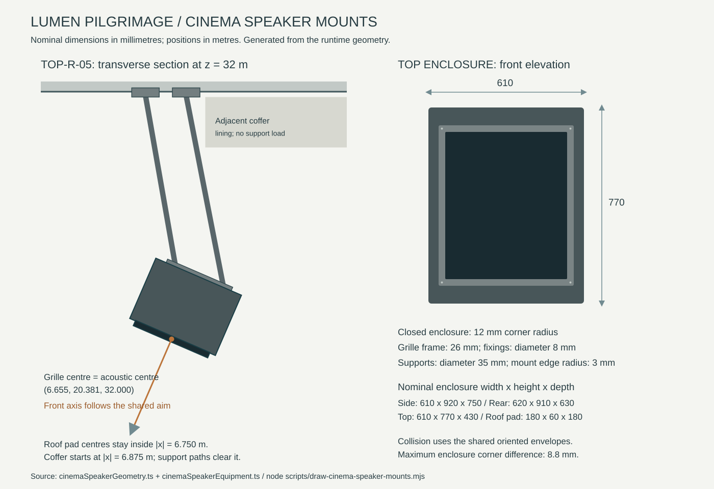

# 映画館のスピーカー筐体と取付

側壁20台、後壁12台、天井16台の可視機器について、放射面、筐体、取付板、支持材、移動時の接触を同じ座標で定義します。幕裏5台と低域4出力を含む信号配線は[上映音響設計](cinema-sound-design.md)を参照してください。室と客席の幾何は[基本設計PDFの現行図・7ページ](cinema-floor-plan.pdf#page=7)を使い、本ページと[取付図](cinema-speaker-mounts.svg)を機器形状の現行仕様とします。PDFの初版図はこの取付詳細を定めません。

## 共通の基準

メートル単位でYが上、幕はz=0、客席後方が+zです。[cinemaSpeakers.ts](../../src/coast/world/cinema/cinemaSpeakers.ts)のID、音響中心`position`、前方単位ベクトル`aim`を使います。[cinemaSpeakerGeometry.ts](../../src/coast/world/cinema/cinemaSpeakerGeometry.ts)はグリル中心を音響中心へ置き、局所+Zを`aim`へ向けて筐体と取付を剛体変換します。側壁・後壁は鉛直の辺を保ち、天井は筐体幅が室の幅方向に沿う姿勢を選びます。

照準と客席被覆を一緒に評価する考え方は[Dolby Atmos Specifications, Issue 5 (2025-10), §2.6・§4.11–4.15](https://professional.dolby.com/siteassets/cinema/dolby-audio-products/dolby-atmos-specifications.pdf)を参照しています。ここでは実製品の指向特性や荷重を認証せず、実装された放射方向と可視形状の一致を確認します。

## 寸法と仕上げ

| 対象 | 実装寸法・形 | 用途 |
| --- | --- | --- |
| 側壁の筐体 | 幅610 × 高さ920 × 奥行750 mm | 側壁の担当客席帯へ向く閉じた筐体。 |
| 後壁の筐体 | 幅620 × 高さ910 × 奥行630 mm | 後壁から前方の客席へ向く閉じた筐体。 |
| 天井の筐体 | 幅610 × 高さ770 × 奥行430 mm | 中央側へ傾いた下面から放射する筐体。 |
| 筐体の縁 | 実寸の丸み半径12 mm | 接近時の輪郭と広い反射を作ります。部品の非等方拡縮で丸みを引き延ばしません。 |
| グリル枠 | 幅26 mm、奥行30 mm、縁の丸み3 mm | 薄い前板と奥の裏当てを囲み、四隅の径8 mmの締結部を枠内へ収めます。 |
| 背面取付板 | 筐体幅の76% × 高さの72%、厚さ30 mm | 筐体と2本の支持材を接続します。 |
| 壁・屋根の取付座 | 面内180 × 180 mm、奥行60 mm | 下地の面へ接続します。縁の丸みは3 mm、締結部は径8 mmです。 |
| 支持材 | 外径35 mmの円形断面 | 背面板から取付座へ連続してつなぎます。 |

筐体、枠と取付材は不透明な暗色塗装として金属度0、粗さをそれぞれ0.78、0.68にします。露出した締結部は金属度1、粗さ0.48です。前板は塗装面として金属度0、粗さ0.74、黒い裏当ては0.97です。色と粗さはワールド用の制作値で、実材の反射率を測定した値ではありません。

前板の厚さは1.2mm、共通グリル基準面からの中心位置は局所+Zへ1.4mmで、表面は+2mmです。孔模様はpitch5mm・径3mm、8cell/40mm周期の512pxで表し、名目の開口率は約28.27%です。実寸のX/YからUVを焼き、同じ座標のcoverageとheightを別textureにします。高品質のbump振幅設定は0.15mm。RGBは塗装色へ線形に掛ける係数、heightは線形データで、textureのalphaは未premultiply、描画の最後に一度premultiplyします。

前板は面積coverageによる透過、裏当ては不透明です。裏当ては厚さ2mm、中心−14mm、後端−15mmで筐体前端へ接続し、前板後端との間に13.8mmの奥行を持たせます。孔の円筒側面は実メッシュにせず、縁の陰影と奥の黒い面で近似します。音響中心と照準は従来の共通基準面に残し、この光学上の開口率から音響透過損失を推定しません。微小支持材の散乱・回折も、実測された機器特性を再現するモデルには含めません。



取付図のグリル外形は共有接触箱を示します。薄い前板と裏当ての層寸法は上記の記述を使います。

## 支持と移動の境界

天井の背面板から2本の支持材を屋根y=22 mへ伸ばします。屋根側取付座の中心は`|x| ≤ 6.750 m`に置き、最内端`|x|=6.875 m`のコファーを避けます。コファーは仕上げであり、この機器の荷重支持先にしません。側壁と後壁は、それぞれ既存の壁面x=±20 m、z=53.9 mへ接続します。

通常の飛行入力による接触には、描画の基準となる同じ向き付き箱を使い、呼び出し側から受け取ったカメラのクリアランスで膨張させます。室全体の飛行上限を下げず、筐体と支持材の周囲で移動入力を止めます。詳細の丸みと円形断面はこの箱の内側に収めます。半径12 mmの三方向の丸みでは、元の箱の角から表面までの差は最大`12 × (√3 − 1) ≈ 8.8 mm`です。径35 mmの支持材の円形断面と外接正方形の角との差は約7.3 mmです。この分だけ接触が保守的になります。

グリルの接触箱は枠と締結部も含む奥行38 mmです。前板の表面を基準面から+2mmに保つため、箱の前端から前板までは17mmの差があり、この部分も保守的な接触になります。配置試験では中央への実メッシュのレイも使い、この差を確認します。

この判定には[共通飛行の更新 #286](https://github.com/stillshore-chirp/lumen-pilgrimage/issues/286)が必要です。共通Controlsから`blocksFlight(x, z, eyeY, clearance)`へ実際の頭部中心と半径を渡し、垂直を含む3D経路を分割して検査します。旧2引数の経路はYがないため機器の体積を検査できません。Draftではその統合と正規入力・頭部offsetによる実動確認を未完了として扱います。

XRの頭部offsetは通常移動の衝突判定に含め、重なりからの退避も確認します。静止中の追跡された頭部の1:1移動を遮断する設計ではありません。その移動で見える閉じた筐体、上面、裏面と取付の奥まで可視包絡へ含めて検証します。頭部の物理的な追跡を止めることと、locomotionを衝突で止めることを区別します。

## 編集・再生成・確認

形と接触の基準は[cinemaSpeakerGeometry.ts](../../src/coast/world/cinema/cinemaSpeakerGeometry.ts)、表面の実形状は[cinemaSpeakerEquipment.ts](../../src/coast/world/cinema/cinemaSpeakerEquipment.ts)、前板の周期・coverage/height生成と材は[cinemaSpeakerFinishes.ts](../../src/coast/world/cinema/cinemaSpeakerFinishes.ts)です。丸みは既存依存のThree.js `RoundedBoxGeometry`、支持材と締結部は`CylinderGeometry`で生成します。[Three.jsの形状API](https://threejs.org/docs/pages/RoundedBoxGeometry.html)が持つ寸法と半径をメートルで渡します。外部モデルや写真を追加せず、既存のMIT HRTF由来素材の扱いも変えません。

使用するThree.js 0.184.0のaddonを含むMIT通知は[ソフトウェアのクレジット](../../public/licenses/ATTRIBUTION.md)を正本とします。インストール済みpackageのLICENSE全文をバイト同一で保存し、Viteの配布物へ`licenses/`として同梱します。版・hash・再生成手順も同じクレジットから確認できます。

取付図は次のコマンドで同じ定義から再生成します。

```sh
node scripts/draw-cinema-speaker-mounts.mjs
```

[配置試験](../../scripts/cinema-navigation.test.mjs)は、全48台のグリル中心と法線、支持材両端から取付板への実メッシュ交差、コファーとの非交差を調べます。詳細版は全頂点が共有接触箱内に収まり、実メッシュへ当てたレイで角の差が上記の範囲内であることも確認します。実出力は同じ位置・向き・投影・照明・画質で比べ、上・横・背面と正規飛行の停止・後退を[検証手順](../verification.md#映画館の機器接続と接近)に沿って確認します。前板の透明描画は正面・斜め・複数台が重なる浅い視角、白/黒/赤入力と各照明で確認します。軽量でheight参照を外した後も、作成元がtextureを所有して解放します。数値の接触検査だけで照明、音、操作や完成品質を判定しません。
