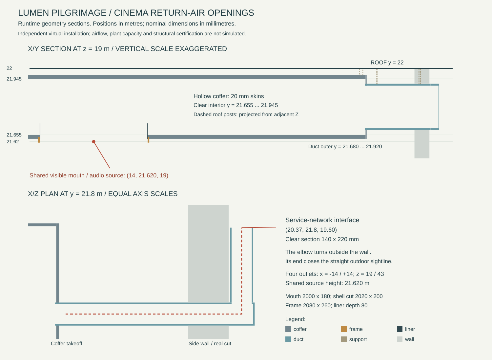

# 映画館の還気口と環境音

室内で見える還気口、その奥の空間、側壁を通るダクト、支持と環境音の出口を同じ座標へ結び付けます。平面と客席は[基本設計PDFの現行7ページ](cinema-floor-plan.pdf#page=7)、機器の取付は[スピーカー設計](cinema-speaker-mounts.md)、上映の57出力は[上映音響設計](cinema-sound-design.md)が正本です。既存PDFの初版換気案を、ここに記す現行開口の断面へ読み替えないでください。

## 配置と断面

[cinemaVentilation.ts](../../src/coast/world/cinema/cinemaVentilation.ts)が4か所の口と固体部品を生成します。Xは±14m、Zは19mと43mです。Yは対象コファーの下面21.635mから15mm下げた21.620mとし、見える口と環境音のPannerがこの点を共有します。これは上流の機械そのものの位置ではありません。ファンや消音器を通った音が最後に室内へ出る点を表す簡易モデルです。

| 部分 | 現行の寸法・接続 |
| --- | --- |
| コファー | 元の外形Y21.635–21.965mを保ち、20mmの殻にします。内側はY21.655–21.945mです。 |
| 下面の開口 | 殻を実際に2020×200mm切り抜き、2000×180mmの口を設けます。外枠2080×260mm、横桟4本は幅10mmです。元の不透明な下面を口の奥へ残しません。 |
| ライナー | 開口の四周に深さ80mmの縁を設け、コファー内の空間へつなぎます。 |
| 側方取出し | コファー外側の実側板を切り欠き、内寸140×220mm、外寸160×240mmのダクトへ接続します。 |
| 壁の貫通 | 室内側壁X±20.00–20.28mを実際に切り抜き、ダクトの殻で貫通部を囲みます。外側の中心X±20.37mで90°曲がり、Z方向へ600mm先を設備系統への接続端とします。直進方向はダクト端板で閉じます。 |
| 支持 | コファー四隅とダクトの短い支持材を屋根Y22mへ接続します。4か所で計32本です。 |



断面図の上段は高さを強調し、下段は同一尺度の平面です。外部の設備系統、風量、圧力損失、室内騒音の等級、実際の耐力を計算する図ではありません。実在施設の機器や法規適合を認証するものでもありません。

## 描画・移動・音の接続

コファーの切欠き後の殻と枠、ライナー、ダクト、支持材を、描画と飛行の体積判定で共有します。室全体の飛行上限は下げません。通常移動は実際の頭部中心と呼出側のクリアランスを用いて止め、逆方向へ退避できます。静止中の1:1頭部追跡は遮断せず、その頭が口の奥から見る内面も描画対象にします。カメラの半径を通せない小さな口でも、開口そのものを不透明な箱へ置き換えません。

[cinemaAmbience.ts](../../src/coast/world/cinema/cinemaAmbience.ts)は共通の4出口を環境音へ使います。既存のループ、開始オフセット、音量、距離則、環境音のオン・オフと解放を維持します。従来のY19.8–19.9mから出口へ音源を上げるため、同じ席でも距離と仰角が変わります。前後比較は同一の音量・ループ位相・頭部姿勢で、帯域レベル、左右差、停止・再開と再訪を確認します。57台の上映スピーカーのID・中心・照準は変えません。

上映の室内反射では、屋根面Y22mを主たる天井として使います。この小さな開口と支持部材の細かな散乱・回折、ダクト内の伝搬は別に解いていません。可視断面の成立と、環境音や上映音の実出力の合格を分けて確認します。

## 同位相の環境音比較

C13のnative Offlineで、旧出口と現出口を4聴取点・各6秒の8条件として比較した。4入力buffer、loop開始、各offset・音量を同一にし、環境音off/onの間もsourceの位相を維持した。現出口−旧出口の広帯域RMS差はR01 −0.415dB、R09 −0.415dB、R20 −0.591dB、口の近傍 +0.303dB。位置変更の差を隠す自動音量補正は加えていない。

各off窓のRMSは0、再開後の非零出力と終端を確認した。対数の下限値を600dBの物理減衰と解釈しない。Offlineの終端と実Appの退出再訪・UI・資源解放は分けて確認する。これは内蔵Pannerを含む有界出力比較で、風量、実室の騒音等級や聴感定位を認証するものではない。

## 編集と確認

寸法を編集したら、描画、移動体積、環境音源を別々の数値へ複製せず、共通モジュールを更新します。図面は次のコマンドで同じ固体定義から再生成します。

```sh
node scripts/draw-cinema-ventilation.mjs
```

[換気の試験](../../scripts/cinema-ventilation.test.mjs)は、元の閉鎖面が開口を塞がないこと、ライナーからコファー・壁貫通・曲がり部までの空隙、支持と共通位置、移動境界を調べます。[検証ガイド](../verification.md#映画館の機器接続と接近)に沿って4か所の下面・斜め・上部の実画面、正規入力の上昇・保持・退避、静止頭部追跡を区別して記録します。数値と有限の写真だけで設備全体の材・音・運用を合格にしません。
