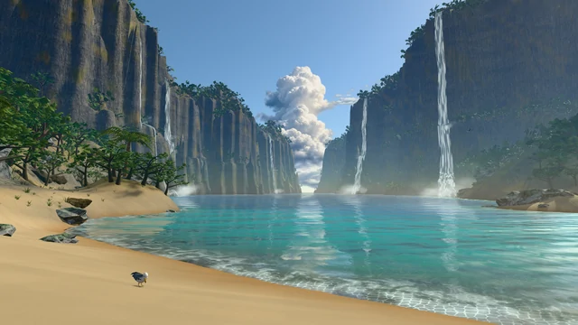
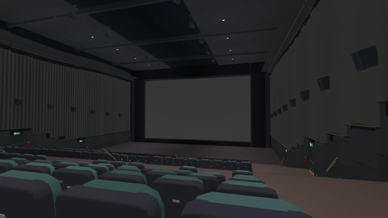
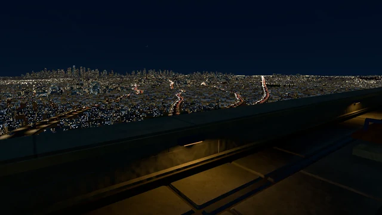
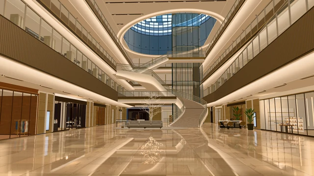
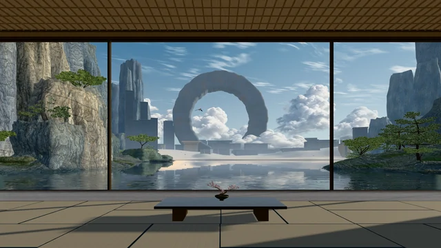
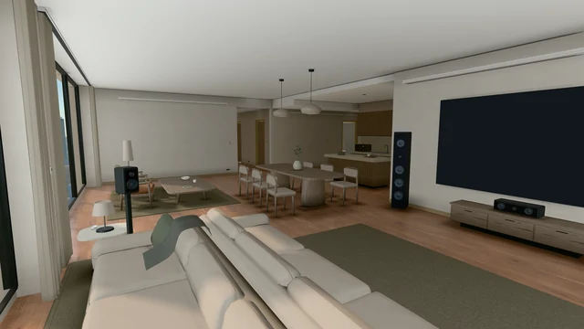

# ワールドギャラリー

景色の中を歩き、気に入った場所で過ごす。Lumen Pilgrimage の6つの空間を、実際のブラウザー描画で紹介します。

景観写真は操作パネルを閉じたデスクトップ画面です。すべて「高品質」で撮影しています。各ページに別視点、昼夜や設定例、操作画面を掲載しています。音や動き、VRでの見え方は静止画からは確認できません。

| 自然と眺望 | 建築と室内 |
| --- | --- |
|  **[入り江と山道](coast.md)** 浜から密林、山中の湖、朱の参道、稜線へ続く散策路。 |  **[映画館シアター](cinema.md)** 大型スクリーンの前に座り、館内を歩いて席を選ぶ。 |
|  **[丘陵展望台](overlook.md)** 高さと方角を変えて、街並みと夜の灯りを眺める。 |  **[商業アトリウム](atrium.md)** 曲階段と回廊を巡り、店先とガラス越しの光庭を眺める。 |
|  **[湖畔の広間](lake.md)** 畳の広間から湖と石の環を望み、昼夜の景色の中で過ごす。 |  **[都心の70階住戸](residence.md)** 窓外の街を眺め、リビング、茶室、書斎を行き来する。 |

[起動と操作](../../README.md#起動と操作) · [探索ガイド](../exploration.md) · [撮影条件・出典・再取得](capture.md)
