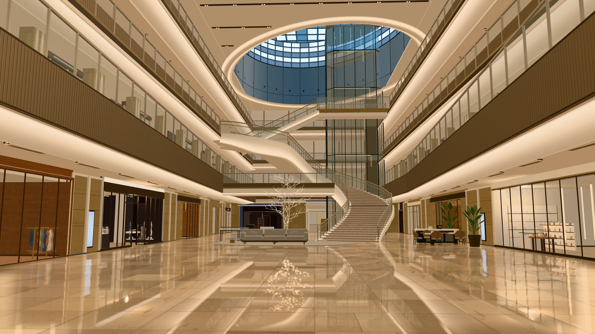
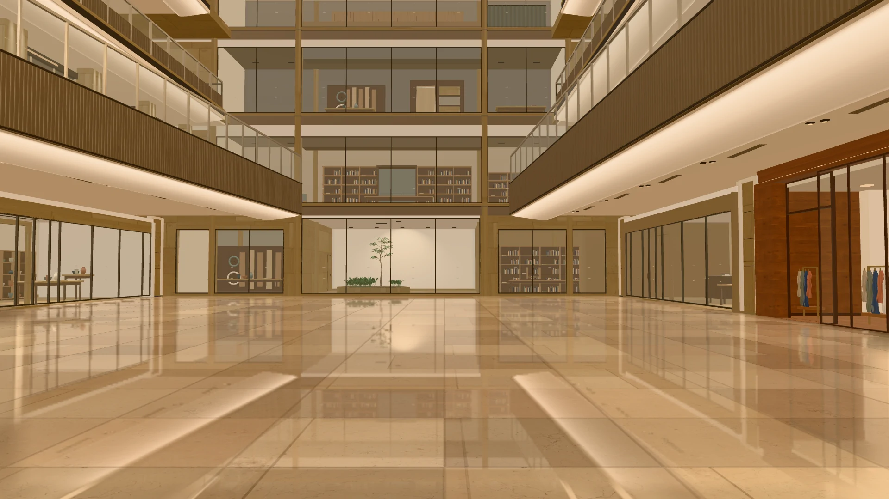
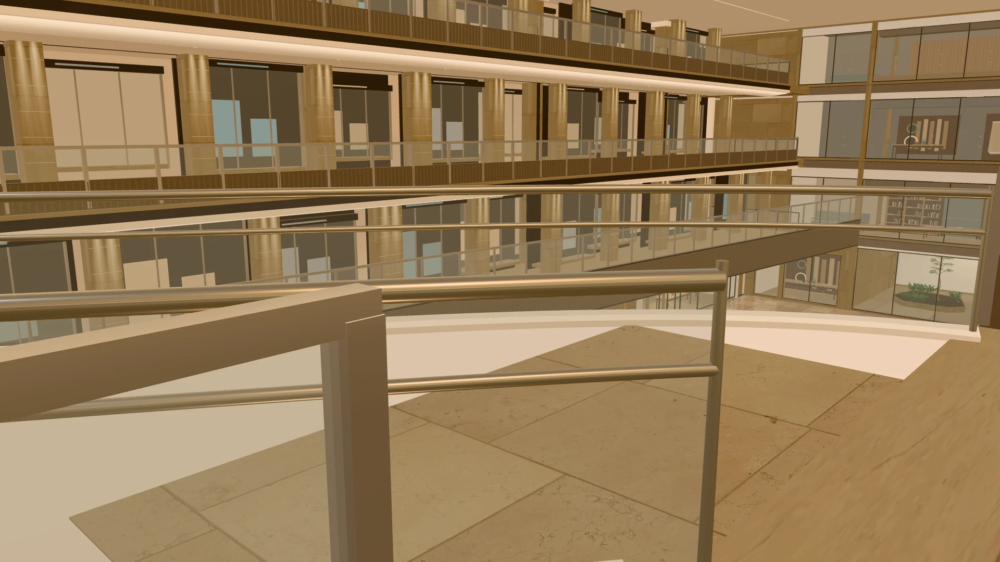
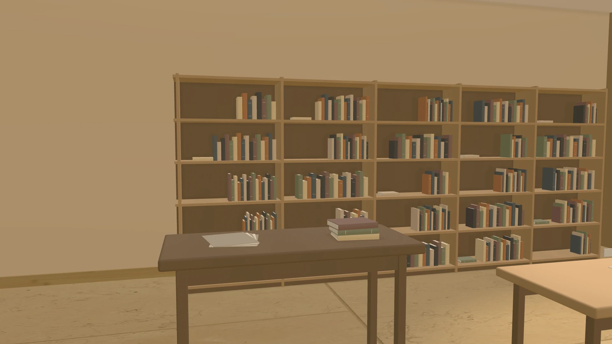
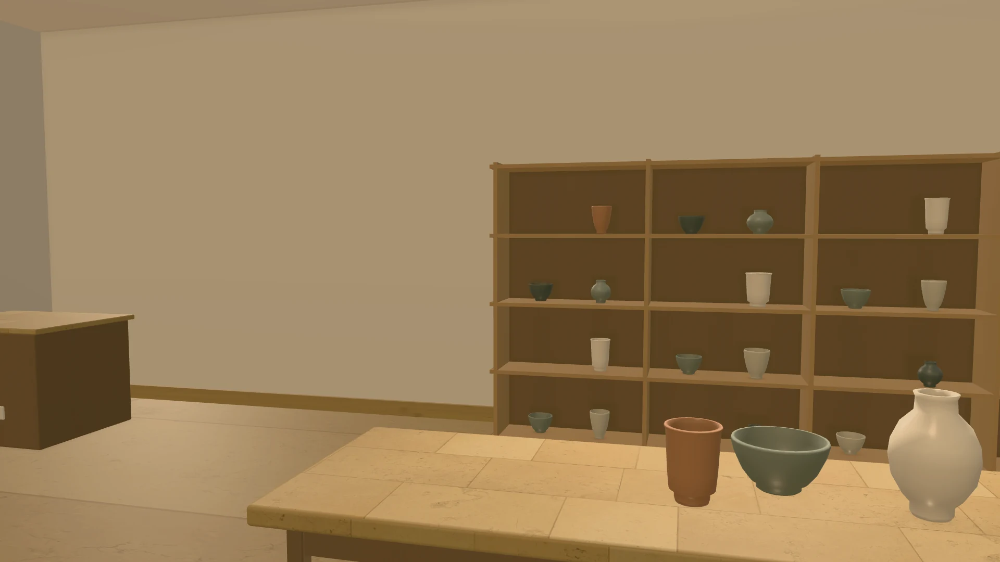
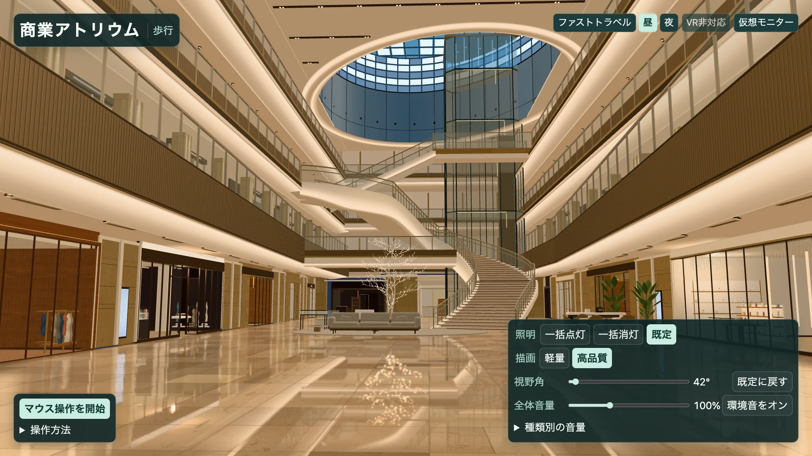

# 商業アトリウム

曲階段と回廊を巡り、店先と光庭を眺めます。歩けるのは共用通路と回廊です。店内や光庭はガラス越しに眺める区画です。

[ギャラリー一覧](README.md) · [操作と行き方](../exploration.md#商業アトリウム)

デスクトップブラウザーの実描画。「高品質」で撮影しています。画像をクリックすると原寸で開けます。

## 正面通路から吹抜けと大階段

「正面通路」から、左右の店先、曲階段、天窓を見渡します。床には店先や照明が反射します。

## ソファ座位から光庭と専門店

初期位置の「ラウンジのソファ」から。正面通路の写真とは逆の方向に、光庭と専門店、上階の部屋が見えます。

## 上階の回廊から吹抜けを見下ろす

「上階の回廊」から。手前の手すり越しに、吹抜けと向かい側の回廊を見渡します。

## 西側の店先を斜めから

正面通路から西側の店先へ歩いて撮影。固定ガラス越しに、書籍と装丁の店の机・本棚を眺めています。

## 東側の店先と夜の照明

東側の店先へ歩いて撮影した夜の状態。固定ガラス越しに、生活工芸の店の器と奥棚を眺めています。

## 操作画面

[操作の説明](../exploration.md#商業アトリウム)を参照してください。

[撮影条件・出典・再取得](capture.md)
