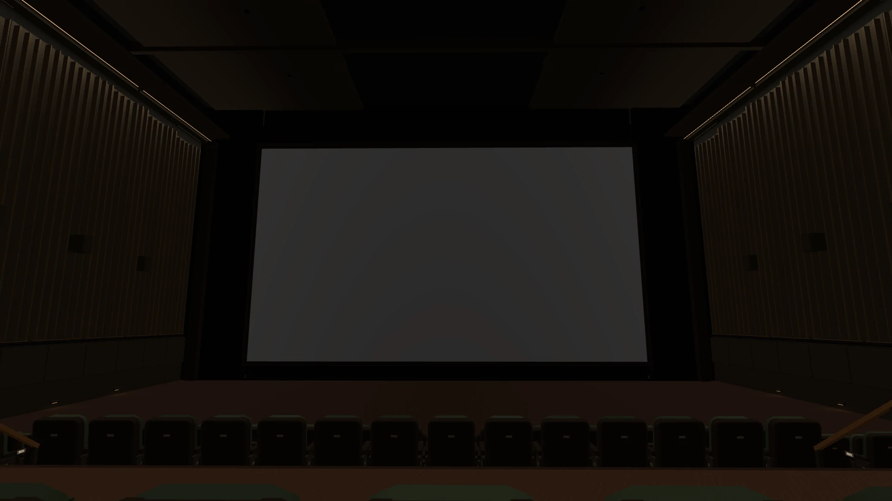
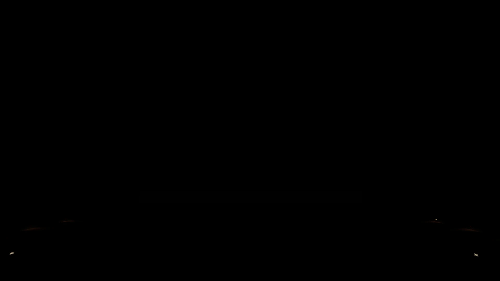
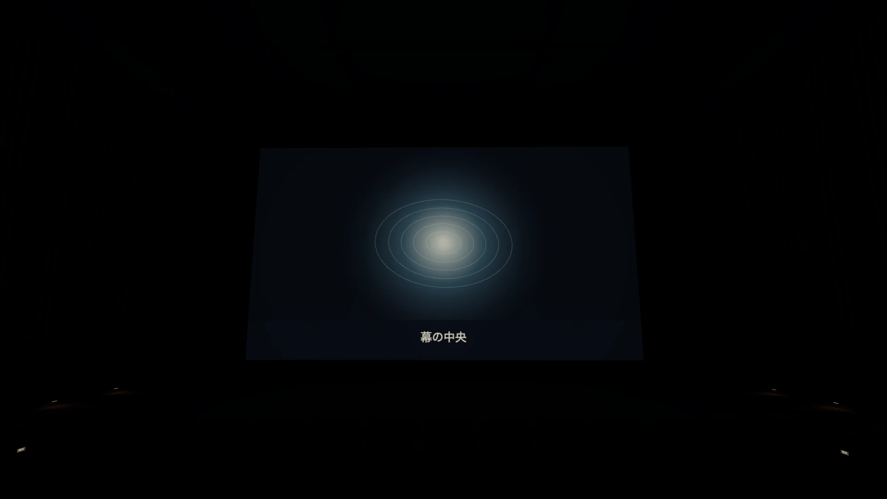
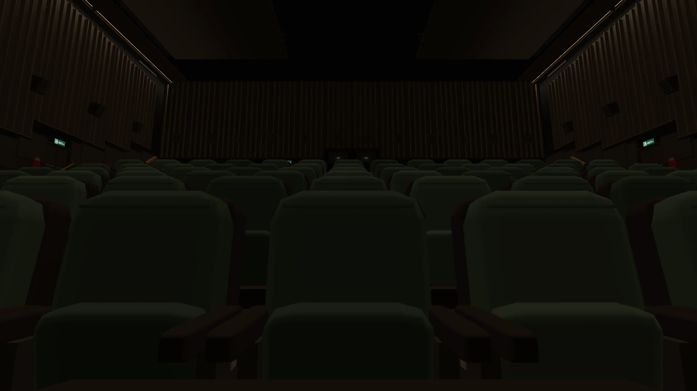
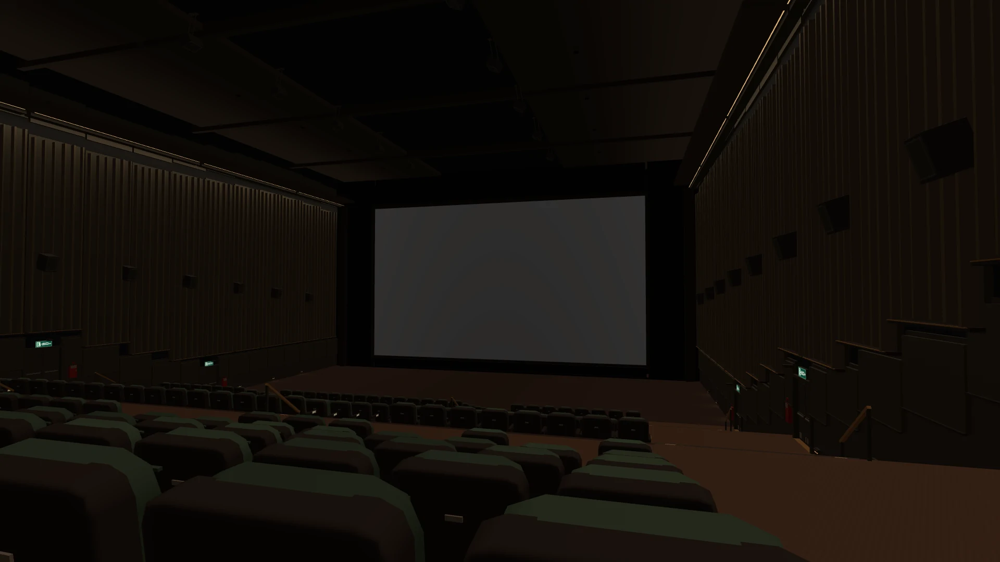
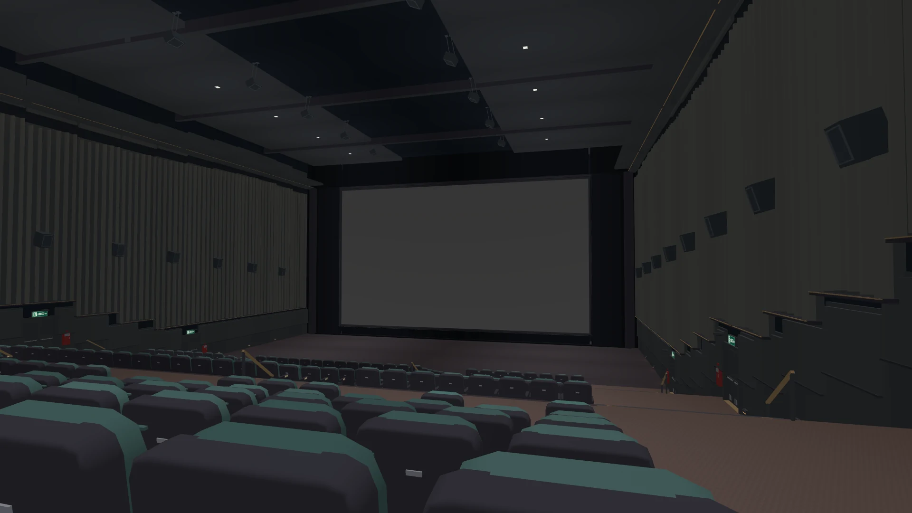
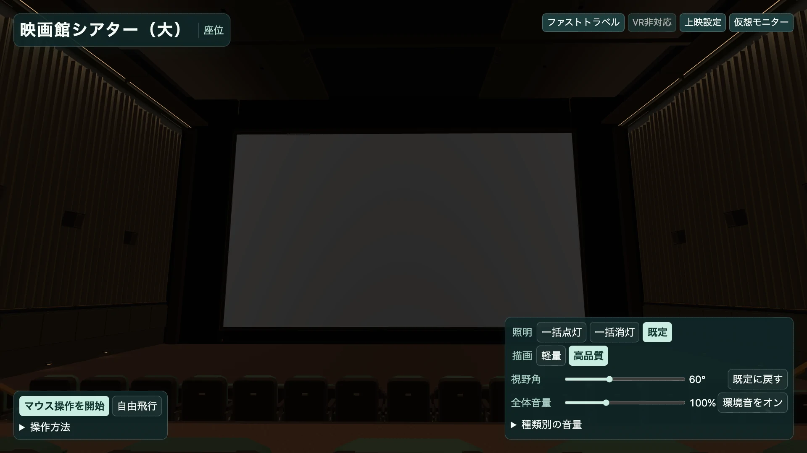

# 映画館シアター

中段中央、前方、後方の席から館内を見渡します。館内の明るさは上映設定で切り替えます。

[ギャラリー一覧](README.md) · [操作と行き方](../exploration.md#映画館シアター)

デスクトップブラウザーの実描画。「高品質」で撮影しています。画像をクリックすると原寸で開けます。

## 中段中央からスクリーンと客席

中段中央席から、入退場モードの館内を見渡した状態。スクリーンには映像を表示していません。

## 同じ中央席から上映時の場内灯

同じ中央席で上映モードへ切り替え、照明の遷移が終わった状態。映像はまだ再生していません。

## 内蔵試映を上映中のスクリーン

「試映を再生」で内蔵の試映を上映した状態。プロジェクト内で生成した映像を使用し、外部の映画は使用していません。

## 前方席から振り返る20列の段床

前方中央の席で振り返り、段床と座席列、後方の壁を見渡します。

## 後方側席から通路とスクリーン

後方側席から。段床を下る通路とスクリーンの位置関係が分かる構図です。

## 清掃照明で見渡す客席と通路

客席と通路を紹介するため、「清掃」モードで場内灯を点けています。通常の入退場・上映モードより明るい状態です。

## 操作画面

[操作の説明](../exploration.md#映画館シアター)を参照してください。

[撮影条件・出典・再取得](capture.md)
