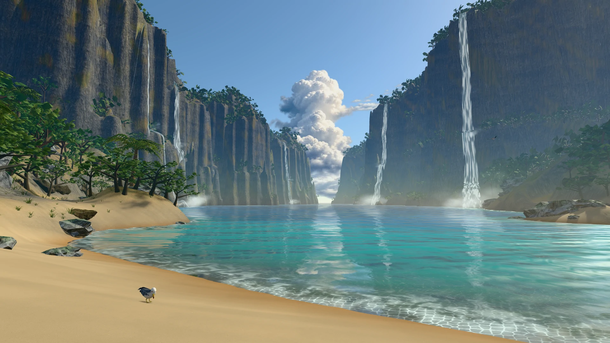
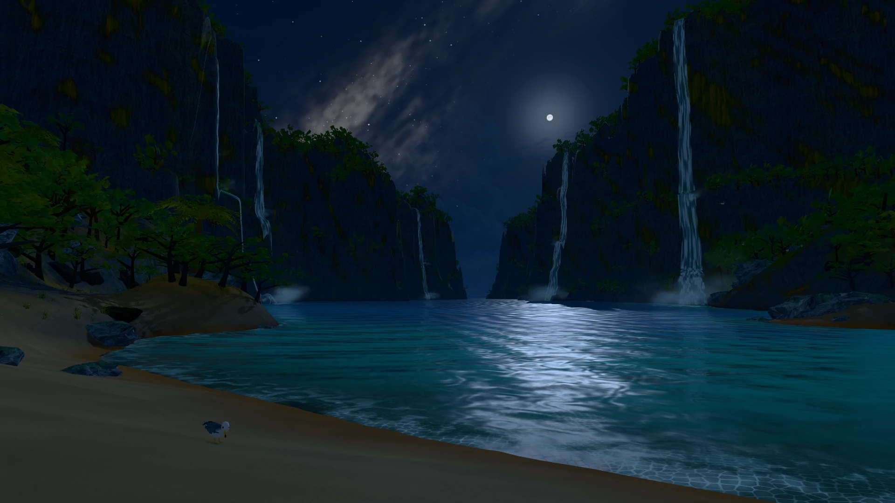
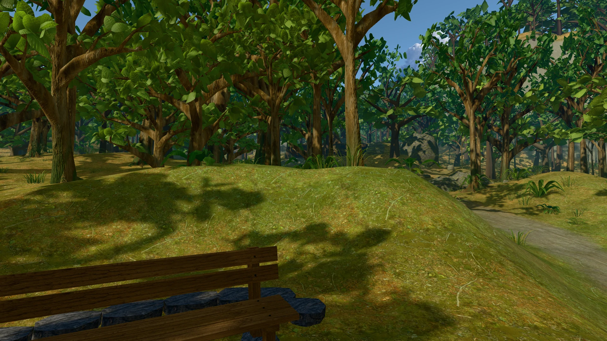
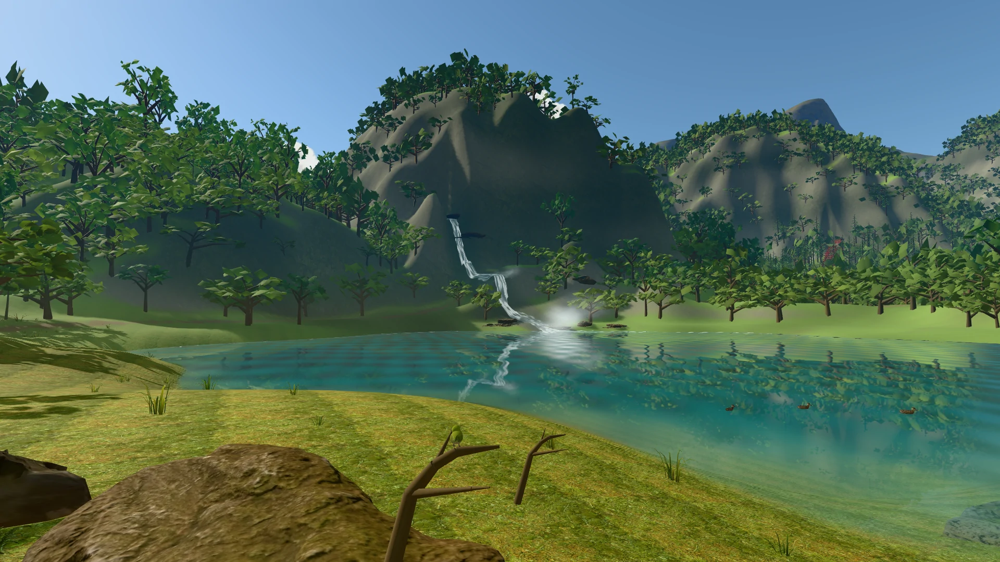
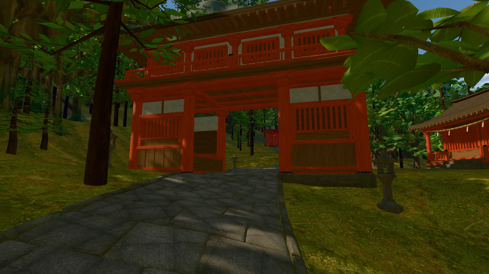
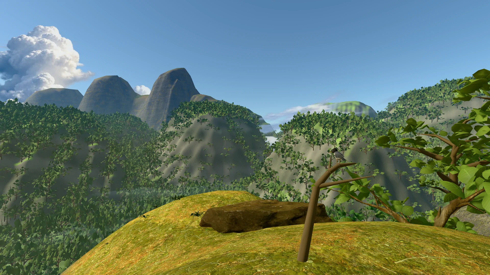
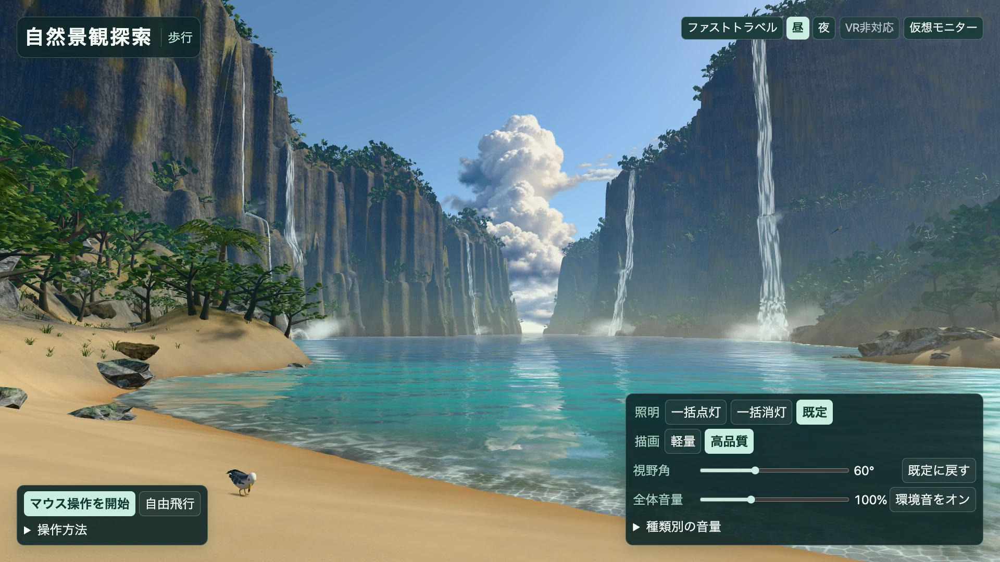

# 入り江と山道

浜から密林、山中の湖、朱の参道、稜線へ続く散策路。

[ギャラリー一覧](README.md) · [操作と行き方](../exploration.md#散策路とファストトラベル)

デスクトップブラウザーの実描画。「高品質」で撮影しています。画像をクリックすると原寸で開けます。

## 浜から入り江と対岸を見渡す

通常起動で到着する浜。波打ち際から、入り江の両岸と滝を見渡します。

## 同じ浜から夜の入り江

昼景と同じ浜、同じ向きで夜に切り替えた状態。月と水面の光を眺められます。

## 密林の休憩所と散策路

ファストトラベルの「密林の休憩所」から林側へ向きを変えた景色。浜から続く道を歩けます。

## 山中の湖畔と滝

ファストトラベルの「湖畔」。水際の植生、その向こうの滝と山を眺めます。独立ワールドの「湖畔の広間」とは別の場所です。

## 朱の参道を歩く位置から

「朱の参道」の到着点から楼門を望む構図。架空の参詣道は、ここから杉林の石段へ続きます。

## 稜線と山並み

「稜線」の到着点。手前の岩と、森に覆われた谷の向こうの山並みを見渡します。

## 操作画面

[操作の説明](../exploration.md#散策路とファストトラベル)を参照してください。

[撮影条件・出典・再取得](capture.md)
