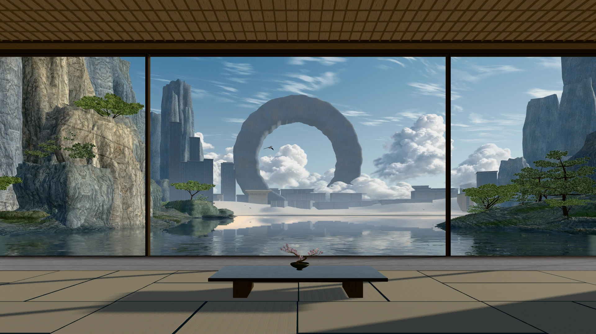
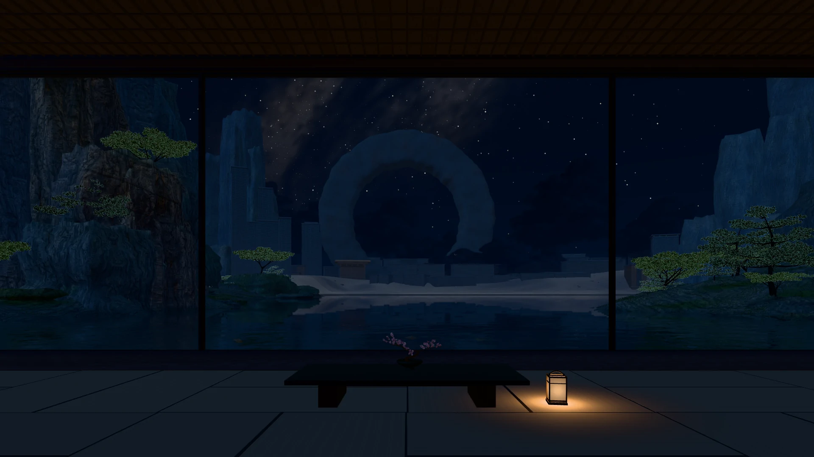
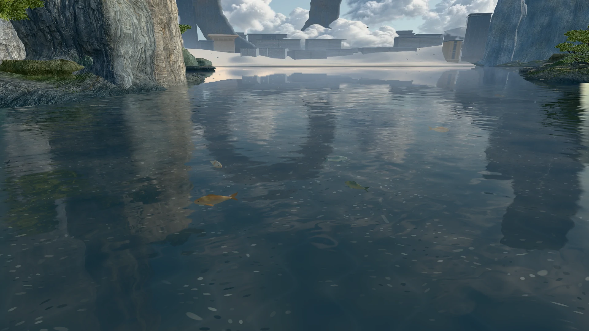
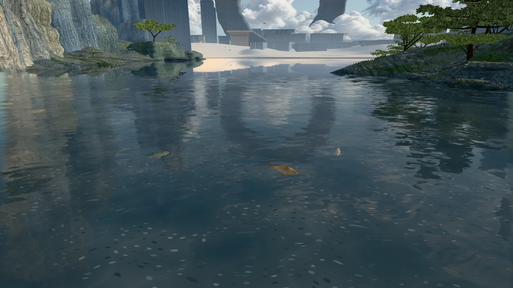
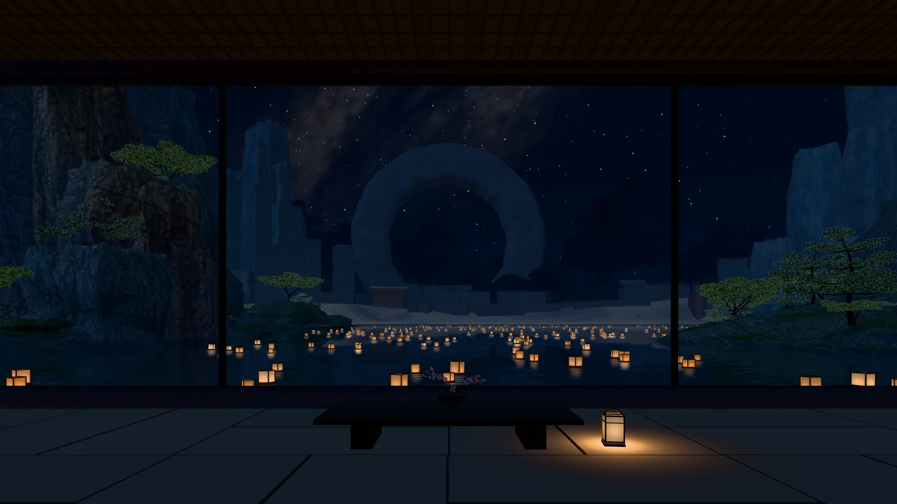
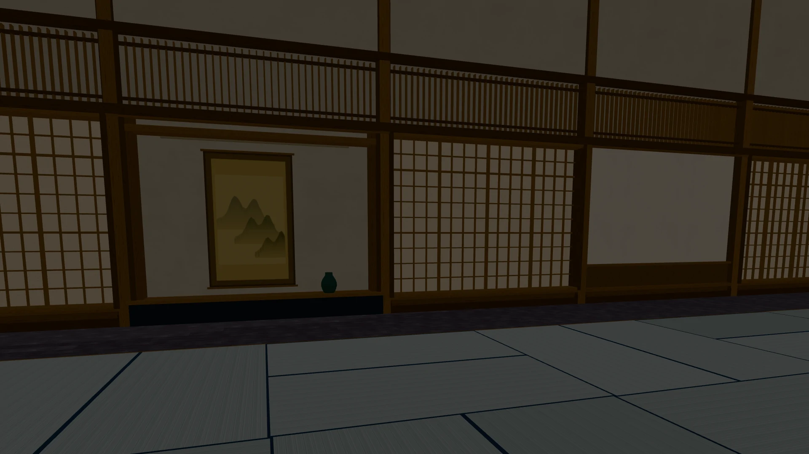
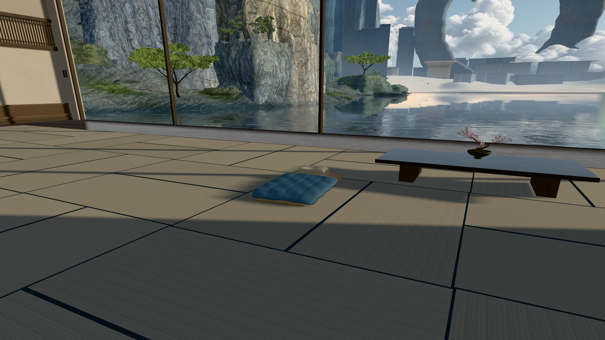
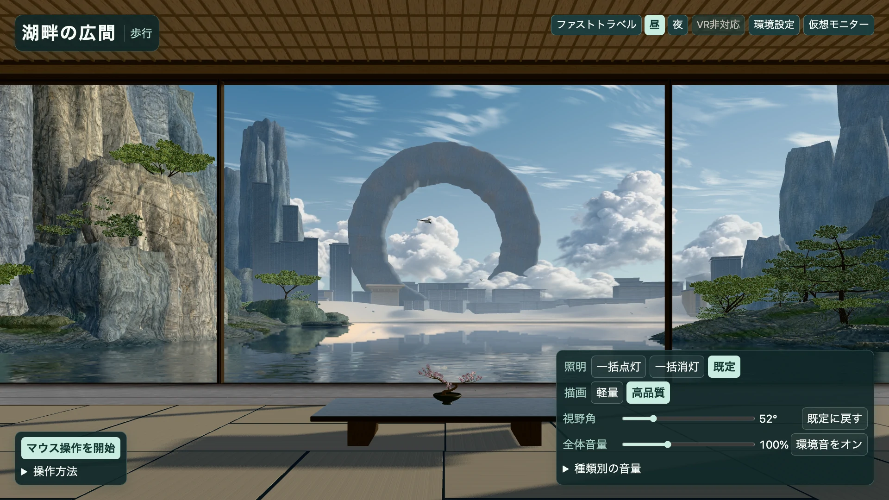

# 湖畔の広間

畳の広間から湖と石の環を眺めます。広間と窓辺を歩き、屋外は窓越しに眺めます。

[ギャラリー一覧](README.md) · [操作と行き方](../exploration.md#湖畔の広間)

デスクトップブラウザーの実描画。「高品質」で撮影しています。画像をクリックすると原寸で開けます。

## 低卓越しに湖と石の環

初期位置の「広間の中央」。低卓の向こうに湖と石の環、雲の重なりが見えます。

## 同じ広間から星空と行灯

昼景と同じ場所で夜に切り替えた状態。窓の向こうの星と、低卓の右脇の行灯が見えます。

## 西の窓辺から浅瀬と岩岸

「西の窓辺」から水面を見下ろします。浅瀬と岩岸を近くに眺められる位置です。

## 東の窓辺から水際

「東の窓辺」から。水面の下を泳ぐ魚が見えるタイミングの写真です。魚の位置は時間によって変わります。

## 湖に浮かぶ灯籠と室内の行灯

環境設定の「湖の灯籠」を表示した夜景。室内の行灯と、湖上の灯りを一緒に眺めます。

## 広間を振り返る畳と背面の設え

広間の中央で振り返った室内。畳、障子、柱と天井のつながりを眺めます。

## 湖を眺めて休む布団と畳

環境設定で「布団」を出した状態。使わないときは同じ設定から収納できます。睡眠アクションはありません。

## 操作画面

[操作の説明](../exploration.md#湖畔の広間)を参照してください。

[撮影条件・出典・再取得](capture.md)
