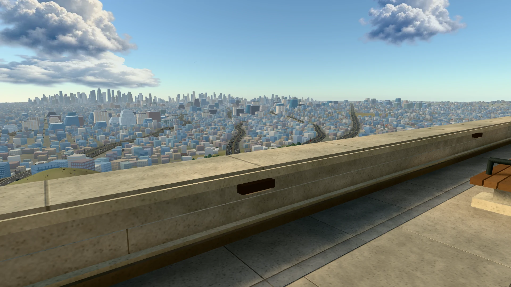
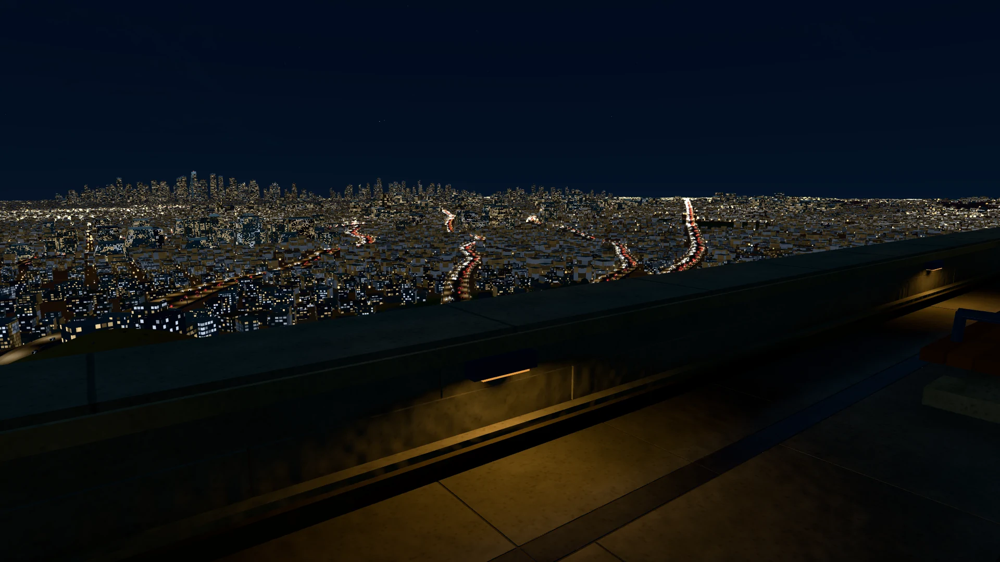
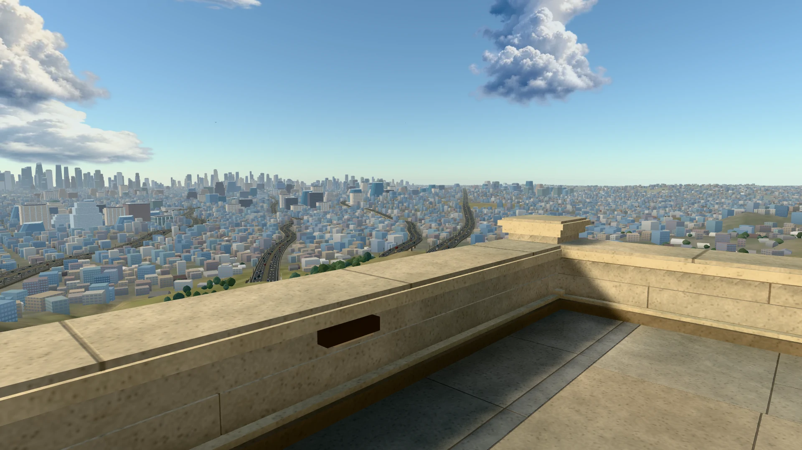
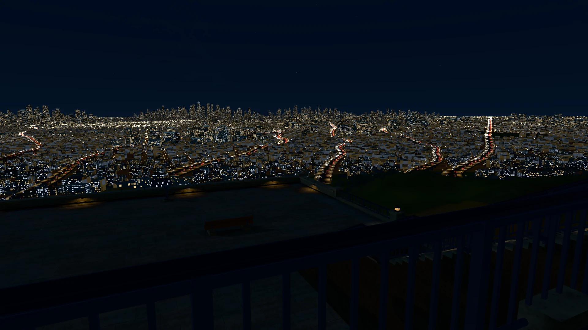
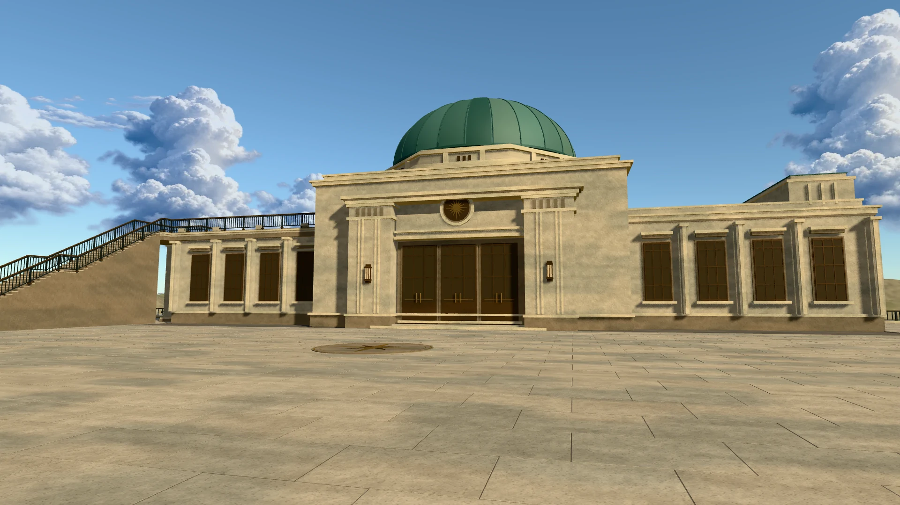
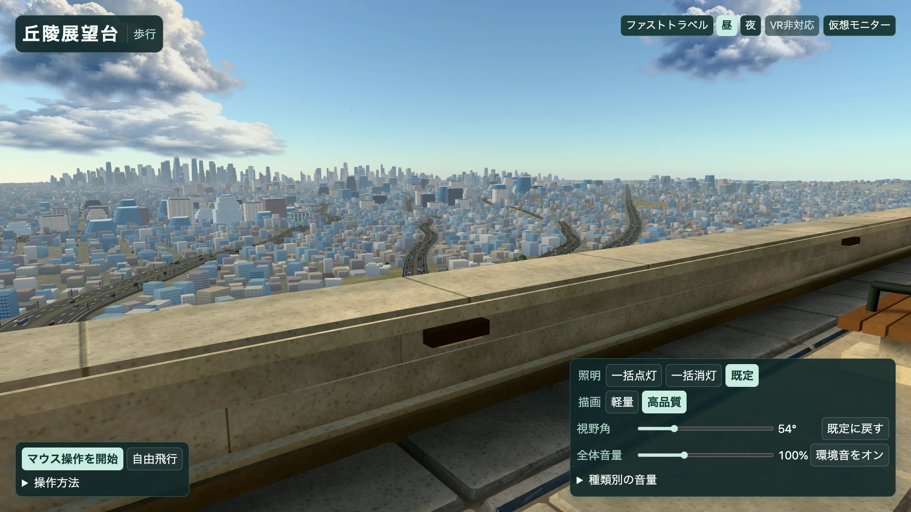

# 丘陵展望台

方角や高さを変えながら、デッキとその先の街を眺めます。

[ギャラリー一覧](README.md) · [操作と行き方](../exploration.md#散策路とファストトラベル)

デスクトップブラウザーの実描画。「高品質」で撮影しています。画像をクリックすると原寸で開けます。

## 中央デッキから盆地の街

「中央展望デッキ」の昼景。低い街区から遠方の高層群まで見渡せます。

## 同じ中央デッキから街明かり

昼景と同じ中央デッキからの夜景。街の窓明かりと幹線の灯りが見えます。

## 東テラスと街区の奥行き

「東テラス」から。デッキの角と街区を一緒に捉えた構図です。

## 2階デッキから夜のパノラマ

「2階展望デッキ」から。手前の手すりと、その先に広がる街明かりを眺めます。

## 中央デッキから振り返るパビリオンと施設

デッキで振り返った施設側の景色。街を眺める方向とは異なる、展望台の建築と足元の広がりです。

## 操作画面

[操作の説明](../exploration.md#散策路とファストトラベル)を参照してください。

[撮影条件・出典・再取得](capture.md)
