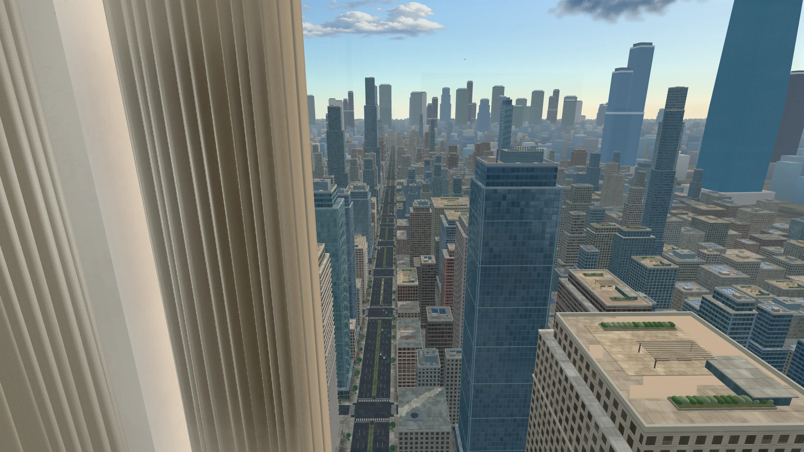
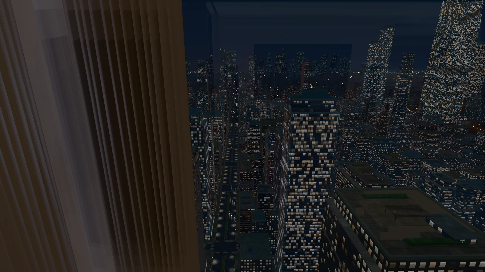
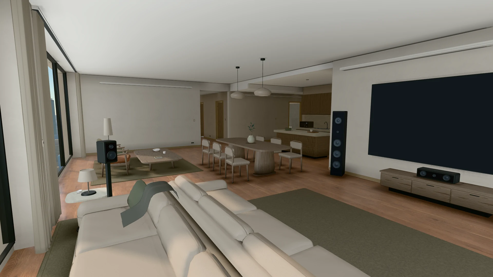
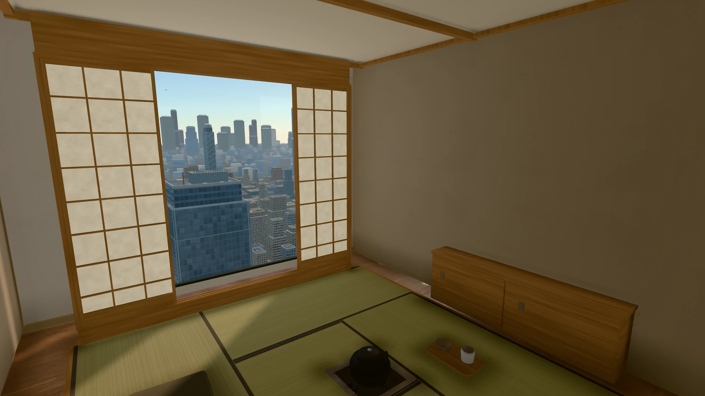
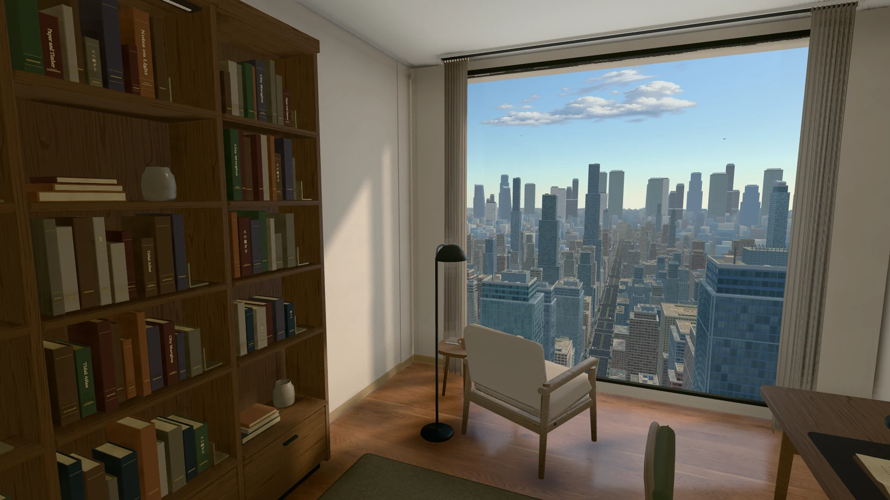
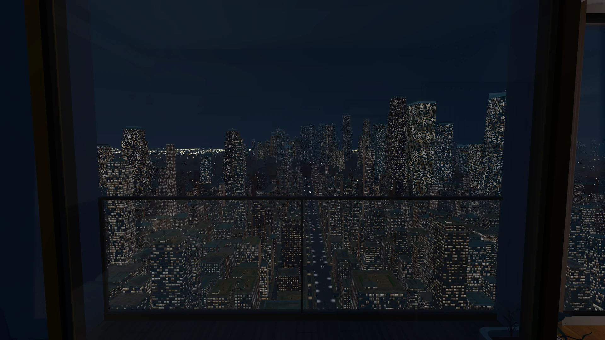
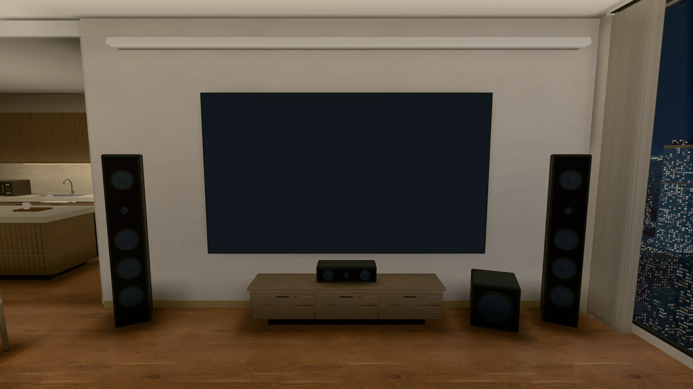
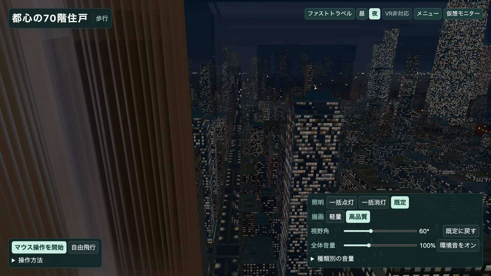

# 都心の70階住戸

南窓からの街並みと、リビング・茶室・書斎などの室内を紹介します。

[ギャラリー一覧](README.md) · [操作と行き方](../exploration.md#都心の70階住戸)

デスクトップブラウザーの実描画。「高品質」で撮影しています。画像をクリックすると原寸で開けます。

## 70階の南窓から街路を見下ろす

「リビング南窓」の昼景。カーテンの先に、近くの屋上と街路、遠くの高層街区が重なります。

## 同じ南窓から夜景

昼景と同じ南窓から、夜の街を見下ろした状態です。

## 窓から振り返るリビングの内装

南窓から室内へ向きを変えた構図。家具と床、その奥の住戸内のつながりを眺めます。

## 四畳半の茶室

「茶室04」。畳と障子、その向こうの街を眺めます。襖・障子・カーテンはそれぞれ操作できます。

## 窓辺の書斎と読書席

「書斎05」。本棚、読書席、窓外の街が一緒に見える位置です。

## 主寝室と東側の窓

「主寝室」から東側の窓へ向いた夜景です。室内全景ではなく、寝室からの眺望を紹介しています。

## リビングのホームシアター席

「リビングのホームシアター」席。テレビは未接続で、映像を表示していない状態です。

## 操作画面

[操作の説明](../exploration.md#都心の70階住戸)を参照してください。

[撮影条件・出典・再取得](capture.md)
