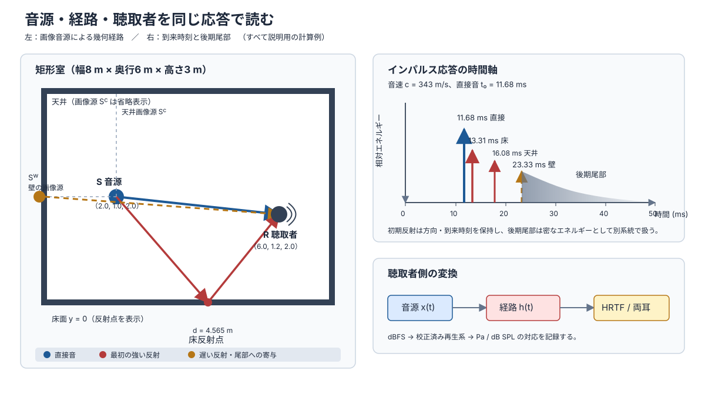

# 5. 音環境

音源が出す信号、伝わる経路、聴取位置を同じ座標と時刻で扱うと、建物の大きさ、開口、遮蔽が耳にも伝わる。本章では[建築の開口と床](architecture.md)を音の経路へ読み替え、[VRの評価](vr-evaluation.md)に必要な聴き分け方を示す。

図では、後述する画像音源の計算例を示す。図の左側は幾何学的な経路、右側はその経路を耳で受け取る時間構造を表す。

## 音源・経路・聴取者

設計の最小単位は、音源、経路、聴取者の三つである。音源には発音位置、指向性、持続時間、スペクトル、時間変化、出力レベルを持たせる。経路は距離、空気吸収、壁・床・天井での反射、開口からの回折、遮蔽物による減衰を含む。聴取者には頭部、肩、耳介、外耳道、鼓膜、耳小骨、蝸牛、聴神経までの変換がある。

NIH の [How Do We Hear?](https://www.nidcd.nih.gov/health/how-do-we-hear) が説明するように、外耳道へ入った圧力変動は鼓膜を振動させ、中耳の耳小骨を介して蝸牛の液体と基底膜を動かし、毛細胞の電気信号へ変換される。設計で十分に意識すべきなのは、耳介と頭部が到来方向ごとに周波数特性を変え、左右の耳へ異なる到達時刻とレベルを与えることだ。左右差は方位の手掛かりになり、耳介のスペクトル形状は仰角や前後の手掛かりになる。Wightman と Kistler は10人・144方向の自由音場から鼓膜までの伝達関数を測定し、ヘッドホン再生で自由音場の到来波形を合成した。[原論文の書誌と概要](https://pubmed.ncbi.nlm.nih.gov/2926000/)

音源信号 $x(t)$ は、伝搬経路のインパルス応答 $h_j(t)$ と、到来方向から耳 $e$ までの頭部インパルス応答（HRIR）$g_{e,j}(t)$ を経て届く。頭と音源が短時間ほぼ静止するなら、耳に届く信号は各経路の畳み込み $x*h_j*g_{e,j}$ の和で表せる。VRでは、直接音と初期反射の到来方向・遅延・レベルを姿勢と位置に合わせて更新する。多数の反射が密になる後期の残響は、空間ごとにエネルギーが減衰する尾として近似できる。

## 音圧レベルとデジタルレベル

空気の音圧 $p$ はパスカル（Pa）で表す物理量である。空気中の音圧レベルは、基準音圧 $p_0=20\,\mu\mathrm{Pa}$ に対する実効値の比を

$$
L_p=20\log_{10}\left(\frac{p_\mathrm{rms}}{p_0}\right)\ \mathrm{dB}
$$

と表す。定義と単位は [ISO 80000-8:2020](https://www.iso.org/standard/64978.html) に置かれている。したがって「60 dB」という記述は、基準と対象が音圧なのか、音響パワーなのか、A特性の時間平均なのかを書かない限り、設計値として不十分である。

デジタル音声のdBFSは、デジタルのフルスケールを参照する。サンプルピークでは表現可能なピーク振幅を基準にし、AES17のRMSレベルではフルスケールのピークを持つ正弦波のRMSを基準にする。耳元のdB SPLを得るには、ヘッドホンやスピーカーを含む再生系の校正が必要である。 [AES17 測定規格](https://aes.org/publications/standards-store/?id=21) · [AES TD1008の定義](https://aes.org/wp-content/uploads/2026/10/20210924_TD1008_v3.13.pdf)

複数音源の加算も、表示されたdBを足すだけでは扱えない。時刻領域では

$$
p(t)=p_1(t)+p_2(t),\qquad
L_p=20\log_{10}\left(\frac{p_\mathrm{rms}}{p_0}\right)
$$

であり、平均二乗圧力を合成する。信号が互いに無相関で、分析時間内に位相関係が平均化されるなら、レベル $L_i$ は

$$
L_\mathrm{sum}=10\log_{10}\left(\sum_i10^{L_i/10}\right)
$$

で加える。60 dBの無相関音源二つは63.0 dBになる。同一周波数で位相差が安定した同一信号なら交差項が残り、同位相の同レベル二つは66.0 dB、逆位相なら理想条件で消える。この「コヒーレンス条件」が、同じ音源の反射を単純なノイズ源として足せない理由である。短時間波形では干渉が生じ、長い時間平均の残響エネルギーでは統計的な加算へ近づく。式、信号の相関、評価時間を記録する。

### 空間への配分と作品の音量を分ける

スピーカーへ配る係数の二乗和が一定でも、耳元の音圧は一定とは限らない。同じ信号は経路ごとの遅延と伝達関数を経て位相を保って加わるため、帯域ごとに強め合いや打ち消し合いが生じる。係数の連続性に加え、最終両耳出力の帯域レベルと方向を調べる。無相関な音源のパワー和を、同一信号の複製へ無条件に適用しない。

端点の係数ベクトルを $a,b$ とし、$v(t)=(1-t)a+tb$ と直線補間すると、

$$
\|v(t)\|^2=(1-t)^2\|a\|^2+2t(1-t)a\cdot b+t^2\|b\|^2
$$

となる。両端が単位長でも中間は一般に単位長ではない。一定パワーを設計条件とするなら、補間後の形状を正規化してから作品の音量を掛ける。一方の端点が無音なら、正規化で無音付近を持ち上げず、発音や終端のフェードを別に設計する。これはベクトルの内積から求める幾何上の性質であり、知覚上の一定音量を保証しない。

dBの直線補間と振幅の直線補間も異なる。dBキーを補間する設計なら、その値を対象サンプルの時刻で評価してから振幅 $10^{L/20}$ へ変換する。極小振幅が保存形式でゼロへ丸められる前の値と時刻を保持し、空間形状の正規化へ作品の音量を混ぜない。比較ではキー端点だけでなく区間内の出力も測る。

## 撥弦音の音色と演奏をつなぐ

撥弦楽器では、音高、爪が弦を解放する短い立ち上がり、倍音ごとの減衰、胴へ伝わる振動を一つの発音として扱う。録音や合成の一音がよくても、強弱を毎音同じ大きさへ正規化したり、次の動作で使う手が前の音を押し続けていたりすると、演奏としての成立は別に確かめる必要がある。音源の物理、弾く動作、フレーズ、室内での聞こえ方を順に結び付ける。

### 調弦は弦番号と基準音を一緒に記す

箏の平調子は、十三本の相対的な音の並びを指定する。一の音を何Hzにするかとは別の情報である。[地唄箏曲美緒野会の調弦基礎「音列」「音の高さ」](https://shamisen.info/instrument/tuning_koto1/)は両者を区別して説明する。[箏曲演奏家・福田恭子の調弦説明「調弦をとる」](https://yasuko-fukuda.com/learning/how-to-tuning-koto/)では、Dを基準とする一・五の同音、二・三・四のG・A・B♭、七以降のオクターブ関係を確認できる。したがって一をD4とする計算例の開放弦は、弦順にD4、G3、A3、B♭3、D4、E♭4、G4、A4、B♭4、D5、E♭5、G5、A5となる。弦番号の順は常に音高の昇順になるわけではない。

ここでA4を440Hzと仮定すれば、G3は196.00Hz、同音の一・五は293.66Hz、巾のA5は880.00Hzになる。これは比較を再現するための平均律の計算例であり、すべての箏曲・調弦の絶対的な基準ではない。同じ音高の二本も独立した弦であり、同一の発音を複製する扱いとは区別する。

### 押す時刻と手を解放する時刻を設計する

[東京藝術大学「アジアの楽器図鑑」の地歌箏曲・左手奏法](https://www.geidai.ac.jp/labs/koizumi/asia/jp/japan/so/000482.html)は、強押しを全音上げ、弱押しを半音上げ、後押しを右手で弾いてから左手で押す奏法として示す。初めから高い音を弾くことと、余韻の途中で張力を増すことは、同じ到達音高でも異なる時間変化である。突き色のように押した後すぐ戻す奏法も区別し、単なる周期ビブラートで代用しない。

理想的な弦で有効長と線密度が変わらない近似なら、半音数を $s$ とする音高比は $2^{s/12}$、必要な張力比は $2^{s/6}$ となる。半音上げは約1.122倍、全音上げは約1.260倍の張力に相当する。実際の押し手では弦の長さ、弾性、柱との接触も関わるため、この比だけで必要な指の力や押し幅を決められない。押し始め、到達、保持、戻すか消音するかまでを演奏入力として記す。

一人の演奏として設計するときは、左手が次の押し手へ移るまでに前の保持を終えられるか確認する。箏の奏法を手指の使い方から分類した[遠藤綾子「音楽科授業で箏を指導するためのメソードの試案」pp.185–186](https://www.jstage.jst.go.jp/article/ssmep/13/0/13_KJ00009323126/_pdf/-char/ja)は、親指・中指・人差指の組合せと左手の押しを分け、音域によって押し手の学習難度も異なることを報告する。これは学校教育向けの予備調査であり、演奏家の最大速度や可動範囲を測った資料ではない。資料にない速度限界や可奏性を推測だけで合格にしない。

### 重なり、同時音、消音を区別する

[教育出版『音楽I』「箏を弾こう」p.89の奏法説明](https://www.kyoiku-shuppan.co.jp/textbook/kou/ongaku/files/R05ongaku-smp-ntmb-mh-04.pdf)は、親指と中指による同時の合わせ爪と、高い弦から低い弦へ親指を滑らかに動かす流し爪を区別する。例えば二弦を同じ時刻に鳴らす比較と、一音ずつ時刻をずらした重なりの比較は別に用意する。低い弦から高い弦への連続音を、向きの異なる流し爪だと自動的に呼ばない。

消音は、音の配列を切る編集と区別して、どの弦へいつ触れるかを入力にする。弦の振動を止めても胴や室内の残響は同時にゼロにはならない。繰り返し再生では、最終音に必要な余韻を残した後に手で止め、短い休止を置く方法もある。この場合、同じ録音の反復であること、消音時刻が作品の設計値であることを明示し、境界の波形差と末尾の実効値を測る。末尾と先頭の数値が滑らかでも、間合いや止め方が自然に聞こえるかは聴感の判定として残る。

### 比較で演奏の差を消さない

音域・弱中強・半音と全音の後押し・消音・再撥弦・同時音・短い旋律・全曲を同じ入力条件で比較する。音色方式を比べるときは、同じ弦、発音時刻、強さ、押し量、消音時刻、標本化周波数を渡す。一音ごとのピーク正規化は弱音と強音の関係を消すため使わず、必要な音量整合は方式ごとの共通ゲインで行う。音色の測定には乾いた音を使い、室内の反射を加えた最終出力も別に確認する。外部曲の音列や演奏を切り出さずに、独自曲と単音条件だけでこの比較を構成できる。

湖畔の広間の例では、[共通の調弦・演奏入力](../../src/coast/world/lake/kotoPerformance.ts)から複数方式を鳴らす。開始時刻と強弱は作曲時の書き分けを保ち、音符ごとに無関係な乱数の遅れを加えない。具体的な押しの時間曲線、句末の消音、終止とループ、計測・未評価の範囲は[箏音源の設計](../lake/koto-instrument-design.md)を参照する。

### 発散しない音源でも、減衰と時刻を確かめる

数値的な安定性と、元の振動を正しく再現する精度は別である。エネルギーが勝手に増えない積分法でも、音高、倍音ごとの減衰、位相、出力の時刻は変わり得る。弦と胴の減衰が大きく異なる系では、無減衰モードを求めた後に減衰を付ける近似にも注意が要る。[Woodhouseの原著 §2.2・3.1–3.4](https://euphonics.org/wp-content/uploads/2022/03/Guitar_I.pdf)は、この非比例減衰が撥弦音の合成へ与える影響を論じている。安定性、周波数、減衰をそれぞれ検証する。

湖畔の箏モデルでは、陰的中点法の周波数のずれをprewarpで補正しても、損失係数をそのままにすると高域の減衰が遅くなることを確認した。そこで一刻みの振幅低下と位相進行を表す**複素極**から剛性と損失をともに補正した。また、中点の速度を刻みの始点の音として出力せず、sampleと同じ時刻の速度状態を使った。係数の導出、正の損失を保つ条件、孤立モードと連成系の違いは[物理モデルの研究正本](../lake/koto-physical-research.md#数値安定性と予測可能な検証)に記す。孤立した極の一致だけで、結合した系全体の精度を保証しない。

### 同じ時刻の出力を比べて収束を測る

刻みを細かくした参照出力と、同じ入力・評価窓で比較する。音量合わせや時間合わせを行う前の波形差を保存し、基本音高、帯域別の振幅と減衰、位相も読む。時間をずらすと差が減るか調べる操作は、時刻の不一致を特定する診断である。整合後の小さい差を元の受け入れ値へ置き換えない。フィルタや標本化周波数変換も比較経路に含まれるため、残差全体をalias量とは呼ばない。

今回の計算例では、880 Hzの同じ単音を0.12–0.80秒の窓で比較し、修正後の未整合の相対波形差は48/96 kHz間で−26.50 dB（約4.7%）、96/192 kHz間で−38.88 dB（約1.1%）だった。参照波形のRMSに対する差のRMSであり、音質の点数ではない。出力フィルタの標本化周波数による位相差も残る。入力、source hash、測定経路と結果は[測定と比較試聴](../lake/koto-measurements.md)で追跡する。実録音との一致や人間にとっての自然さは、この収束実験だけでは判定できない。

事前に波形を生成して配布する方式では、生成精度と再生時の負荷も分ける。例えば96 kHzで計算して48 kHzのPCMへ保存すると、増える計算時間は主に制作工程にある。配布後のデコード、保持メモリ、再生、空間音響処理は実際のファイルと再生経路で測り、内部生成レートをそのまま実行時の負荷だと扱わない。

### 混合した録音が、音色へ何を残したかを測る

実録音を加えたという制作方法だけでは、その楽器として聴こえる根拠にならない。帯域を分けて混合する場合は、録音側が担当する帯域と時間を先に確認する。同じ窓とゲイン条件で元信号を $x[n]$、帯域通過後を $y[n]$ とすれば、$\sum_n y[n]^2/\sum_n x[n]^2$ は残したエネルギーの割合を表す。これは知覚上の寄与率ではない。小さなアタック成分が重要な場合もあり、全体のRMSだけから可聴性や楽器の同定を決められない。

弦の固有周波数が合っていても、琴柱・胴への伝達と放射が未校正なら、基音に対する部分音の強さや残り方が実物から離れ得る。[Coaldrakeの箏の構造研究](https://pub.dega-akustik.de/ISMA2019/data/articles/000063.pdf)が扱う固有形状・異方性・弦胴の結合と、可聴出力の伝達係数を分けて読む。少数の録音から部分音比や減衰を測れても、胴の質量・損失・放射をそれぞれ一意に同定したことにはならない。

実務では同音高の乾音を音量条件付きで比べ、アタック、持続部、終端を分離する。部分音比、帯域エネルギー、時間窓別のスペクトルと減衰を測り、録音だけ・合成だけ・混合の実音を人間が聴く。混合を終えて合成へ戻す時刻より後の問題を、録音のアタックを延ばすだけで解決したと扱わない。湖畔の初回候補では数理・信号検査が通っても所有者がギターとして知覚したため、[音源設計](../lake/koto-instrument-design.md#所有者による初回試聴と再設計の判断)で箏の同定未達を保持し、全帯域録音と実測拘束の短音比較へ工程を戻した。これは当該候補の結果であり、箏一般の音色を一つの部分音比で定義するものではない。

### 最大ピークと基音を区別する

最強のスペクトル成分は基音とは限らない。第2部分音の方が強い録音もあり、想定音高の近くにピークが見つかったという検査だけではオクターブ誤りを除けない。複数窓で奇数倍音を含む系列と時間周期を調べ、`f/2`・`f`・`2f`の候補を比較する。周期 $T$ の信号は $2T$ 後にも一致するため、自己相関の $2T$ の山だけから基本周波数を半分へ変更しない。短周期を整数sampleへ丸める偏りにも注意し、小数周期の補間とスペクトルの両方で確認する。

こうして得るのは信号周期についての根拠であり、単一弦の実演、通常奏法、特定の弦数、聴取者の知覚音高まで自動的に証明するものではない。[箏の根音監査](../lake/koto-sample-processing.md#根音と音域一貫性の追加監査)ではこの区別を使い、最大481 Hzから根音240 Hzを見落としていた判断を訂正し、他のcutにも下位倍音や別弦の曖昧さが残ることを記録した。

### 観測に合う減衰モードと、予測できる減衰モードを分ける

減衰正弦波の和 $x(t)=\sum_k A_k e^{-\sigma_k t}\cos(\omega_k t+\phi_k)$ は、全ての $\sigma_k\geq0$ でも、位相の相殺が解ける区間では観測点の包絡が増え得る。極が安定という条件だけでは、短い録音の将来の振幅や音色を正しく予測できない。[Hua / Sarkarのmatrix pencil原著](https://doi.org/10.1109/29.56027) §II・IV–Vを基に、pencil長、SVDの切断、SNRと近接極の識別条件を確認する。細かいFFT目盛りを作ることと、観測時間から近接した成分を識別することも区別する。

モードを増やす場合は、学習に使わない後半の窓、開始時刻やpencil長の変更、既知信号と雑音を加えた対照で検証する。学習誤差だけが下がり、保持窓の予測や推定係数が安定しなければ、二偏極や固有振動を同定したとは扱わない。湖畔の151 Hz録音ではこの条件を満たさず、[二モード外挿を不採用とした](../lake/koto-physical-research.md#短い録音からのモード同定と外挿の不採用)。短い音の継続を作れることと、自然な楽器の減衰を再現したことは別の結論である。

## 初期反射を距離と時刻で読む

矩形室の画像音源法は、反射面の向こう側へ音源を鏡映し、鏡映された音源から聴取点までの直線距離を反射経路の距離とする方法である。Allen と Berkley の原論文は、矩形室の二点間インパルス応答を画像音源で計算し、反射音を含む応答を作る手順を示している。[Image method for efficiently simulating small-room acoustics](https://pubs.aip.org/asa/jasa/article/65/4/943/765693/Image-method-for-efficiently-simulating-small-room)

数値を一つ置く。室を幅8 m、奥行6 m、高さ3 m、音速を343 m/sとし、音源を $S=(2.0,1.0,2.0)$、聴取者を $R=(6.0,1.2,2.0)$ m とする。直接距離は

$$
d_0=\sqrt{(6-2)^2+(1.2-1.0)^2}=4.005\ \mathrm{m}
$$

で、到来時刻は11.68 msである。床面 $y=0$ に対する画像音源は $S_f=(2.0,-1.0,2.0)$。そこから $R$ までの距離は4.565 m、時刻は13.31 msとなる。床面上の反射点は音源画像と聴取点を結ぶ線が床を横切る点で、$x$ は約3.82 mに収まり、室内の床面に存在する。したがってこの例の最初の反射は床から約1.63 ms遅れて到来する。天井画像 $S_c=(2.0,5.0,2.0)$ からは5.517 m、16.08 ms、左壁画像 $(-2.0,1.0,2.0)$ からは約8.00 m、23.33 msである。

この計算は、反射面を硬い鏡として扱う説明用の幾何計算である。実装では、反射係数を帯域ごとに掛け、開口・家具・人体の遮蔽、指向性、回折を別に考える。この条件で床からの反射は1.63 ms遅れる。問うべきは、最初の強い反射が直接音から何 ms後に、どの方向・帯域で来るかである。

### 伝搬係数に経路上の役割を持たせる

空気吸収は全経路長に応じて蓄積し、音源の指向性は最初に音源を出る方向へ、反射応答は実際に当たる面へ結び付ける。空気吸収は温湿度・周波数にも依存するため、距離だけの係数を使う近似と実測条件を区別する。[Rindelの原著 §1–2](https://www.mdpi.com/2076-3417/14/22/10139)は室内音響における空気吸収の条件を整理している。反射を直接音の後の一定時間内で選ぶなら、絶対到来時刻と直接音に対する超過時間を区別し、固定の機器補正を二重に加えない。

幕やガラスの透過は、描画と同じ有限面を横切る経路へ適用する。複数の反射区間が同じ幕を二度通る場合、通過の有無だけの真偽値では回数を表せない。帯域の基準レベルを経路ゲインで、帯域間の違いをフィルターで表す場合は、同じ材料減衰を二重に掛けない。既存処理が音源単位の固定フィルターである場合、係数を共通化しただけで経路ごとの適用まで同じになったとは扱わない。

座席列をかすめる音の低域の落ち込みには干渉が関わる。幾何上の遮蔽へ高域減衰を与える近似を、そのseat-dip現象の再現と呼ばない。[Daviesの原報 pp.423–428](https://www.ioa.org.uk/system/files/publications/WJ%20DAVIES%20REDUCING%20THE%20ATTENUATION%20OF%20SOUND%20PASSING%20OVER%20AUDITORIUM%20SEATING.pdf)の座席配置と測定条件を読むときも、単純なローパスへ置き換えて使える係数が得られたとは解釈しない。

## インパルス応答から残響を測る

室のインパルス応答 $h(t)$ は、短い励振に対する受音点の圧力応答である。直接音、初期反射、密な後期反射を同じ波形から観測でき、音源 $x(t)$ と畳み込めば受音信号 $y(t)$ になる。測定では一つの残響値へ急がず、帯域ごとの波形と減衰曲線を確認する。

Schroeder の方法は、インパルス応答の二乗を後ろ向きに積分して残留エネルギー曲線を作る。

$$
E(t)=\int_t^\infty |h(\tau)|^2\,d\tau,\qquad
D(t)=10\log_{10}\frac{E(t)}{E(0)}
$$

この考え方は [Schroeder, “New Method of Measuring Reverberation Time”](https://cir.nii.ac.jp/crid/1360574095032562560) の原論文に基づく。EDTは0〜−10 dB、T20は−5〜−25 dB、T30は−5〜−35 dBの傾きを60 dBへ外挿する値で、倍率はそれぞれ6、3、2である。EDTは初期反射を含む知覚上の残響感に寄り、T20/T30は長い減衰の傾きを表す。二重傾斜や開放空間では三つの値が一致しないこと自体が手掛かりになる。

[ISO 3382-1:2009](https://www.iso.org/standard/40979.html) は演奏・音声空間の残響時間と室内音響パラメータの測定手順を、[ISO 3382-2:2008](https://www.iso.org/standard/36201.html) は通常室の残響時間測定、機器、位置数、報告方法を定める。回帰区間と基底雑音の位置を確かめる。基底雑音が回帰終端へ持ち上がると、減衰曲線が平らになり、見かけの残響時間を過大評価する。音源停止後のノイズフロア、各帯域のダイナミックレンジ、回帰区間の有効性を一緒に保存する。

実際のモール調査では、最初の5 dBを除き、基底雑音より10 dB以上高い範囲からT20/T30を求め、マイクを高さ約1.35 m、反射面から1.5 m以上離して3回繰り返した。[Alnuman と Altaweelの原測定](https://www.mdpi.com/2076-3417/10/3/1170) は位置・帯域・占有状態・時間帯を記録している。VR用RIRでも音源・受音位置、頭高、向き、占有状態をメタデータに残す。初期反射は位置依存が強く、吹抜け近傍では尾部も変化する。

## Sabine式を見積もりとして使う

約20°Cの空気と拡散した音場を仮定した最初の見積もりには、Sabine式

$$
T_{60}=0.161\frac{V}{A},\qquad
A=\sum_i\alpha_iS_i
$$

を使える。$V$ は空間体積、$S_i$ は面積、$\alpha_i$ は対象帯域の吸音率、$A$ は等価吸音面積（m²）。表記をサビンとする場合、メートル法の1サビンは完全吸音面1 m²相当である。Sabineの原資料は [Sabine, Collected Papers on Acoustics](https://commons.wikimedia.org/wiki/File%3ACollected_papers_on_acoustics_%28IA_collectedpaperso00sabi%29.pdf) に収録されている。係数は周波数と入射条件で変わるため、単一の平均吸音率を全帯域へ適用しない。

数値例として、30×20×8 mの閉じた仮想箱を考える。体積は $V=4800\ \mathrm{m^3}$。床600 m²の $\alpha=0.15$ は90、天井600 m²の $\alpha=0.20$ は120、壁800 m²の $\alpha=0.08$ は64となり、$A=274\ \mathrm{m^2}$。したがって

$$
T_{60}=0.161\times4800/274=2.82\ \mathrm{s}
$$

となる。100人を一人あたり0.5 m²相当として置く仮定なら $A=324$、$T_{60}=2.39$ sとなる。これは指定した係数と人数による計算例である。

吸音率が大きい場合は、同じ拡散音場の仮定でもSabine式の近似を点検する。全境界面積を $S$、面積平均の吸音率を $\bar\alpha$（$0<\bar\alpha<1$）とするEyring式は、約20°Cの空気なら $T_{60}\approx0.161V/[-S\ln(1-\bar\alpha)]$ と書ける。元の導出は[Eyring, “Reverberation Time in Dead Rooms,” pp.217–241](https://trueaudio.com/array/downloads/CF%20Eyring-Reverb%20Time%20in%20Dead%20Rooms.pdf)を参照する。材料面積から目標値が可能かを見積もる式であり、方向性の強い反射、結合室、席ごとの差をこれだけで予測・実測したことにはならない。

吹抜けへ直接適用するときは、開放ボリュームを一つの閉室として数えたことを明示する。アトリウムがギャラリー、階段、店舗、通路へ開けば、エネルギーは流出・回帰し方向性を持つ。単一の $V/A$ は結合、開口の見通し、局所遮蔽を表現しない。2.82 sと2.39 sは初期検討の計算値である。実際の空間では、開口を含む幾何音響と複数位置の測定を組み合わせる。

## 周波数・占有・規模は実測で分けて読む

大きい空間ほど長い残響になるという説明だけでは判断を誤る。ポルトガルの4モールを現地測定した Carvalho と Pereira は、面積11,700〜71,740 m²の施設で、500 Hz・1 kHz・2 kHzの平均RTを1.7〜3.2 sと報告した。高天井・複数階・ガラス面を持つモールAは基準床3.0 s、フードコート3.2 sで、500 Hz〜2 kHzに長い値が現れた。一方、低い天井と有孔パネル、布面を持つモールCは1.7 sだった。占有時フードコートの $L_{Aeq}$ は66.9〜70.1 dB、無占有時の44.0〜53.5 dBから15〜22 dB増えた。[Carvalho & Pereira, Sound and Noise in Shopping Malls, 論文情報と原稿への案内](https://sigarra.up.pt/flup/en/PUB_GERAL.PUB_VIEW?pi_pub_base_id=132045)

別のヨルダンのモールでは、無人時に500 Hz、1 kHz、2 kHzの帯域で残響時間を測った。食事空間では平均0.96 s（範囲0.91〜0.99 s）、吹抜けにつながる主入口では約1.4 sだった。占有時に別途測った $L_{Aeq}$ は58〜83 dBだった。二つの調査は、規模だけでRTを決められないことを示す。天井高さ、ガラス面、布・有孔材、測定帯域、人数と行動を別の入力にする。 [Alnuman と Altaweelの一次報告](https://www.mdpi.com/2076-3417/10/3/1170)

## 空間定位、遮蔽、後期尾部、遷移

HRTFは頭部・耳介・身体による方向依存の伝達関数で、対応する時間領域の応答がHRIRである。Web Audio APIのPannerNodeは、equal-powerとHRTFによる空間化、距離モデル、音源と聴取者の三次元座標を定義している。HRTFを使う空間化では、方向に応じた応答を信号に畳み込む。距離モデルはゲインを規定する。伝搬距離に応じた到来時刻を表現するには、別途遅延を与える。 [W3C Web Audio API 1.1 作業草案](https://www.w3.org/TR/webaudio-1.1/#PannerNode)

### 頭部応答の長さと方向範囲

HRIRを短くするときは、左右それぞれの到達時刻、耳間の時刻差とレベル差、スペクトルの形を測る。全体のエネルギーを多く残していても、遅れて届く耳の先頭を切れば方向の手掛かりを失う。頭部応答と室内の後期残響は別の伝達なので、切り落としたHRIRを残響の尾で補ったことにはならない。前処理で共通の測定遅延を除く場合も、方向依存の耳間差と館内の伝搬遅延を分けて記録する。[MIT KEMARの測定資料](https://sound.media.mit.edu/resources/KEMAR/hrtfdoc.txt)のような原データの条件へ戻って確認する。

測定角度の範囲外を端の方向へ丸める処理は、未測定方向の応答を得た処理ではない。着座時に十分な範囲でも、音源の真上へ飛べば不足し得る。測定範囲、方向の離散化、個人の耳形状との不一致を残し、許可された姿勢での数値検査と前後・上下の聴き分けを分ける。

### 遮蔽と部屋の遷移

直接音は、見通しがある限り音源の方向、距離によるレベル、到来遅延を最優先する。遮蔽が入ると、経路の長さだけでなく、開口端での回折と周波数依存の高域減衰が変わる。壁越しの音を単純な全帯域ミュートにすると、扉の向こうに音源がある感覚が失われる。直接音の低域・中域・高域を別々に減衰させ、開口を通る見通しが回復したときに連続的に戻す設計は、遮蔽の判断を聴感へつなぐ。

初期反射は疎な到来音として方向と時刻を保持する。後期尾部は密なエネルギーとして扱い、頭部の向きを変えたときに一点の音源のように回転させない。低コスト実装でも、直接音・初期反射・後期尾部を別バスへ分ければ、音源定位を保ったまま残響だけを空間状態に合わせて更新できる。

部屋の遷移では、扉や開口を通過した瞬間に全帯域を切り替えない。McKenzie らは測定SRIRを直接音・初期反射・後期残響に分け、RMS補償を含む補間を6DoFで試験した。論文が検証した室間遷移の条件では50 cm〜1 m間隔が知覚的に十分だった。[Auralization of Measured Room Transitions in Virtual Reality](https://www.pure.ed.ac.uk/ws/portalfiles/portal/353253573/Mckenzie2023JAESAuralization.pdf)。結合室の時間変化畳み込みを実空間・仮想空間で聴取した原研究もある。[Auralisation of the Transition between Coupled Rooms](https://research.aalto.fi/en/publications/auralisation-of-the-transition-between-coupled-rooms/)

開口部の遷移係数には、開口の位置、聴取者の側、直接音の見通し、各RIRのエネルギー、移動速度を反映する。直接音は幾何経路へ追従し、初期反射は見える面の到来順を補間し、後期尾部は部屋の結合に合わせて時間定数とレベルを連続的に変える。遷移中に総エネルギーが不自然に跳ねないことを、RMSや帯域別エネルギーで数値確認する。

### 開口と固定ガラスの経路を確かめる

店内の設備音を共用部から聞く例では、音源から耳までの線分が、引き込んだ入口の有効開口を通るかを調べる。入口の正面近くでも、横へずれた位置からは、線分がガラスの袖を横切り得る。商業アトリウムでは建具と同じ寸法データから有限な面を作り、開口・固定ガラス・壁を横切る場合で、経路のゲインとローパスの遮断周波数を変えた。面との交差に基づく簡易モデルであり、周波数ごとの回折を評価する用途には開口端を考慮した計算や測定が要る。鏡像法で反射点を求める際も、反射が成立する面から開口を除く。設備の位置と入口の引き込みを変えたら、正面、斜め、開口の上を通る経路を再検査する。 [店舗の音響面と経路](../../src/coast/world/atrium/atriumAcoustics.ts) · [開口とガラスの経路テスト](../../scripts/atrium-audio.test.mjs)

尾部には吹抜け側1.86 sと軒下側0.95 sの設計値を持つ応答を生成し、回廊の張り出しやソファ周辺で短い側の比率を増やした。計算結果の点検では、生成した応答を逆積分した減衰曲線から、−5 dBから−25 dBまでの時間を求めて60 dB相当に換算する。これは生成バッファのテストであり、各位置での実際の残響を評価する場合は、周波数帯、占有、音源・受音位置を指定して測る。耳に届く定位については、ブラウザーの聴取点追従と実機での聴感を分けて記録する。 [応答の長さと場所のテスト](../../scripts/atrium-audio.test.mjs) · [商業施設での測定条件](https://www.mdpi.com/2076-3417/10/3/1170) · [一般室の残響時間測定](https://www.iso.org/standard/36201.html)

湖畔の広間では、固定ガラスを透過して音源の方向から届く成分と、両端の換気ルーバーの方向から届く成分を重ねる。ルーバーを経由した距離から直線距離を引き、その差を音速343 m/sで割ると、直接経路に対する遅れが得られる。透過とルーバーの通過で、経路ごとに減衰と音色が変わる。実測ではサッシの構成や羽根への入射角で周波数別の結果が変わる。広間では、固定した外壁とルーバーの位置・寸法を経路の入力とし、聞き分けのための減衰を設定する。音源を固定し、広間中央から左右の窓辺へ聴取位置を動かして、方向、音色、音量の変化を確かめる。 [Mimuraら・窓の遮音実測](https://doi.org/10.1250/ast.43.276) · [ViveirosとGibbs・換気ルーバーの実測](https://www.ioa.org.uk/system/files/proceedings/eb_viveiros_bm_gibbs_measurement_of_the_sound_insertion_loss_of_ventilation_louvres.pdf) · [経路実装](../../src/coast/world/lake/lakeAudioAcoustics.ts) · [経路テスト](../../scripts/lake-audio.test.mjs)

### 有限の戸板と、交代する経路を追う

壁の近くへ耳や音源を動かしたときも、線分が壁の厚みを貫く限り、その材の透過を保つ。壁までの距離を使って遮蔽全体をゼロへ補間すると、壁に近づくだけで音が明瞭になる。同じ室IDでも、L字の角や固定ガラスが直線を遮ることがある。室IDが一致することを見通しの証明にせず、接合した壁の厚みも含めて角を回る全区間を検査する。有限な壁の体積と実際の開口を分け、開いた戸板の回転・引込みも同じ建具座標で照合する。開いた戸板は別の方向の見通しを遮るため、開度だけで室全体の遮蔽を解除しない。直達・閉材透過・開口を迂回する成分を分ける簡易モデルでも、波動計算や実測した製品の遮音量とは区別する。[狭い開口の帯域依存と測定条件](https://www.jstage.jst.go.jp/article/ast/30/2/30_2_147/_pdf) · [動的開口の波動モデルと適用限界](https://arxiv.org/html/2107.11548v1)

強い経路の順位が変わるときは、順位を経路の識別子にしない。開口や戸板端の組合せで同じ経路を追い、古い応答の音量・帯域・到来方向・遅延を一体として扱う。一例として、古い応答を無音へ下げてから接続先と係数を替える方法がある。同じ経路の長さだけが変わる場合には、入力履歴を保った二つの固定遅延を交差させれば、遅延時間を連続的に伸縮したときの音程変化を避けられる。ただし交差区間には二つの履歴が重なり、干渉や音量変化があり得る。時間幅は音源と移動を固定した実PCM・聴取で決め、特定の値を普遍的な無クリック条件にしない。[Web AudioのDelayNode、PannerNode、ConvolverNode](https://www.w3.org/TR/2021/REC-webaudio-20210617/)

## 実時間の計算と更新

時間領域の畳み込みとFFTによる分割畳み込みは、同じ入力履歴に対する因果応答を再現する計算方式として比較する。FFTの積はそのままでは循環畳み込みなので、ゼロ詰め、重ね合わせまたは保存区間、遅延履歴の対応が必要になる。ブロック長だけから追加遅延を決めず、インパルスの到達を入力時計と出力時計で測る。二つの実信号を一つの複素FFTへ詰める最適化では、共役対から元の二系列を分離し、片側無音、振幅差、奇数本、リング境界でも同じ出力になるか確かめる。[Wefersの原著 §4.1–4.2](https://publications.rwth-aachen.de/record/466561/files/466561.pdf)は分割畳み込みと実信号のFFT処理を扱う。

フィルターの近似は、音量整合前の振幅と位相、十分な応答振幅がある帯域での群遅延、インパルスの先頭、同じ入力のPCMで評価する。振幅だけの一致や全体エネルギーの一致を、位相・定位・時刻の一致へ読み替えない。帯域係数から因果フィルターを作る場合も、目標の複素応答を先に定める。[W3C Audio EQ Cookbook](https://www.w3.org/TR/audio-eq-cookbook/)の係数はその確認に使えるが、有限長に切った応答の誤差まで保証しない。

応答を更新するときは、旧応答と新応答へ同じ過去入力を与えて切り替える。新しい応答に履歴がないまま混ぜれば、静止時の応答が正しくても切替中に音が欠ける。フェード中の二重計算、最新の保留更新、シーク時の履歴消去、退出後の参照解放も評価する。リングバッファーを長くしても、音声処理の期限は延びない。

疎な経路を密な行列として送ると、転送量に加えて受信側の探索・変換・配列確保が増える。準備をメイン側へ移すなら、音声側で減る費用とメイン側で増える費用を分けて測る。転送する不変データと再利用する作業領域の所有を分け、長さ・オフセット・有限値を検査してから有効なキューへ加える。使用量だけでなく確保容量、成長時のコピー、消費済みキューとGC待ちの領域も数える。 入力ごとに値が有限でも、加算後や保存形式への変換で表現範囲を超える場合がある。入力、合成、フィルター状態の各境界を分け、表現できない値を持続状態へ残さない。音声コールバック、メッセージ受信、メイン側の準備、転送待ちは別の時間であり、コールバック内の配列確保をなくすだけで実時間性が成立したとは判断しない。[ChromeのAudio Worklet設計資料](https://developer.chrome.com/blog/audio-worklet-design-pattern)はこの実行環境の制約を説明する。

### 幾何の遅延と処理の初期化

幾何経路を音速で割った時間と、Pannerや畳み込みの処理遅延を区別する。OfflineとRealtimeは初期化条件も異なる。ChromiumのHRTFは応答データ未準備時に入力コピーへ戻る経路を持つため、最初の一波形だけで遅延を較正しない。十分に初期化した後の複数方向・時点で、波形、相互相関、基準経路との差を比べる。極小閾値で検出されるFFT由来の前駆成分と、主要な到来も分ける。特定ブラウザーのサンプル数を全実装へ固定加算しない。[Chromium HRTF処理](https://raw.githubusercontent.com/chromium/chromium/main/third_party/blink/renderer/platform/audio/hrtf_panner.cc) · [RealtimeとOfflineの初期化](https://raw.githubusercontent.com/chromium/chromium/main/third_party/blink/renderer/modules/webaudio/panner_handler.cc)

## 聴取と数値の照合

実用上の聴取は、乾いたモノラルの短音、声、足音の順で行う。既知の位置へ置き、頭を回し、遮蔽物へ近づき、開口を横切る。直接音の方向、最初の反射の壁、移動中の音像の安定を確認し、声の子音が尾部へ埋もれる位置、足音が床材へつながる位置、残響がノイズフロアを持ち上げる位置を聴く。比較時はヘッドホン、音量、HRTF、再生サンプルを固定する。

数値側では、距離を音速で割った遅延がRIRの先頭と一致するかを見る。音圧はPaから20 log、エネルギーは10 log、dBFSは校正経路なしにdB SPLへ変換しない。帯域別に直接音・初期反射・尾部を積分し、T20/T30の回帰区間がノイズフロアから離れているかを確認する。位置で変わる直接音・初期反射と、尾部の傾向を分けて記録し、実測・計算・知覚評価に別のラベルを付ける。

### 問いに応じて出力と指標を選ぶ

同じモデルでも、保存する出力によって答えられる問いが変わる。入力と出力のサンプル時刻、音源・受音位置、方向、状態、出力レベル、コードと素材の版を結び付ける。直接音・初期反射・尾部の個別出力と、音量操作を通った最終両耳出力を区別し、正規化や時間合わせ前のロスレスPCMを残す。 計測器がNaNなどの非有限値をゼロへ置き換えると、有限性と無音の判定を取り違える。入力の欠落と壊れた数値を別に数え、失敗した出力も保持する。

| 設計で問うこと | 確認する出力と指標 | その検査だけでは決まらないこと |
| --- | --- | --- |
| 距離・遮蔽・開口が応答へ反映されたか | インパルス到達、経路ごとの帯域伝達、最終音の包絡とレベル | 近似した回折や材料が実空間を再現する精度 |
| 配分とフィルターの変更で音を保てたか | 係数の連続性、複素応答、同時刻の個別バスと最終PCM | 方向の聴き分けや自然さ |
| 残響の減衰が設計に合うか | 帯域別の減衰曲線、有効な回帰窓、直接音と尾部のエネルギー | 材料面積から求めた見積もりと実測室の一致 |
| 動作と計算が時間内に続くか | 達成した更新頻度、受信待ち、処理時間、キュー量、連続出力の欠落 | 別機種や長時間での期限保証 |

### 処理時間の標本を読む

音声グラフ全体、利用者のJavaScript処理、メッセージ処理、機器のコールバック間隔は別の範囲である。 機器の一回のコールバックが複数の処理ブロックを含む場合もあり、比率の分母と各ブロックの処理時間を同一視しない。例えばBlinkの[AudioCallbackMetricReporter::UpdateMetric](https://raw.githubusercontent.com/chromium/chromium/main/third_party/blink/renderer/platform/audio/audio_callback_metric_reporter.cc)は、前回のグラフ処理時間を実コールバック間隔で割った瞬時比率を生成し、間隔の平均と分散だけを指数平滑する。[Inspectorの転送処理](https://raw.githubusercontent.com/chromium/chromium/main/third_party/blink/renderer/modules/webaudio/inspector_web_audio_agent.cc)はその値をそのまま返す。この実装の比率を百分率で表示するなら100倍が必要で、API名や説明だけから単位・平均窓を推測しない。対象ブラウザーの版、生成元、転送処理と生値を照合する。実間隔が延びれば比率が小さくなる場合もあり、受信タスクやOS待ちを含む余裕の指標とは限らない。

このような値を低頻度で読む標本は、読めた時点の状態を示す。全コールバックの最大値、期限超過回数、音声欠落回数の履歴にはならず、小さい標本から長時間の欠落ゼロを推定できない。ネイティブの処理トレース、連続PCM、入力キューの不足、OSや機器の出力欠落を分けて記録する。 録音フレームが連続していても、再生制御による無音は残り得る。連続した入力の無音区間を再生状態と照合し、入力不足ゼロだけで連続再生を判定しない。トレースや録音器自身の費用も含め、計測器を加えた条件と通常条件を区別する。

## 設計例　吹抜けでの反射と音像

吹抜けを一つの例にすると、次のような短いブリーフが、素材名だけの指示より検証可能である。

> 30×20×8 mの吹抜けを一つの閉室として扱ったSabine計算は、床・天井・壁の仮定で2.82 sになる。この値は開口・隣接ギャラリーを含まない初期見積もりであり、実測値や受入値として使わない。音源は高さ1.0 m、聴取者は高さ1.2 mから開始し、直接音の遅延と床反射を幾何計算で確認する。通路側から吹抜けへ入るときは、見通しのある直接音、疎な初期反射、後期尾部を別々に連続変化させる。500 Hz・1 kHz・2 kHzを別帯域で保存し、空室と占有状態を別シナリオにする。受入時は、同一ヘッドホンと校正条件で、音像の方向、床反射の到来順、遮蔽の高域変化、遷移中の帯域別RMS、T20/T30の回帰有効性を、計算・実装・聴取の三つで照合する。

この書き方なら、数字の出所、適用範囲、未確定の結合、聴く現象、検証方法が一続きになる。寸法を変えたら音源・開口・聴取位置の共有座標を更新し、変更された経路を再確認できる。音響を設計判断の証拠として扱うための最小の契約である。

---

[前章　4. 光環境](lighting.md) · [目次](README.md) · [次章　6. VRでの見え方と評価](vr-evaluation.md)

### 処理ノードと音響現象を区別する

音響グラフを改修するときは、ノードの作成順ではなく、入力から出力までの接続と制御ゲインから経路を同定する。切替用に音量0の旧経路を残す構成では、最初に作ったPannerの位置が現在の到来方向とは限らない。途中へGainやDelayを加えただけでも、音源に直結したFilterだけを探す観測器は実際の伝達を見落とす。入力・経路・出力の所有と役割を追い、旧経路の一覧も残して、停止・切替・解放の検査を隠さない。

制御側のgetter、音声処理中の評価値、出力波形も分ける。[Web AudioのAudioParam計算](https://www.w3.org/TR/webaudio/#computation-of-value)はrender quantumごとにcurrent valueを更新する。[BlinkのAudioParamHandler::Value](https://github.com/chromium/chromium/blob/main/third_party/blink/renderer/modules/webaudio/audio_param_handler.cc)では、control側のgetterとaudio threadのtimeline評価が分かれる。終了した音源の枝で古いgetter値が残っても、それだけで音漏れとは判定できない。無音時にもパラメーターを処理する入口があるため、無音なら必ず更新が止まるとも一般化しない。参照sourceと実行browserのrevisionが未照合なら、その限界を残す。

制御ゲインを測るfixtureでは、既知の連続入力を実バスのaudio inputへ与え、getterとバス直後の振幅を併測できる。AudioParamへ信号を加えて目標値を作らず、masterはtrimやlimiterの前を測るなど、非線形処理との境界を明示する。観測用音源が実イベントの計数を汚さない構成にし、最後にstop・disconnectする。制御命令が登録されたことを、出力の成功へ置き換えない。

解析窓の時刻範囲も必要である。getterが収束条件へ入った直後の8192sampleには、まだ収束前の音が含まれ得る。実際に読む窓全体が条件成立後になるまでaudio clockで待ち、render/readback境界の余裕と有限の待機予算を記録する。画面のframe数や固定wall sleepを音声窓の代わりにしない。観測器の準備時間、ゲイン収束時間、出力窓の確保時間を分けることで、音響の不合格と観測器の時間切れを区別できる。

接続と非ゼロの制御ゲインは、音が通り得る条件を示す。入力自体が無音なら発音の証拠にはならず、複数チャンネルの割当確認と各チャンネルの実PCM測定も異なる。位置とモードの接続を出力の波形・帯域・時間へ結び付け、特定の実装ノードや係数の存在だけで聴取現象を判定しない。
