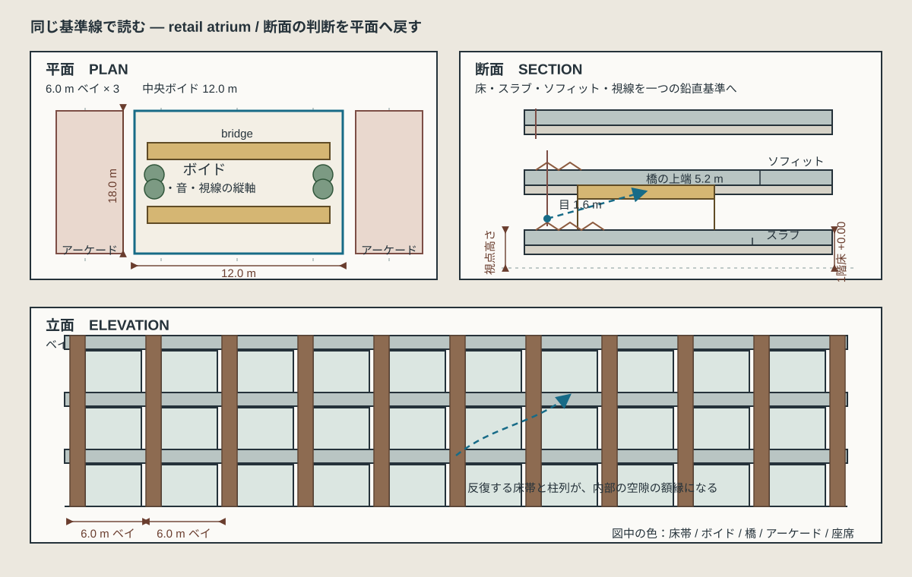

# 2. 建築と動線

建築を歩けるワールドへ移す仕事は、外観に加えて、歩行者がどこに立ち、何を見上げ、どこで速度を落とし、次の場所へ何を手掛かりに進むかを、寸法と境界と視線の連鎖として組み立てる仕事である。立面の印象だけを先に作ると、入口の奥行き、床の厚み、階段の勾配、開口から入る光、上階から落ちてくる音が互いに別々の設定になる。画像は整っていても、歩いたときの空間は成立しない。

本章は、多層アトリウムを題材に、図面の読解、人の尺度、階段と動線をつなげる。数値例は、仮想空間で見え方と移動を検討するための仮定である。実施設計では、用途・地域に応じた法令、構造、避難計画を別途確認する。

## 平面図・断面図・立面図

平面図、断面図、立面図は、同じ建物について異なる質問に答える三枚の図である。それぞれが「どこにあるか」「どの高さで切れるか」「外からどう見えるか」を示す。Aalto University のデジタル設計教材は、平面と断面を切断図、立面と配置図を投影図として整理し、平面は水平の切断、断面は床どうしの関係を示す垂直の切断と説明している。[Digital Design「Drawing 2D: Section and Projection」](https://digitaldesign.aalto.fi/digital-design-workflows/vector/2d-cad-drafting/drawing-2d-section-and-projection/) の「Content in a nutshell」「Section drawings」を参照すると、線の太さや切断位置を決める前に、図の目的を定める必要があると分かる。

平面図では、歩行面、柱のグリッド、壁、入口、開口、階段の踏み面、座席の占有範囲を同一の水平座標に置く。アトリウムの平面で最初に確認すべきものは、吹抜けの輪郭と、その輪郭の外側に連続する歩行帯である。吹抜けの境界線を消すと、上階の床がどこまで張り出し、どの位置で人が立ち止まれるかが読めなくなる。

断面図では、床仕上げの高さ、構造スラブの厚み、天井や梁の下端、開口の上端、橋の床と手すり、階段のピッチを同じ鉛直基準で見る。アトリウムは高さが増えるほど壮大に見えるが、床の厚みとソフィットの影が薄いと、上階が宙に浮いた板に見える。断面はこの不自然さを見つけるための図である。立面図は、同じ高さの床や柱が外周でどのようなリズムをつくるかを確認する。商業施設の大きな開口では、ガラスの面積だけを描かず、柱、梁、庇、サイン、照明の位置を同じ立面基準に揃える。

寸法線は、後工程が参照する関係を固定するための線である。まずプロジェクト原点、方位、基準階の仕上げ床、構造グリッドを定める。次に、全体寸法、グリッド間隔、開口の位置、仕上げ間寸法、歩行面の高さを区別して記す。例えば「床から天井まで3,600 mm」と「スラブ上端から上階スラブ上端まで4,200 mm」は異なる高さである。前者は視覚的な室内寸法、後者は階高の基準である。寸法の種類を混ぜると、3D化したときに床厚や天井懐が消える。

透明な建具では、共用側の完成面、板の芯、枠の見込み、室内の有効範囲の始点を分ける。完成面から室内へ板厚を伸ばせば、芯はその半分だけ奥へ移る。完成面を示した図へ板芯の座標を渡すと、見えるガラスと反射計算の面、下枠を受ける床端がずれる。光の遮蔽、音の反射、歩行の境界、床や枠の支持には、基準面と厚さの向きを合わせて渡す。薄板として音や光を近似する場合も、どの面を代表にしたかを明示すれば、形状を直した影響を追える。

同じ基準は、図面とデータモデルの間にも必要になる。buildingSMART の IFC 4.3 は、サイト、建物、階、空間のような空間構造を階層として扱い、物理要素を一つの空間構造へ格納する関係を定義している。[IFC 4.3.2.0「Spatial Structure」](https://standards.buildingsmart.org/IFC/DEV/IFC4_3/HTML/concepts/Object_Connectivity/Spatial_Structure/content.html) の説明に従えば、柱や梁を階と空間の階層へ結び付けることで、部材の場所と全体構成を同じ情報として扱える。`IfcBuildingStorey` には階の基準高さがあり、構造スラブ上端、階の総高さ、スラブ下面までの高さを分けて記録できる。[IfcBuildingStorey](https://standards.buildingsmart.org/IFC/RELEASE/IFC4/ADD2_TC1/HTML/schema/ifcproductextension/lexical/ifcbuildingstorey.htm) の「Semantic definitions」「Figure 148 — Building storey elevations」が示す区別である。

ワールドのデータでは、建物、階、空間、部材の所属を定める。床、開口、階段、手すり、座席を共通の座標から描画・衝突・音響へ渡すと、階の高さを動かした影響を各機能でたどれる。

図1の左上は平面で、反復するベイ、中央のボイド、橋、アーケード、座席を同じグリッド上に置いている。右上は断面で、スラブ、ソフィット、橋の厚み、上階の開口、視線を重ねた。下段の立面は、柱と床帯の反復が、内部の空隙の輪郭を外側へ伝える様子を示す。この三面が一致していれば、平面で見える橋が断面で宙に浮かず、立面に描いた柱が歩行経路の境界として機能する。

## 商業アトリウムの類型を、部材名で読む

アトリウムは中央に空けた大きな穴として作ると理解が止まる。歩く人にとっては、階をまたいで見える目標、音が上下に伝わる空気の柱、光が落ちる深い面、座る場所へ接続する公共の室である。米国のWhole Building Design Guideは、アトリウムを主入口や公共動線、特別な目的地に用いる多層空間として扱い、天窓・大きなガラス面・橋・座席・植栽・音の吸収を一つの設計課題として挙げている。[WBDG「Atrium」](https://www.wbdg.org/space-types/atrium) の「Space Attributes」を参照すると、アトリウムの価値は空隙の大きさだけでなく、動線と環境制御が同じ断面で働くことにある。

ここでは五つの要素を使って類型を読む。

**ボイド**は床がない領域である。空間の中心を空ける操作に見えるが、実際には周囲の床端、手すり、梁、照明、サインによって輪郭を持つ。ボイドの面積を大きくしても、縁に立てる場所がなければ、歩行者には遠い暗い穴として現れる。逆に縁の歩行帯を連続させると、中央の空隙は方向を決める基準になる。

**ベイ**は柱や壁の反復間隔である。ベイが6 mなら、柱、店舗間口、天井照明、床目地、橋の支点を6 mのリズムで関連づけられる。ベイが実装上の単なる反復ループになると、店舗や休憩場所が均質な記号列になる。入口だけベイを開き、休憩の前だけ柱間を広げるなど、反復からのずれを利用すると、歩行者は場所の変化を身体で読める。

**スラブ**は床の板である。歩行面の高さを決めるだけでなく、厚みの下端がソフィットとして視界と音を切る。アトリウムの各階を同じ厚みで描くと、階の重なりが読みやすい。店舗の前でスラブ端を厚く見せ、ボイド側で薄い縁を見せると、同じ階でも商業の内側と公共の空隙の性格を分けられる。

**ブリッジ**はボイドを横切る床で、移動の近道と観察の足場を兼ねる。橋の幅、床の厚み、手すりの高さ、橋から見下ろす床までの落差を、平面・断面・歩行判定に同じ値で入れる。橋の中ほどで別の店舗が正面に見える配置は、縦方向の移動目標を生む。橋の側面を完全に塞ぐと、横断はできてもアトリウムの視覚的な連続性が切れる。

**アーケード**は柱列、壁面、庇、天井帯などで形成される線状の縁である。店舗とボイドの間に幅2.4 m程度の歩行帯を置くと、買い物の立ち止まりと通過を同じ境界内で扱える。アーケードの天井が低く、ボイド側が明るい場合、歩く人は暗い縁から明るい中心へ視線を向ける。床材、照明、音の反射が変わる境界を設計すれば、壁を置かなくても場所が切り替わる。

座席は家具の配置だけでなく、歩行可能領域を分割し、視線の高さを増やす装置でもある。背の低いベンチは視界を保ちながら速度を下げ、背の高い植栽や背もたれは視線を部分的に隠す。座る人がいる状態を想定するなら、座面の高さ、背の高さ、足元の余白、通過帯を一つの断面で確認する。座席を「置いた」時点で完成とせず、座席が見通しと回遊のどこを変えたかを評価する。

## ソフィット、開口、音、光は同じ幾何から出る

ソフィットはスラブ、梁、庇などの下面である。歩行者の目には上階の輪郭をつくる帯として現れる。受照量は面の向きや開口との関係で変わり、音響上は反射や遮蔽を生む境界になる。面の位置と開口は共通に扱い、光学反射率と帯域別の吸音率はそれぞれの物理に従って与える。

まず開口の高さと奥行きを決める。開口が低いと、視線は近い床へ戻り、上階の目的地が隠れる。開口が高く深いと、遠くの橋や照明が見えるが、中央の空隙が単なる縦穴になる。柱列とスラブ端は、視界を連続させるフレームとして働く。開口の奥に光源を置くときは、光源そのものを見せるか、壁やソフィットを反射面として見せるかを決める。後者では、受照面の色・粗さ・法線が光の印象を左右する。

放射照度は、入射放射輝度と入射角の余弦を、面に見える半球の立体角で積分した量である。視感度で重み付けした入射輝度を使えば、対応する測光量である照度を得る。受照面の向きと開口を変えると積分に入る方向が変わる。面光源や天窓の近くでは、面の各部の見え方を扱う。 [Physically Based Rendering, 4th ed. `4.2](https://pbr-book.org/4ed/Radiometry,_Spectra,_and_Color/Working_with_Radiometric_Integrals)

アトリウムでは、高さや開口が、受音点までの経路と反射の分布を変える。Zhao、Kang、Jinは長さ、高さ、アスペクト比、天窓形状を変えた音場をシミュレーションし、平均音圧とT30の変化が形状、吸音、散乱の組み合わせに依存することを示した。同じ仕上げ材のままでも、断面を変えれば受音位置ごとの結果が動く。 [Zhao, Kang & Jin, Effects of geometry on the sound field in atria](https://discovery.ucl.ac.uk/id/eprint/10052476/)

これをワールドへ移すときは、音源と受音点を同じ空間モデルへ置く。橋の下のソフィット、店舗の開口、柱列の背面を、反射・遮蔽・通過の境界として使う。開口の幅だけを増やしても、上部に吸音する天井があれば音の届き方は変わる。逆に、硬い床と硬いソフィットを連続させると、中央の会話や足音がどこから聞こえるか分かりにくくなる。視線が通る場所ほど、音の境界を意図的に配置する必要がある。

### 支持する面と、歩く面を揃える

低い天井を部屋の中央に設ける場合、閉じた天井懐なのか、四周が開いた吊り天井なのかを断面で決める。四周が開く天井の下面へ、部屋全体の音響高さや移動上限を一律に置き換えると、周囲の高い領域まで閉じてしまう。板と梁の投影範囲を共通座標に置き、その直下の頭上余裕を求める。上から覗ける範囲には上面、支持材、主天井の貫通部と上階スラブへの接続も必要になる。化粧材の面に吊材が接するだけでは、支持先を示せない。架空空間で接続を読めることと、実製品の許容荷重・構造安全認証は分ける。[NISTIR6867 §3.1の荷重経路](https://nehrpsearch.nist.gov/static/files/NIST/PB2002104220.pdf)

水勾配を持つ床では、描画メッシュと歩行高さを同じ床面から求める。室内床との接続点を原点とし、例えば東向きに下がる面なら `h(e)=−s(e−e0)` と書ける。勾配を描画だけへ加えると、外側ほど視点の足元が床から離れる。数値式どうしの一致に加え、描画に使う実三角形へ下向きrayを当てて高さを照合し、閾値を越える歩行・低姿勢・出入りも実操作で確かめる。床を平らにしたり可動範囲を狭めたりする前に、共通面の不一致を直す。

適用上の注意: 荷重経路の原理は参照できるが、原典の既存建物の寸法・安全判定を架空の高層住戸へ転用しない。床の式と数値照合は幾何的な導出であり、防水・滑り抵抗・法規適合の認証ではない。

### 隣接する外皮を、見える範囲から閉じる

一つの階を建物全体から切り欠いて室内を置くと、室内の平面より大きい棟の外側に隙間が残る。全室・バルコニー・共用廊下のunionを保護し、残る隣接volumeだけを閉じる。通常の開口一覧にない昇降機の目地や奥板も、既存の有限厚として保護する。支持の接続と、壁の中へ隠れる重なり、外から見える二重面を分けて検査する。

窓端から都市が見えるだけでは外皮欠落と決められない。期待する外皮上の点を実カメラへ投影し、そこへ達するrayが棟へ入るか、手前の枠で遮られるか、同じpixelに何が描かれるかを調べる。近接の立位・低姿勢・両眼で確かめる。訪問不能な隣接部の外皮を復元することと、内装や新しい経路を作ることは別の設計判断である。

## 人の尺度と視距離を、数値で戻す

人の尺度は「小さく感じる」「大きく感じる」という感想で終わらない。目の高さ、歩行面から手すりまでの高さ、視線が床へ当たる距離、立ち止まる場所から目的地までの見通しへ分解できる。人の身長の平均を一つのキャラクターへ埋め込む必要はない。設計用の観察点を複数置き、立位・座位・階段上で同じ目的地がどう見えるかを比較する。

視距離の計算例を示す。観察者の目を床上1.60 m、目的地を13.00 m先の橋の手すり上端、橋の上端を5.20 mとする。床面を水平とし、遮蔽物のない仰角は次で求める。

`仰角 = arctan((5.20 - 1.60) / 13.00) = arctan(3.60 / 13.00) = 15.5°`

観察者から8.00 m先に、下端が3.60 mのソフィットがあるとする。目的地へ向かう視線の高さは、線形補間で `1.60 + (5.20 - 1.60) × 8.00 / 13.00 = 3.815 m` となる。視線はソフィット下端3.60 mより上を通るため、ソフィットは橋を隠す。ソフィット下端を4.20 mへ上げた場合、同じ視線はその下を通り、橋が見える。断面の高さを0.60 m動かすだけで、目的地の見え方が切り替わる。

視線の幾何から求まるのは、橋が可視となる条件である。実際に方向の手掛かりになるかは、表示の画角、光、輪郭、頭部運動と合わせて評価する。Gath-Moradらは69人が参加するデスクトップVR実験で、目的地の可視性が上下階を移動する判断や探索行動に影響することを示した。この結果を、入口や踊り場で何が見えるかを検討する根拠に使える。 [Gath-Morad et al., Visibility matters during wayfinding in the vertical](https://www.nature.com/articles/s41598-021-98439-1)

ワールドでの評価点は、入口、最初の分岐、目的地の正面、階段の踊り場、橋の中央に置く。各点から「次に進める場所」「次の階の目的地」「戻れる方向」を見て、視線の先に床、手すり、柱、照明など意味のある形があるかを確認する。見通しを作るために壁を透明にしすぎると、空間の境界が消える。境界を保つために壁を厚くしすぎると、目的地が見えず探索が停滞する。開口の位置、柱の太さ、床端の高さを数値で変え、視界と境界が同時に成立する範囲を探す。

### 接近の余白と、奥へ続く主動線を分ける

大きな客席室でも、主通路の線を図へ引いただけでは歩ける証拠にならない。卓、椅子の背、脚、柱の実外形へ身体の余白を加え、入口から奥端まで連続した帯が残るかを調べる。経路の終点が低い卓へ入っていたり、奥の横断通路が椅子に占有されていたりする場合は、線の見た目ではなく席と経路を同時に直す。座位で使う場所への接近、注文待ち、スタッフの搬送、奥で向きを変える余白を、同じ空き面積として二重に数えない。

比較の基準として、米国Access Boardの§403.5.1は歩行面の最小幅915 mm、§304.3.1は直径1,525 mmの回転空間を定めている。これらは人体と余白を検討する一次資料で、国内の仮想施設に法令適合を認定する値ではない。制作では目的に合う余裕を選び、什器の実形状・通常の移動・低姿勢・振り返りで成立を確かめる。主動線と営業用の帯を分け、同じ座標で図と模型を照合した例は[大型カフェの平面](../atrium/cafe-interior-design.md#座標平面とサービス計画)を参照する。 [Access Board, ADA Standards §304/403](https://www.access-board.gov/ada/)

## 比較写真と滞在視線を別の主視点にする

写真と比べるカメラは、部材の位置、比率、輪郭、重なりを確かめるために置く。滞在する人の視線は、座る、立ち上がる、横へ歩くという用途から決まる。両者が逆向きなら、それぞれを設計の主視点として扱う。写真に合う一枚があっても、座った正面が未用途の壁で終われば、滞在場所の設計は残っている。各視点の位置、向き、目高、画角を定め、写真側で守る構成と、滞在側で見渡せる場所を同じ平面・断面へ重ねる。

前景・中景・遠景には、距離に加えて用途を与える。前景の床と縁は足元の支持と立ち上がる余白を示し、中景の店先や席はそこで何ができるかを示す。遠景には次に向かう場所、または留まって眺める終端を置く。上階も窓の反復だけにせず、床の厚みと奥の部屋の用途が読み取れるようにする。距離や高さの違う要素が役割を持てば、物品数を増やさずに、見回した先の空間をつなげられる。これは構成を考えるための設計方針であり、配置だけで美観や静穏を保証するものではない。

見える目的地と、歩いて入れる場所は区別する。[Hölscherら（2006）の方法と建築分析](https://www.uni-giessen.de/de/fbz/fb06/psychologie/abt/kognition/forschung/publikationen/Datein/Publikationen_PDFs/HMVBK_JEP.pdf)では、初訪問者と既知の訪問者各6人に複雑な会議施設の経路課題を課し、階ごとの不一致、階段への見通し、公私領域の区別などを分析した。単一施設の少人数調査から装飾量や快適性の最適値は定まらないが、視界に入る行き先と経路・領域を照合する理由になる。鑑賞専用の庭や閉じた部屋は、枠、巾木、建具、連続する床端で止まる理由を示し、その奥は見せる範囲まで床・壁・天井をつなぐ。写真の反対方向に用途と閉鎖面を設ける個別の設計例は、[ソファ正面の施設設計](../atrium/sofa-facing-facility-design.md)に示す。

## 階段の蹴上げ、踏み幅、頭上の余裕

主階段は、上下を接続する機械部品として配置すると、歩行中の主役にならない。アトリウムに面する階段は、上階の人影、踊り場からの眺め、手すりの連続、足音の変化を伴う立体的な場所である。平面では階段幅、昇降方向、踊り場、ボイドとの距離、入口から見える位置を定める。断面では蹴上げ、踏面、段鼻、ピッチライン、頭上のソフィット、階段下への立ち入り境界を定める。立面では手すりの連続と段鼻のリズムを定める。

英国イングランドの建築ガイダンス *Approved Document K* は、階段の蹴上げ $R$、水平の踏み幅（going）$G$、頭上の余裕を評価する方法を示す。用途別の値を示す表1.1では、一般アクセス階段の例が蹴上げ150〜170 mm、踏み幅250〜400 mmである。本文には $2R+G$ の通常の範囲と、段鼻を結ぶピッチ線を基準とする頭上寸法も図示されている。日本を含む他地域の規則を適用する際は、用途と管轄ごとの根拠を確認する。 [Approved Document K, K1・表1.1・階段の断面図](https://assets.publishing.service.gov.uk/media/60d5bdcde90e07716f516cfd/Approved_Document_K.pdf)

たとえば高さの差1,980 mmを一つのフライトで12蹴上げに割ると、蹴上げは165 mmになる。踏み幅を280 mmに取れば $2\times165+280=610$ mm。上端を踊り場とする直階段では、11踏面で水平長は3,080 mmになる。断面ではピッチ線から上部の梁やスラブの下面まで鉛直に測り、設計例として2.00 mの余裕を取る。階段裏に展示やベンチを置くときは、歩ける高さがある部分を確認し、低い部分の手前に縁や造作を設ける。

踊り場は、足元を水平に保って向きを変え、階段の先を見渡す場所である。主階段の踊り場から店舗や橋を見せると、利用者は上階へ進む途中で空間のつながりを把握できる。歩行面、段差判定、手すりの衝突、カメラの頭部高さを共通の階段データへ結び付ける。

手すりは手の高さにある連続した境界であり、落下方向を示し、階段の上り下りを身体へ伝える。踊り場で途切れると、視覚的にも触覚的にも階段の連続が途切れる。Approved Document Kの図1.11・1.12は、傾斜部から水平部までの連続と端部の延長を図示する。仮想空間の設計でも、手すりの端が壁や床へ自然に戻ること、背景に埋もれない材質、段鼻と同じ座標系で動くことを確かめる。

## 曲線階段と踏み幅の測定線

曲線階段で段鼻が放射状に並ぶ場合、中心からの距離によって同じ一段でも踏み幅が変わる。どの線で測るかを指定して評価する。イングランドのガイダンスでは、階段の幅によって測定線の位置が変わる。幅1 m未満の曲線階段では例として中央線を使い、幅1 m以上の図では両端から270 mmの位置で測っている。 [Approved Document K, Diagram 1.9](https://assets.publishing.service.gov.uk/media/60d5bdcde90e07716f516cfd/Approved_Document_K.pdf)

計算例として、半円状に12段を配置し、内周半径を0.60 m、外周半径を1.50 mとする。階段幅は0.90 m、中央の歩行線半径は `(0.60 + 1.50) / 2 = 1.05 m` である。1段の中心角は `180° / 12 = 15° = 0.261799 rad`。円弧長 `s = rΔθ` を使うと、次の値になる。

- 内周の円弧長は `0.60 × 0.261799 = 0.157079 m = 157.1 mm`
- 中央の歩行線は `1.05 × 0.261799 = 0.274889 m = 274.9 mm`（施工寸法へ丸めると275 mm）
- 外周の円弧長は `1.50 × 0.261799 = 0.392699 m = 392.7 mm`

三つの値は同じ15°から出ている。中央の歩行線では274.9 mmで一歩の寸法を確認できるが、内周と外周の弧長は157.1 mmと392.7 mmへ変わる。したがって、3Dでは中心線だけに歩行判定を置かず、扇形の踏面面積を生成し、内周の尖り、段鼻、手すり、外周の落下境界を別々に持たせる。衝突判定が中心線だけだと、カメラは踏面のない内側へ入れる。見た目だけ扇形にすると、外周で一歩が過大になる。

図面で「15°」だけを表示すると、施工・実装側は半径を推測することになる。内周半径、外周半径、角度、歩行線、段数、上端の高さを揃えて記す。高さの差1,980 mmを12蹴上げでつなぐ場合、曲線階段でも一段165 mmとなる。曲率を変えると歩行線上の踏み幅と、梁の下を通る位置が変わる。高さや段数にも手を入れた場合は、蹴上げと上端の接続を再計算する。

## 3Dの境界と座席は、見える形で成立させる

歩けるワールドには、見た目の形、物理的に止まる形、用途として通過を許可する範囲がある。ボイドの床端は、視覚上の縁、足の支持の終わり、落下を止める手すりを持つ。橋の下を通れる場合も、上階の床が光や音を遮る。店舗は、ガラスや開口の先に見せる範囲と、移動を許可する範囲を決める。同じ平面と断面から各境界を取り出し、見える縁と身体の止まる位置がどう関係するかを確認する。

回廊と地上床が平面で重なる点には、複数の支持面がある。商業アトリウムでは、足元から届く高さを上限として候補を絞り、階段をたどると次の床へ移れる。下からはスラブの下面が頭上の境界になる。回廊と店舗を同じ平面位置まで移動する試験を上下両方から行うと、出発した階に応じて支持面を選べるかを確かめられる。階段の接続は、上りと下りの両方向で確かめる。 [支持面と頭上の判定](../../src/coast/world/atrium/atriumNavigation.ts) · [上下階と階段の動作検証](../../scripts/atrium-navigation.test.mjs)

境界は歩行を止める理由まで見せる必要がある。床の端、段差、手すり、低い植栽、座席の背を、光と影と材質で見せる。透明な境界を使う場合も、反射、フレーム、床の見切り、音の変化を組み合わせる。衝突形状が描画形状より大きい場合は、その理由を視覚的な厚みや余白に戻す。

座席は、座位の人と歩行者の双方を置く装置である。幅0.55 mの座面を並べ、座面前の足元、背後の通過帯、斜めからの視線、立ち上がる人の身体の余白を取る。アトリウムの縁にベンチを置く場合、座った人の目の高さが床上1.10–1.20 m程度になる想定を置き、橋や店舗のどこが見えるかを確認する。この想定は平均身長を固定する値から切り離し、視線の検証点を増やす設計用仮定として使う。

全体を再現した写真と、歩ける範囲を示す平面は、異なる設計資料として使える。ソファ周辺や通路に置く展示台は、座位の視線に対する高さと、立ち上がった後に通れる幅を同時に検図する。店先は共用部から見せる場合にも、入口と商品の間に実際の奥行きを持たせられる。入口で視線が旧い外壁に塞がれていないかは、設計上の平面だけでなく、組み立てたモデルへ目の高さから線を通して確認する。 [見通しと通路寸法の事例](atrium-case.md#什器を動かし見通しと通路を同じ寸法で確かめる)

## 負の空間を、額縁として設計する

負の空間は、人が歩き、立ち止まり、次の目的地を見つけるために物体の間へ残す厚みである。アトリウムなら、中央のボイド、床端から柱列までの余白、橋の上下の空気、座席の周囲、入口から階段へ向かう間が負の空間になる。これらの幅、高さ、視界、音の反射面を合わせて決める。

額縁としての負の空間は、対象を常に見せる必要がない。入口から橋の一部だけ見せ、柱を過ぎたところで全体を開く。階段の踊り場で、上階の手すりと天窓だけを見せる。座席の背の間からボイドの光を見せる。見えるものを絞ることで、次に進む理由が生まれる。見えない場所も、床の連続、音の方向、光の反射によって存在を予告できる。

負の空間を3Dで作る際は、空気の体積にも境界を与える。照明の遮蔽、音の反射、カメラの視錐台、歩行可能面のどれも、空白を無限の透明領域として扱わない。ボイドの中央に家具を詰めると、アトリウムは広いロビーへ変わる。縁を空けすぎると、スケールを測る手掛かりがなくなり、建物は模型のように見える。柱、手すり、座席、橋の端が、空白を測る目盛りになる。

## 建築の判断を、設計ブリーフへ翻訳する

ここまでの判断を、次のような一つの設計ブリーフへまとめる。

「三層の商業アトリウムを、入口から主階段、中央橋、屋上庭園へ連続して歩けるワールドとして作る。中央ボイドは幅18 m、主階段の一つのフライトは、レベル差1,980 mmを12蹴上げ、踏み幅280 mmで処理する。各階は6 mベイを基本にし、入口のベイだけ12 mへ開く。ボイド縁には2.4 mのアーケードを連続させ、橋は2本、幅3.0 m、スラブ厚0.30 m、手すり上端1.0 mとする。入口から橋の上端が見える断面を作り、ソフィット下端を視線計算で検証する。ベンチはボイド縁の一箇所に置き、歩行帯を残し、座位の視線から橋の一部を見せる。照明は天窓、ソフィット反射、店舗開口の三層に分け、音は硬い床とソフィットの連続を避け、橋の下で減衰する。図面、衝突、音響、照明は同じ基準階とグリッドから生成する。」

このブリーフを実装へ渡すとき、最初に平面を作り、次に断面で階高・スラブ・ソフィット・橋・階段を結ぶ。立面でベイと開口の反復を整え、最後に素材を置く。素材を置いた後も、視線の計算点と歩行の到着点を削除しない。主階段のモデルが完成したら、平面で踏面の数と踊り場を読み、断面で頭上のクリアランスを読み、3Dで足が踏面を外れないことを読む。三つの読みが一致したとき、建築判断は見た目の説明から、歩ける空間の仕様へ翻訳されている。

## 限界と使い方

この章の数値は、設計を始めるための比較可能な仮定である。階段の値は英国政府の一つのガイダンスから取った例であり、地域や用途の規則を代表しない。曲線階段の計算は円弧を歩行線へ展開した幾何確認であり、構造、手すり、滑り、避難、施工誤差を確認していない。視距離の計算は遮蔽物のあるなしを判定するもので、視認性、色差、照度、表示の理解、身体能力を保証しない。アトリウム音響の研究はシミュレーション条件を持ち、素材、吸音分布、空調、利用者の人数によって結果が変わる。

平面図で経路を配置し、断面図で視線と高さを検証し、立面図で部材の反復を揃える。その関係を3Dでも維持すると、入口から目的地を発見する過程、歩ける境界、光や音の返り方が、同じ空間の形から説明できる。

## 参考資料

- [buildingSMART International, IFC 4.3「Spatial Structure」](https://standards.buildingsmart.org/IFC/DEV/IFC4_3/HTML/concepts/Object_Connectivity/Spatial_Structure/content.html) — §4.1.5.13。空間構造と物理要素の階層的な格納。
- [buildingSMART International, IFC 4「IfcBuildingStorey」](https://standards.buildingsmart.org/IFC/RELEASE/IFC4/ADD2_TC1/HTML/schema/ifcproductextension/lexical/ifcbuildingstorey.htm) — 「Semantic definitions」「Figure 148」。階の高さ、総高さ、スラブ下面までの高さ。
- [Aalto University Digital Design,「Drawing 2D: Section and Projection」](https://digitaldesign.aalto.fi/digital-design-workflows/vector/2d-cad-drafting/drawing-2d-section-and-projection/) — 「Content in a nutshell」「Section drawings」。平面・断面・立面の投影と切断の整理。
- [Whole Building Design Guide,「Atrium」](https://www.wbdg.org/space-types/atrium) — 「Space Attributes」。公共動線、天窓、橋、座席、吸音、維持管理を含むアトリウムの設計課題。
- [UK Ministry of Housing, Approved Document K,「K1 – Stairs and ladders」](https://assets.publishing.service.gov.uk/media/60d5bdcde90e07716f516cfd/Approved_Document_K.pdf) — §§1.2–1.3、1.11、1.25–1.27、1.34–1.36、Table 1.1、Diagrams 1.9–1.13。階段寸法・頭上クリアランス・手すり・曲線踏面の測り方。
- [W. Zhao, J. Kang, H. Jin, “Effects of geometry on the sound field in atria,” *Building Simulation* 10, 25–39 (2017)](https://discovery.ucl.ac.uk/id/eprint/10052476/) — アトリウムの長さ、高さ、アスペクト比、天窓形状が音圧と残響時間へ与える影響。
- [M. Gath-Morad et al., “Visibility matters during wayfinding in the vertical,” *Scientific Reports* 11, 18980 (2021)](https://doi.org/10.1038/s41598-021-98439-1) — 多層VR環境で目的地の可視性と上下移動の判断を調べた実験。
- [C. Hölscher et al., “Up the down staircase: Wayfinding strategies in multi-level buildings,” *Journal of Environmental Psychology* 26, 284–299 (2006)](https://www.uni-giessen.de/de/fbz/fb06/psychologie/abt/kognition/forschung/publikationen/Datein/Publikationen_PDFs/HMVBK_JEP.pdf) — §2、§5.1、§6。実施設の経路課題、公私領域・上下階・階段の建築分析と一般化の限界。
- [M. Pharr, W. Jakob, G. Humphreys, *Physically Based Rendering: From Theory to Implementation*, 4th ed., §4.2](https://pbr-book.org/4ed/Radiometry,_Spectra,_and_Color/Working_with_Radiometric_Integrals) — 入射放射輝度、余弦項、立体角による照度計算。

---

[前章　1. 参照画像と透視投影](image-reading.md) · [目次](README.md) · [次章　3. 造形と材質](modeling-materials.md)
