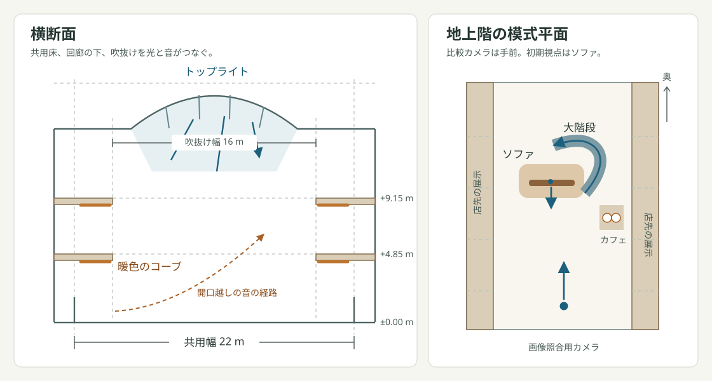
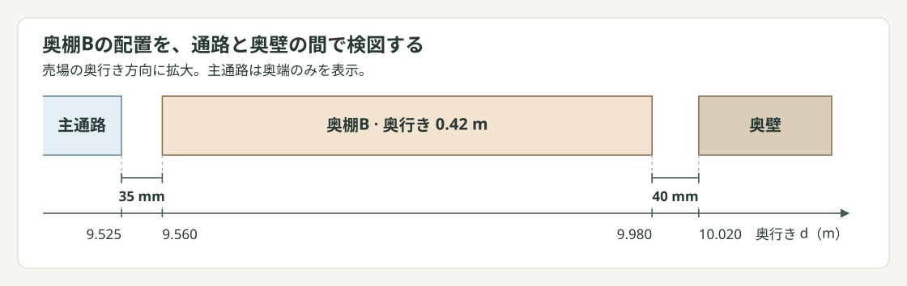

# 7. 吹抜けを設計する

## 床から天井までを一つの体験として読む

左右に店舗が並ぶ商業アトリウムを考える。奥にソファと白い枝の照明があり、手前右から大階段が入る。見上げると、下がり天井の暖色光を越えて青みを帯びた採光部が見える。床には照明帯とガラスの縦桟が映る。ソファに座ると上階の足音やカフェの声が、見える位置に応じて前後・上下から届く。

図1から始まる数値例は、幅22 mの地上共用部を持つ架空の吹抜けである。寸法、光度、吸音性能、処理時間には設計判断を追うための仮定値を使う。後半の[実装事例](#商業アトリウムの実装で確かめたこと)では、Lumen Pilgrimageの設計データと画面・動作の検証を扱う。

最初に空間の軸、開口と閉じた面、座る場所と歩く場所を決め、それらの境界を光と音の計算にも使う。描画する段や窓と、衝突・反射・遮蔽を判定する面の位置を同じ座標から引けると、造形を修正した際に生じる影響を追いやすい。

*図1　架空のアトリウム。断面は左右の回廊と天井の高さを示し、平面は動線と主な見え方を示す。平面の階段は経路の模式図。*

## 合わせる視点と、空間を発見する視点

比較用のカメラは地上の通路の手前に置く。画像右を $X$、上を $Y$、カメラの前方を $s$ とする。カメラの姿勢は水平、眼高は1.60 m、画像は2,944 × 1,648 px、主点は $(1560,\ 1090)$ px、焦点距離は2160 pxと仮定する。歪みを省いたピンホールモデルなら、画像座標は次で表せる。

$$
u=1560+\frac{2160X}{s},\qquad
v=1090-\frac{2160(Y-1.60)}{s}.
$$

ソファの床際を $(X,Y,s)=(-2.70,0,29.70)$ mに置くと、投影は約 $(1364,1206)$ pxになる。床上の同じ点で $v$ が6 px下へずれると、投影行は1206.36 pxから1212.36 pxに変わる。$s=3456/(v-1090)$ で逆算した距離は約28.24 mに縮む。遠方で床と接する画素を拾う際は、影の外縁や家具の手前の角を混ぜるだけでも奥行きが動く。立位カメラで複数の床上アンカーを合わせ、別視点でも柱間や階段の重なりを確かめる意味がここにある。 [Criminisi・Reid・Zisserman, Single View Metrology](https://www.robots.ox.ac.uk/~vgg/publications/1999/Criminisi99/)

開始時の視点はソファの中央、眼高の目安は1.20 m、向きは手前の通路側に取る。比較カメラとは空間をほぼ反対方向から見るため、開始直後には大階段が画面の主役にならない。座ったまま首を回すと、近くの枝、横のカフェ、遠くの階段の順に奥行きが立ち上がる。平面でソファの前に立ち上がる余白を取り、座位・立位で見える欄干やカフェの遮蔽物を断面で照合する。店先は共用床から手前の売場とその奥が見えるだけの立体を持たせ、入口のガラスや敷居に通行境界を合わせる。窓の内側が横移動でこちらに追従して見えるようなら、展示の奥行きや反射の参照位置を疑う。

## 階段の曲線を歩ける形にする

地上から上端の回廊まで9.15 mを54蹴上げでつなぐ。均等に分ければ1段の蹴上げは169.4 mmとなる。18蹴上げのフライトを3つとし、各フライトの上端が水平面に接続する形ではフライト内に17踏面を数える。中心の踏面を320 mmで作ると3フライトの中心線上の水平長は16.32 m。ここに踊り場の水平長が加わる。踏面の数え方、蹴上げと踏面の寸法、フライトと踊り場の関係を設計データで明示すると、図と歩行判定を照合できる。 [buildingSMART IFC 4.3, IfcStairFlight](https://standards.buildingsmart.org/IFC/RELEASE/IFC4_3/HTML/lexical/IfcStairFlight.htm)

次に、扇形の踏面を曲線で並べたと仮定する。中心半径5.40 m、幅3.55 m、中心線の踏面320 mmとすると、一段あたりの回転角は $0.320/5.40=0.05926$ rad。曲線上の踏面 $g$ は半径 $r$ に比例し、内側の端から0.30 m離れた半径は $5.40-1.775+0.30=3.925$ mなので、その位置の踏面は約233 mmである。中心線だけを見て幅全体の歩きやすさを評価すると、この縮みを見落とす。

ここで設計目標として歩く線の踏面を280 mm以上にしたければ、必要な半径は $0.280/0.05926=4.725$ m以上となる。内側の端から約1.10 mの範囲は、手すりの内側や造形の厚みに取り込む余地がある。幅いっぱいに歩ける曲線を取りたい場合、内側端から0.30 mで280 mmを満たす中心半径は11.8 m以上が必要になる。たとえば回り角を131°に固定すると、半径11.8 mでは中心線だけで約27.0 mを要し、短い曲線をその場で置き換える設計は成立しにくい。歩行面と装飾の切れ目を作る、曲線の角度を小さくする、曲線と直線の分担を変えるといった選択は、階段を下から見た輪郭に返ってくる。ここでの280 mmはこの試算のための仮の判断値である。

仮想空間では、踏面と着地の高さを幾何から決め、ユーザーの歩行入力で上下する支持面は連続に近づける。踊り場の先から手すりを越えたり、開口の縁で視点が急上昇したりすれば、設計した経路と動きが食い違っている。階段下の余裕、上端から回廊への接地、曲線内側の位置で生じる横滑りを現地視点で追う。

## 光源の形、床の反射、視線の高さ

屋根開口には青みのある広い光を割り当て、暖色の線はバルコニー下と階段の側板に連続させる。天空の光が床へ届く経路と、コーブに当たった光が壁と側板に回る経路では、影の位置も反射の輪郭も異なる。店先の展示は、壁や棚の鉛直面を明るくして奥行きを見せる。青い開口と暖色の照明が画面内に同時に入る条件を用意し、シャドーの接地部とハイライトの両方を確認する。昼光の色を定めるときの参照と、店舗照明の照度を考えるときの参照は次を使える。 [CIE・標準光 D65](https://www.cie.co.at/publications/colorimetry-part-2-cie-standard-illuminants-0) · [ANSI/IES RP-2-20, Lighting Retail Spaces](https://ies.org/products/recommended-practice-lighting-retail-spaces/)

店先の下向きの灯具を点光源と近似し、該当方向の光度を800 cd、計算面までの垂直距離を2.80 mと置く。直下の水平照度は $800/(2.80^2)\approx102$ lx。水平に1.60 m離れた点では距離が3.225 m、入射角の余弦が $2.80/3.225$ となる。同じ方向光度を仮定した照度は約66.8 lxである。配光が狭い灯具では、その角度の光度が落ちるので使用する値が変わる。照明帯や大きな天窓は面の広がりを持ち、近傍の照度は点光源の式だけで決まらない。 [CIE, International Lighting Vocabulary](https://www.cie.co.at/eilvterm/17-21-060)

床の中間色を拡散反射率0.35のランバート面と近似すると、直下の拡散成分の輝度は $0.35\times102/\pi\approx11.4$ cd/m²になる。研磨石には視点によって変わる鏡面反射も重なるため、この数値を床全体の輝度や画面の階調とみなせない。白い照明帯の形が出る位置は、床と光源の立体関係で決まる。そこに材の粗さで広がりを付け、拡散側の石目と目地が覆い隠されない露出を選ぶ。設計比較ではカメラの位置と露出を固定する。照明を動かした比較、床の粗さだけを変えた比較、視点を横へ動かした比較をそれぞれ見る。 [Khronos・glTF 2.0の材質仕様](https://registry.khronos.org/glTF/specs/2.0/glTF-2.0.html#metallic-roughness-material)

## 目では見えない距離を音で表す

ソファとカフェの間を歩くと、誰かの短い声、椅子が動く音、吹抜け遠方のざわめきの順に位置と細部が変わる。多層のアトリウムで上下階を分ける境界は開口と床スラブである。開口越しで直接経路が通るとき、下の声は高さを持つ。回廊の床板が間に入ると、開口から回り込む成分と残響の比率が大きくなる。ガラスに投影された反射像から、そこに音源があるように聞こえないよう、音の直接経路は実体の座標に結ぶ。

床と左壁を平面とみなした初期反射の例を計算する。声の位置を $(-2.0,1.4,30.0)$ m、耳を $(-2.0,1.2,25.0)$ mとする。直接音は5.004 m。床面で鏡映した音源の高さは $-1.4$ mで、反射経路は $\sqrt{5.0^2+2.6^2}\approx5.635$ mとなる。音速343 m/sと置くと、返りは直接音から約1.84 ms遅れる。左壁の位置が $X=-11.0$ mなら鏡像音源は $X=-20.0$ m、経路長は約18.68 m、遅れは約39.9 msになる。反射点を実際に調べ、面が窓の開口や吸音材と重なるときは、そのまま硬い壁の返りとして扱わない。 [Allen & Berkley, Image method for efficiently simulating small-room acoustics](https://pubs.aip.org/asa/jasa/article/65/4/943/765693/Image-method-for-efficiently-simulating-small-room)

空間が大きいという印象には、遠くの面からの返りや尾の広がりも効く。吹抜けの部分を幅16 m、長さ38 m、平均有効高さ14 mで近似すると、体積は8512 m³。中域の残響時間を1.9秒程度に仮設定した場合、Sabineの式を逆に使うと必要な等価吸音面積は $0.161\times8512/1.9\approx721$ m²になる。軒下の仕上げ300 m²を仮の吸音率0.08から0.54に変えると、等価吸音面積には138 m²の増分がある。拡散を仮定した計算での残響時間は約1.59秒。実際に開いた回廊と吹抜けでは、遅い尾に異なる減衰が重なる。設計上の感度を見る試算として使い、残響と初期反射はソファ、階段下、上端など複数の位置で確かめる。類似施設でも、開口や吸音面のある場所と硬い大空間で残響時間が変わることが報告されている。 [Alnuman & Altaweel, 商業施設の実測](https://www.mdpi.com/2076-3417/10/3/1170) · [Rumyantseva et al., 商業施設共用部の実測と対策](https://www.mdpi.com/2624-599X/3/1/11) · [ISO 3382-2, 通常室の残響時間測定](https://www.iso.org/standard/36201.html)

## 最も重い視線で評価する

ソファから売場を横切り、階段を上がって吹抜けを見下ろす動作は、照合用の一枚には写らない。ステレオでは左眼と右眼の投影で、手すりのすぐ向こうの床や、ショーウィンドウ内の什器の位置関係が変わる。レンダラーには各ビュー固有の変換と投影が渡される。撮影カメラで作った反射像を床の見た目として固定すると、頭が横に動いたときに、映り込みが床に焼き付いたように見える。画質を検討する場面では横移動を含め、反射と実物が視差に従って動くか確かめる。 [W3C WebXR Device API, XRView](https://www.w3.org/TR/webxr/#xrview)

90 Hzなら更新間隔は約11.11 msである。ある向きでGPUの第95百分位が12.6 ms、透明層の一部を一時的に無効にした条件で8.9 msと仮定する。CPU時間とその他の設定が同程度であれば、その場面の透明層に伴う処理が調査対象になる。この仮の変化が実測で出た場合、短縮されたのはアプリ側のGPU時間である。コンポジターの再投影や、リンク経由での遅延は実機の指標で確かめる。アプリのフレーム時間、連続する遅れ、デバイスのメニューを操作しながら振り向いたときの追従を、それぞれ実環境で評価する。

## 商業アトリウムの実装で確かめたこと

### 写真で読む手掛かりを、歩く空間へ移す

実装では、参照写真から読める柱、店の間口、階段、天窓を空間の骨格に使った。通行人は写真に写る人の尺度を読む手掛かりになる。このワールドの用途は一人での散策なので、完成した空間ではソファ、手すり、ラックや低卓の高さで尺度を伝える。人の動きで隠れていた部分も立ち止まって見られるため、店先の側面と奥壁まで形を持たせた。写真に写っているもののうち、位置や大きさの推定に役立つものと、利用目的に沿って画面内に再現するものは、根拠をそれぞれ持つ。 [共用部の実装](https://github.com/stillshore-chirp/lumen-pilgrimage/pull/226) · [人型モデルを見直した変更](https://github.com/stillshore-chirp/lumen-pilgrimage/pull/228) · [参照写真との再照合](https://github.com/stillshore-chirp/lumen-pilgrimage/pull/230)

当初のシェルの側壁は、実物のように奥行きを取った店舗の内部を横切った。そこで店の間口・奥行き・入口を共通の寸法データから作り、既存壁を開口と店の区画に合わせて割り直した。各入口に対して目の高さから室内へ視線を通し、入口付近の床が同じ高さで続くかも確認した。断面の視線、歩行を許可する範囲、入口から奥へ進む設計上の通路幅は、同じ間口でも別々の検証を要する。実装で歩行できるのは共用部で、店内は共用部から見渡す。 [テナント内装の設計](../atrium/tenant-interior-design.md) · [実装と入口の検証](https://github.com/stillshore-chirp/lumen-pilgrimage/pull/234)

### 什器を動かし、見通しと通路を同じ寸法で確かめる

右手の小物売場では、斜めから見ると低い卓と中ほどのケースの先に、空いた奥壁が大きく出た。照明棚の一つを間口の入口寄りに移して、手前・中ほど・奥の展示が順に視界へ入るようにした。次に、棚が占める設計上の矩形と通路の余裕を検図した。

横に延びる主通路部分の中心は奥行き $d=8.70$ m、有効幅は1.65 mである。通路の奥側の端は $8.70+1.65/2=9.525$ mとなる。棚を横へ移した際に元の奥行き $d=9.52$ mに置くと、移動先では通路へ5 mm張り出す。棚の前端を $d=9.56$ mにすると、通路との間に35 mmの余裕ができる。設計上の奥行きは0.42 mなので、棚の後端は $d=9.98$ mとなり、奥壁の仕上げパネル（R1-11）の表面 $d=10.02$ mとの間に40 mmの隙間が残る。 [小物売場の詳細設計](../atrium/tenant-interior-design.md#r1-全面ガラスの小物売場) · [寸法データ](../atrium/tenant-interiors.json) · [通路幅の検査](../../scripts/check-atrium-tenant-interiors.py)

*図2　仮想空間の設計寸法。奥棚Bの占有範囲と、通路および奥壁の仕上げ面までの隙間を示す。*

### 光、反射、環境音を同じ位置で照合する

店舗では、ショーウィンドウの縦光、棚の見切り、商品、さらに奥の壁を別々の距離に置いた。正面・左右の斜め・ソファ側で撮影し、棚の背板が商品より手前にあった箇所は背板を後ろへ移した。同じ角度で点灯と消灯を比べ、器具や商品の周囲だけでなく床に現れる光も確認した。背景の建築を見せる反射と、VRで視線の動きに追従させる反射の簡略化は、[照明の章](lighting.md#点消灯で見せる光を照合する)と[VR評価の章](vr-evaluation.md#反射の実装と検証を切り分ける)に示す。 [店舗内装の調整と検証](https://github.com/stillshore-chirp/lumen-pilgrimage/pull/234)

環境音は、換気やカフェの設備音と、自分が歩く床の足音を手掛かりとした。店舗の計画を変更すると設備音源が置かれる位置と通過する開口が変わるため、視線と音が参照する間口を同じ寸法データに結んだ。通路からカフェを見通せる方向でも、耳までの直線が固定ガラスを横切る場合と開口を通る場合とで、音の変化は異なる。確かめた内容はブラウザーでの発音・頭部追従と、計算した経路や生成した応答の検証である。音響の測定条件と設計値の読み方は[音環境の章](acoustics.md#開口と固定ガラスの経路を確かめる)を参照する。 [環境音の設計](https://github.com/stillshore-chirp/lumen-pilgrimage/pull/230) · [内装の音響仕様](../atrium/tenant-interior-design.md#音響)

## 設計判断を人に伝える

「上質なモールのように」だけでは、難しい箇所から詰める順序を共有しにくい。構図と歩行、素材と光、音と実機性能の関係まで含めた指示では、制作者が途中で解釈を照合できる。

> ソファに座って手前の通路を見渡し、立ち上がってカフェ横から階段の上端へ歩けるようにする。階段の内側では、手すりの線と歩行面の境界を一致させる。入口側の比較視点で、暖色の照明帯と青い屋根、床の反射が同時に読めるようにする。床は横移動で反射が動き、石目と目地が残ることを確認する。階段上端からは、見下ろした地上の声と、スラブの陰にいるときの声の違いが聞き取れること。ショーウィンドウまたは階段の手すりが画面を大きく占める方向で、頭部追従とメニュー操作を実機で確認する。

この指定では、景色、距離、動き、聞こえ方、検証する場面が結び付いている。設計を変える場合は、先に狙った知覚を特定する。階段の曲率の修正は動線と構図に、灯具の位置の修正は側板と床のハイライトに影響する。制作の評価は、変えた設定の数より、それぞれの変化が空間の体験として追えるかで行う。

---

[前章　6. VRでの見え方と評価](vr-evaluation.md) · [目次](README.md)
