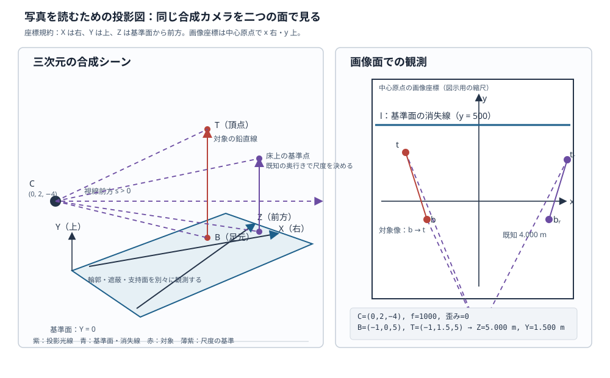

# 1. 参照画像と透視投影

参照写真に写る線や遮蔽から、空間の前後関係とカメラの向きを読み取れる。単一の画像から取り出せる寸法は、対象の平行線、接地面、既知の長さなど、使える条件によって変わる。本章では、画像上の観測から仮のモデルを立て、透視投影によって照合するまでを扱う。

## 全体と部分を往復して読む

一枚を縮小して眺めると、全体の構図を把握できる一方、遠景の細い支持部や、暗い開口の奥行きを取りこぼしやすい。反対に、細部の切り抜きだけを見ると、その部材がどの面に載り、何に隠されていたかを見失う。全体、重複する領域、重要な対象の拡大、全体への再統合という順序で、観測する尺度を往復させる。以下は、単一視点計測の幾何条件と制作事例を結ぶ読解方法であり、分割すれば認識精度が一定量上がるという実験結果ではない。

### 最初に画像全体の座標と関係を押さえる

原版の画素寸法、縦横比、向き、分かる範囲の撮影条件、歪み補正・トリミング・リサイズの履歴を保存する。全体では、消失方向と地平、主要な輪郭、足元の支持、手前が奥を隠す順序、前景・中景・遠景のまとまりを読む。明暗が変わる線をすべて形の境界とせず、影、反射、透過、霞による境界の候補も残す。基準面や平行方向を取り違えたまま細部だけを精密化しても、単一視点計測の前提は満たせない。 [Criminisi・Reid・Zisserman, §2・§4](https://www.robots.ox.ac.uk/~vgg/publications/1999/Criminisi99/criminisi99.pdf)

次に、原版へ規則的な格子を重ね、隣接領域を重複させて全画面を順に読む。格子の大きさと重なり幅は画像の解像度、対象の密度、輪郭の広がりに合わせる。大きな天窓や連続する岸を一つの枠で切断して判断せず、境をまたぐ輪郭と隣の面まで読み直せる幅を取る。細密な遠景などで読み取りが足りなければ、より細かな格子や対象別の切り抜きを追加する。格子は読み落とした場所を探す索引であり、各枠を独立した場面として再解釈するものではない。

### 小さくても設計を左右する対象を拡大する

格子を読んだあと、画面占有率が小さくても、支持、用途、輪郭、接続を左右する対象を追加で切り出す。対象だけを囲わず、載る面、隣の部材、影、手前の遮蔽物を含める。湖畔の遠景なら、格子面とその足元、低い庇と背後の水平層、矩形と斜面の取り合いを同時に見られる範囲である。原寸表示を基準にし、拡大しても元の画素にない形や文字は確定しない。見える部材と、判読できない用途を分ける。 [遠景を原版で再解析した変更](https://github.com/stillshore-chirp/lumen-pilgrimage/pull/256) · [現行の観察と設計補完](../lake/lake-hall-design.md#写真と照合する視点)

### 共通の対象IDと原画像座標へ戻す

全体画像、格子領域、切り抜きで同じ対象を共通IDに結び、輪郭・端点・支持境界を原版の左上原点の画素座標へ戻す。切り抜きの範囲と、表示時の拡大率・回転・補正も残す。同じ屋根を二つの領域で見た記録は、一つの観測を詳しく読んだ結果であって、独立した二視点の証拠にはならない。格子の境で面の所属や遮蔽順が食い違ったら、原版の周辺を広げて照合する。

再統合した記録には、直接見えた形、幾何条件から推定した奥行き、独自に補う形、未確定の点を区別して付す。写真の外側や遮蔽物の背後には、複数の立体候補が残る。その候補を平面・断面と粗い3Dに起こし、基準視点の投影と、移動後の支持・遮蔽・側面を一緒に確かめる。画像の読解は、画面外の設計や探索中の検証へ渡して初めて、歩ける空間の制作に結び付く。必須工程は[段階的解析](../agent-harness.md#参考画像の段階的解析)、具体的な確認方法は[検証ガイド](../verification.md)を参照する。

## 輪郭は観測値、奥行きは仮説

シルエットは、画像に投影された対象の外形である。滑らかな不透明面なら、外形を生む点の集合は視線が表面に接する条件で表せる。角や縁もシルエットの一部をつくる。カメラ中心から外形を逆投影すると、対象が存在し得る空間を円錐状に制約する。円錐の内部に奥行きの候補が残る。 [Cross, Surface Reconstruction from Image Sequences, 第6章](https://www.robots.ox.ac.uk/~vgg/publications/2000/Cross00a/cross00a.pdf)

単一写真を読むときは、輪郭の線、遮蔽境界、接地・支持の境界、同一面にあると判断できる線、反復する線分を別々の観測として残す。遮蔽境界は手前の面が奥の面を隠している順序を示す。遮蔽された面の形は未観測なので、境界の滑らかさだけから裏側の凹みや厚みを確定しない。この境界管理は、後で「完全に写っている外形」と「推定した内部形状」を分離するために必要になる。[3, pp.74–76, 80–81](https://www.robots.ox.ac.uk/~vgg/publications/2000/Cross00a/cross00a.pdf)

霧にかかる遠景は、全体画像で位置を把握したあと、原版の等倍表示で屋根の端、格子の間隔、斜面に隠れる下端を拾う。格子が読める場合は、その線が付き始める高さや隣の面への回り方まで観察し、建築の用途を特定する情報とは区別する。湖畔の広間では、左の格子面、低い屋根の重なり、右の斜面に接する矩形を別々に照合する。接地や庇の影が見える範囲は、仮定した奥行きを置いた実形状で作り、窓辺へ移動して影と遮蔽の変化を確かめる。 [湖畔の広間の設計](../lake/lake-hall-design.md#写真と照合する視点)

複数の視点から得たシルエットの円錐の共通部分は視覚包絡（visual hull）を与える。視覚包絡は輪郭に接する外側の形を表す一方、すべての視点で隠れる凹部を埋めてしまう。表面テクスチャや点の対応を二枚以上で追い、三角測量を加えることで、輪郭だけからは得られない凹部の深さを拘束できる。[3, pp.75–81, 82–88](https://www.robots.ox.ac.uk/~vgg/publications/2000/Cross00a/cross00a.pdf)

設計記録では、輪郭の頂点をポリラインで持ち、各区間に「前景／背景」「接線らしさ」「面の所属」「精度」を付ける。精度は画素の読み取り誤差、境界のぼけ、圧縮、遮蔽、歪みの疑いを含む。照明の境界は形の境界と別レイヤーに置く。これは、視線に接する輪郭と、光源・材質・影による明暗を同じ幾何条件として扱わないための設計上の分離である。

## ピンホール投影の約束

以下では、世界座標を $P=(X,Y,Z)$ とする。$X$ は右、$Y$ は上、$Z$ は基準面から前方へ進む軸とする。カメラ座標では $x_c$ を画像右、$y_c$ を画像上、深さ $s$ を視線前方の正値に取る。世界点をカメラ座標へ移す姿勢を回転 $R$ と並進 $t$ で書くと、

$$
\begin{bmatrix}x_c\\y_c\\s\end{bmatrix}=R\begin{bmatrix}X\\Y\\Z\end{bmatrix}+t,
\qquad s>0 .
$$

正規化像は $x_n=x_c/s,\;y_n=y_c/s$ であり、画像座標を右・上向きに保てば、内部行列を使った同次式は

$$
\lambda\begin{bmatrix}x\\y\\1\end{bmatrix}
=K_{\uparrow}[R\mid t]\begin{bmatrix}X\\Y\\Z\\1\end{bmatrix},
\qquad
K_{\uparrow}=\begin{bmatrix}f_x&\gamma&c_x\\0&f_y&c_y\\0&0&1\end{bmatrix} .
$$

ここで $f_x,f_y$ は焦点距離の画素換算、$\gamma$ は軸の非直交（skew）、$(c_x,c_y)$ は主点である。投影行列 $P=K_{\uparrow}[R\mid t]$ を用いる表現では、同次座標の等号は共通スカラーまでの一致を意味する。Oxford のカメラモデルも、中心投影を $3\times4$ 行列で表し、深さによる除算を同次座標のスケールに含めている。[3, pp.4–5](https://www.robots.ox.ac.uk/~vgg/publications/2000/Cross00a/cross00a.pdf)

画像ファイルの画素座標は通常左上原点で $v$ が下向きなので、保存時には $y$ の符号を反転し、主点も同じ座標系へ移す。本文の $y$ と画素の $v$ を混ぜると、上下反転したカメラを得る。図 `figures/perspective.svg` は説明を簡潔にするため、中心原点で $x$ 右・$y$ 上の座標を描いている。

実レンズでは、正規化像から歪んだ像への写像を入れる。OpenCV が説明する代表的な半径・接線モデルは、$r^2=x_n^2+y_n^2$ として

$$
\begin{aligned}
x_d&=x_n(1+k_1r^2+k_2r^4+k_3r^6)+2p_1x_ny_n+p_2(r^2+2x_n^2),\\
y_d&=y_n(1+k_1r^2+k_2r^4+k_3r^6)+p_1(r^2+2y_n^2)+2p_2x_ny_n .
\end{aligned}
$$

$k_i$ は半径方向、$p_i$ は接線方向の係数である。直線を消失点へ延ばす前に、線が画面端で曲がっていないかを確認し、必要なら校正値で補正する。Zhang の平面校正は、既知寸法の平面パターンを複数姿勢で撮り、内部行列と半径歪みを推定する方法で、カメラやパターンの移動量を事前に測る必要がない。[4, pp.1330–1334](https://www.cs.jhu.edu/~hager/teaching/cs461/ZhangCalibrationTR.pdf) OpenCV の公式手順も複数視点の既知三次元点と画像点から `calibrateCamera` を求め、`undistort` の後に再投影誤差を確認する流れを示す。[6, 「Calibration」「Undistortion」「Re-projection Error」](https://docs.opencv.org/4.12.0/dc/dbb/tutorial_py_calibration.html)

## 消失点、消失線、単一視点計測

未補正の半径歪みは二視点の対応制約を緩め、対応点探索と幾何推定を不安定にする。Fitzgibbonは多視点幾何と歪みを同時に推定する方法を示している。[5](https://www.robots.ox.ac.uk/~vgg/publications/2001/Fitzgibbon01b/)

投影行列を $P=[p_1\;p_2\;p_3\;p_4]$ と書くと、最初の3列は世界軸 $X,Y,Z$ それぞれの方向に対応する消失点を同次座標で与える。第4列は世界原点の投影を与える。床が $Y=0$ なら、床内方向の消失点 $p_1,p_3$ を通る直線が床の消失線になる。一方向の平行線は同じ消失点を持つ。視線方向の成分を持たない方向の消失点は画像の無限遠にあるため、対応する線は画像上で平行になる。 [Criminisi, Reid & Zisserman, Single View Metrology §2](https://www.robots.ox.ac.uk/~vgg/publications/1999/Criminisi99/criminisi99.pdf)

建築写真に現れる平行・直交関係を、平面の向きや校正を拘束する幾何条件として使う方法も報告されている。[2](https://robots.ox.ac.uk/~vgg/publications/1999/Liebowitz99/)

単一視点計測では、中心投影、基準面の消失線、基準面に平行でない方向の消失点を使う。この条件で、共通の尺度を残したまま平行な面どうしの間隔を計測できる。平面のアフィン計量では、平行な線分の長さ比や面積比が得られる。異なる方向の絶対長さを求める場合は、さらに計量を拘束する条件が要る。たとえば鉛直高さをメートルに換算するには、同じ方向の既知高を使う。 [Criminisi, Reid & Zisserman, Single View Metrology §2–3](https://www.robots.ox.ac.uk/~vgg/publications/2000/Criminisi00a/)

高さを例にする。基準面上の足元を同次画像点 $b$、同じ鉛直線上の頂点を $t$、鉛直方向の消失点を $v$、基準面の消失線を単位法線ベクトル形式の $\hat l$ とする。論文の正規化に従うと、基準面からの距離 $h$ は

$$
\alpha h=-\frac{\lVert b\times t\rVert}{(\hat l\cdot b)\,\lVert v\times t\rVert} .
$$

左辺の $\alpha$ がアフィン尺度である。既知の基準高 $h_r$ に同じ式を適用して $\alpha$ を決めれば、別の頂点の高さをメートルへ移せる。基準高さが複数あれば $\alpha$ を過剰決定し、画像点・消失点・消失線のばらつきから不確実性を伝播できる。[1, Sec.3.1, Sec.4](https://www.robots.ox.ac.uk/~vgg/publications/1999/Criminisi99/criminisi99.pdf)

この計測が成立する条件は、対象方向の線が実際に平行であること、基準面が一つの平面であること、レンズ歪みが無視できるか補正済みであること、対応する足元と頂点が同じ線上にあること、遮蔽で端点を取り違えないことである。消失点が画像外に遠いと、わずかな端点誤差が高さへ大きく伝わる。CRZは画像点と投影行列を共分散として扱い、一次近似で最終距離の分散を求めている。[1, Fig.3, Sec.4](https://www.robots.ox.ac.uk/~vgg/publications/1999/Criminisi99/criminisi99.pdf)

## 傾き、シフト、歪み、トリミング

カメラのピッチ・ヨー・ロールは $R$ を変え、各方向の消失点と基準面の消失線を移す。カメラ中心の移動は $t$ を変え、有限の点の投影倍率と遮蔽順を変える。光軸に対するセンサーやレンズのシフトは、画面上の主点 $(c_x,c_y)$、skew、焦点距離と組み合わせた内部行列の問題として扱う。Zhangのモデルが主点、焦点距離、skewを独立した内部パラメータとして置くのは、この差を姿勢の回転だけで吸収しないためである。[4, Sec.2.1](https://www.cs.jhu.edu/~hager/teaching/cs461/ZhangCalibrationTR.pdf)

トリミングは画像の見える範囲を変え、主点の画素座標を新しい原点へ移す。リサイズは焦点距離と主点の画素スケールを変える。OpenCVの `getOptimalNewCameraMatrix` は、歪み補正後に画面端をどれだけ残すかを `alpha` で選び、同時に有効なROIを返す。したがって、元画像の校正値を別のクロップへそのまま貼らず、変換後の内部行列とROIを記録する。[6, 「getOptimalNewCameraMatrix」「Undistortion」](https://docs.opencv.org/4.12.0/dc/dbb/tutorial_py_calibration.html)

写真が一枚しかない場合、焦点距離、主点、カメラ距離、対象の絶対寸法、画面外にある消失点は同時に決まらない。同じ画角の画像は、焦点距離を変えて撮る方法と、広い像から中央を切り出す方法の両方で得られる。実際の構成では、元ファイルの画素寸法、撮影時の向き、レンズ情報、クロップ履歴を保存し、消失線を線分の延長だけで決めず、複数線の最小二乗と残差で評価する。この評価方針は、単一視点計測で誤差を投影行列と端点へ分けて扱う考え方に対応する。[1, Sec.4](https://www.robots.ox.ac.uk/~vgg/publications/1999/Criminisi99/criminisi99.pdf)

## 計算例　相対深さと高さをメートルへ移す

図1の合成シーンでは、共通の仮単位を $U$、カメラ中心を $C=(0,2,-4)\,U$、注視点を原点、焦点距離を1000 pxとする。歪みのないピンホールで、像の中心を原点、上を正とする。カメラの上向き軸と前向き軸を選ぶと、世界点は次の式で投影される。

*図1　床方向と鉛直方向の消失点を同じ像面で読む。*

$$
x=\frac{1000\sqrt5\,X}{2Z-Y+10},\qquad
y=1000\frac{2Y+Z}{2Z-Y+10} .
$$

$Y$ は高さ、$Z$ は床に沿った奥行きである。鉛直方向の消失点は $(0,-2000)$ px、床 $Y=0$ の消失線は $y=500$ pxである。鉛直線では $Y$ を、床上の奥行き方向の直線では $Z$ を遠方へ延ばしたとき、像が近づく位置として確認できる。

対象の足元を $B=(-1,0,5)$、頂点を $T=(-1,1.5,5)$ とすると、画像点はそれぞれ $b=(-111.803,250.000)$ px、$t=(-120.869,432.432)$ px である。足元の $y$ から $q=y/1000$ と置けば、床上の奥行きは

$$
Z=\frac{10q}{1-2q} .
$$

したがって $q=0.25$ から $Z=5.000\,U$ を得る。足元で求めた $Z$ を頂点の式へ戻すと、

$$
Y=\frac{q_t(2Z+10)-Z}{2+q_t}=1.500\,U,
\qquad q_t=0.432432 .
$$

画像に写る床上の基準点の奥行きをモデルで $4.000\,U$ と求め、その距離が実測で4.000 mだったとする。基準点の像は $y=222.222$ px。対象の奥行きは基準点の1.25倍なので、$5.000\,U$ は5.000 mとなり、高さ $1.500\,U$ は1.500 mになる。ここでは、カメラの位置関係を共通の仮単位で与えたモデルに対する一様な尺度合わせをしている。

足元の読み取り範囲を248〜252 pxとすると、奥行きは4.921〜5.081 Uになる。頂点にも±2 pxの読み取り幅を与え、各端の組み合わせを代入すると、高さは約1.480〜1.520 Uとなる。尺度に使った4.000 mも±0.050 mの範囲を持つ場合は、両方の端の組み合わせから高さは約1.46〜1.54 mと見積もれる。ここで扱ったのは端点と基準長の取り得る範囲である。消失線、主点、歪みの誤差まで扱うには、撮影条件と線の当てはめの不確かさを加える。 [Criminisi, Reid & Zisserman, Single View Metrology §4](https://www.robots.ox.ac.uk/~vgg/publications/1999/Criminisi99/criminisi99.pdf)

## フレームを増やすときの役割分担

同じ場所から同じカメラで撮った連続フレームは、輪郭・遮蔽・一時的な照明の変化を平均化し、端点の読み取りを安定させる。カメラ中心が動かなければ、静止物の視差は生じないので、奥行きの三角測量は増えない。カメラを動かしたフレームでは、同じ三次元点の対応が二つの画像のエピポーラ線上へ制限され、対応点を三角測量できる。Oxfordの幾何整理でも、二つのカメラ中心と点が作る平面がエピポーラ線を定め、対応探索を二次元から一次元へ減らすと説明される。[3, pp.4–5](https://www.robots.ox.ac.uk/~vgg/publications/2000/Cross00a/cross00a.pdf)

追加フレームは役割を分けて選ぶ。正面に近いフレームは輪郭と左右対称性を読みやすくし、横へ移動したフレームは前後の重なりと凹部を分け、上下へ移動したフレームは高さ方向の面の接続を拘束する。各フレームの $K_i,R_i,t_i$、クロップ、歪み補正の有無を同じ記録へ保存する。静止面上の対応点は再投影誤差、輪郭はシルエット距離、遮蔽は可視性の順序で評価し、別の誤差を一つの見栄えの点数へ混ぜない。[3, pp.74–88](https://www.robots.ox.ac.uk/~vgg/publications/2000/Cross00a/cross00a.pdf)

ReidとZissermanは、未校正の二つの動画列から対応を用いて別視点を作り、地面への交点を求め、誤差を除去・無視・伝播する手順を示した。追加する視点は、対応点、既知寸法、見えていない輪郭のどの不足を補うかで選ぶ。[7, Abstract](https://www.robots.ox.ac.uk/~lav/Publications/reid_zisserman_eccv1996/reid_zisserman_eccv1996.html)

## 写真座標への一致と、動く視点への一致

一枚の写真座標へ合わせる仕事では、目標を「同じ世界を再構築すること」と「同じカメラから同じ像を出すこと」に分ける。前者が未確定でも、後者は $K,R,t$、クロップ、歪み、画面比、輪郭・遮蔽の観測値で検証できる。平面、薄い立体、奥行きの仮置きは、元画像への再投影誤差とシルエットの一致を満たす範囲で選び、未観測の奥行きを確定値として扱わない。[1, Sec.2–4](https://www.robots.ox.ac.uk/~vgg/publications/1999/Criminisi99/criminisi99.pdf)

カメラを移動させる探索では、同じ座標を保った三次元モデル、各視点の投影、遮蔽の更新が必要になる。一枚にだけ合う看板や薄い平面は、視点を横へ動かすと前後の視差と側面の遮蔽を再現できない。対応点の三角測量、複数シルエットの視覚包絡、テクスチャの多視点照合を組み合わせ、再投影された輪郭と画面内の対応点を全フレームで確認する。[3, pp.75–88](https://www.robots.ox.ac.uk/~vgg/publications/2000/Cross00a/cross00a.pdf)

Lumen Pilgrimageでは、写真から得た寸法・視線・配置をワールド座標へ移し、実装のカメラ、ワールド間移動、描画と音響が同じ座標状態を受け取る必要がある。実装上の責務は `docs/architecture.md` のワールド固有環境とカメラ・入力の接続に置き、写真合わせの一枚目の投影条件は、別視点の検証用に $K_i,R_i,t_i$ として残す。こうして、写真への一致、探索中の移動、後からの再投影検証を同じ座標系で追跡できる。

### 投影に合わせた寸法の確からしさを読む

天窓のような水平面は、写真上の点を視線に戻し、仮定した高さの面と交差させると平面に起こせる。カメラの高さを $h$、面の高さを $H$、上向きの視線ベクトルの鉛直成分を $r_Y$ とすると、カメラを原点とする視線上の点は、視線ベクトルを $t=(H-h)/r_Y$ 倍した位置にある。同じ画素とカメラを使う限り、面を高くするとカメラから見た水平位置と奥行きが同じ比率で広がり、写真上の点はそのままになる。 [Pharr・Jakob・Humphreys, Rays](https://pbr-book.org/4ed/Geometry_and_Transformations/Rays)

商業アトリウムでは天窓の輪郭を、高さ17.10 mの仮定面に逆投影して楕円を近似した。第7章と同じ眼高1.60 mを使う試算では、面を1 m高くしたときの視線上の距離の比は $(17.10+1.00-1.60)/(17.10-1.60)\approx1.065$ になる。同じ輪郭でも、この仮定差で平面の広がりが約6.5%変わる。高さを測った資料や別の撮影位置が得られれば、高さと奥行きの仮定を絞り込める。 [天窓の配置と仮定面](../worlds.md#商業アトリウム)

店舗開口の検図では、配置を決めるのに使った17点を再投影し、画像上の水平差を照合した。差の中央値は2.6 px、最大は14.0 pxだった。この差が表すのは、基準点と採用したカメラ・平面の整合である。店の奥行きや別視点の重なりを判断する段階では、共用通路から入口・什器・奥壁を見通し、遮蔽と視差を別途確認する。2枚目の現地写真があるときは、配置の調整に使わなかった対応点でも測る。 [配置の読み取り](../atrium/tenant-interior-design.md#写真と設計寸法の照合) · [開口端の再投影検査](../../scripts/check-atrium-tenant-interiors.py) · [吹抜けの実装事例](atrium-case.md#写真で読む手掛かりを歩く空間へ移す)

## 参考文献

1. Antonio Criminisi, Ian D. Reid, Andrew Zisserman, “Single View Metrology,” *International Journal of Computer Vision* 40(2), 123–148, 2000. Oxford Visual Geometry Groupの[論文ページとPDF](https://www.robots.ox.ac.uk/~vgg/publications/2000/Criminisi00a/)。単一視点の消失線・消失点、平面間距離、アフィン尺度、誤差伝播を参照した。
2. David Liebowitz, Antonio Criminisi, Andrew Zisserman, “Creating Architectural Models from Images,” *Eurographics* 18, 39–50, 1999. [Oxford VGGの論文ページ](https://robots.ox.ac.uk/~vgg/publications/1999/Liebowitz99/)。建築的な平行・直交制約と一・二枚からのモデル化の位置付けを参照した。
3. Geoffrey Cross, *Surface Reconstruction from Image Sequences: Texture and Apparent Contour Constraints*, D.Phil. thesis, University of Oxford, 2000. [Oxford VGG PDF](https://www.robots.ox.ac.uk/~vgg/publications/2000/Cross00a/cross00a.pdf)。シルエット円錐、視覚包絡、凹部の限界、エピポーラ対応、輪郭とテクスチャの併用を参照した。
4. Zhengyou Zhang, “A Flexible New Technique for Camera Calibration,” *IEEE Transactions on Pattern Analysis and Machine Intelligence* 22(11), 1330–1334, 2000. [Microsoft Researchの技術報告PDF](https://www.cs.jhu.edu/~hager/teaching/cs461/ZhangCalibrationTR.pdf)。平面パターン、内部行列、半径歪みの校正モデルを参照した。
5. Andrew W. Fitzgibbon, “Simultaneous Linear Estimation of Multiple View Geometry and Lens Distortion,” *CVPR*, 2001. [Oxford VGGの論文ページ](https://www.robots.ox.ac.uk/~vgg/publications/2001/Fitzgibbon01b/)。未補正の半径歪みが二視点対応と基礎行列推定を妨げること、複数視点で歪みを同時推定できることを参照した。
6. OpenCV, “Camera Calibration,” 4.12.0公式ドキュメント。 [OpenCV公式技術文書](https://docs.opencv.org/4.12.0/dc/dbb/tutorial_py_calibration.html)。歪み式、`calibrateCamera`、`getOptimalNewCameraMatrix`、`undistort`、ROI、再投影誤差を参照した。
7. Ian D. Reid, Andrew Zisserman, “Goal-directed video metrology,” *ECCV*, 1996. [University of Oxfordの著者ページ](https://www.robots.ox.ac.uk/~lav/Publications/reid_zisserman_eccv1996/reid_zisserman_eccv1996.html)。未校正動画の二視点対応、別視点生成、誤差処理を参照した。

（出典の確認日：2026-11-25 JST。図版と数値例は本章で作成した合成資料であり、参考文献の図版・写真を転載していない。）

---

[目次](README.md) · [次章　2. 建築と動線](architecture.md)
