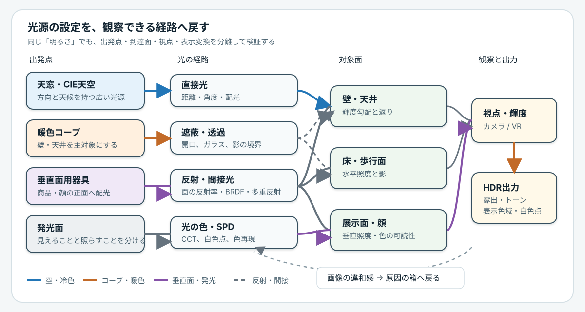

# 4. 光環境

照明の設計は、光源から面に届く量と方向、面から視点へ返る光を決める。仕上げた画像を読み解くときは、光源、遮蔽、受照面、反射、視点、表示変換を順にたどる。

本章は測光量と光の経路から始め、昼光、人工光、色、映像の表示までを扱う。[造形と材質](modeling-materials.md)で述べる表面の性質は、光が観察者へどう戻るかを決める。

## 光源から観察者へ届く経路

画面上で白く見えるものには、少なくとも四種類の理由がある。

第一は、面そのものが光を放つことだ。看板、ディスプレイ、空、発光パネルなどは、観察者へ直接届く放射の出発点になる。第二は、光源から面へ直接届く入射光である。第三は、その入射光を面が反射、透過、吸収することだ。壁が明るく見えるとき、壁が光源なのか、別の光を受けているのかで、シーンの直す場所はまったく違う。第四は、同じ放射が別の面を経由して届く間接光である。

この区別を省略して「環境光を上げる」「全体を少し明るくする」と調整すると、原因のない明るさが蓄積する。床の白さ、壁の色、人物の顔の読みやすさ、金属の反射が同じスライダーで変わり、どの観察を改善したのか説明できなくなる。まず、図の左から右へ光の経路を一本書く。光源、遮蔽、到達面、反射、視点、表示変換を別々の箱として見るだけで、調整対象がかなり絞られる。

発光マテリアルを置けば、それが見えることはある。しかしレンダラーによっては、発光色はカメラに見えても、十分な間接照明を自動的に発生させない。照明としての寄与を期待するなら、実装がエリアライトとして扱うのか、グローバルイルミネーションで拾うのか、ベイクやパストレーシングのどの経路を使うのかを確認し、必要なら独立した照明源を用意する。見えている面と、周囲を照らしている面を同じものとして扱わない。

## 霞を通して見る面のつながり

霞による減衰は、面と観察者の間を通る光の経路に生じる。PBRTの第4版11.2節では、透過率を経路上の消散係数の積分から求め、連続した区間の透過率は積でつながると説明する。同じ位置に接する壁と地面を描くとき、両者の前にある空気もつながっている。材質が違うことだけを理由に霞の量を変えると、接点の明暗が分かれ、壁が地形から離れたように見える原因になりうる。 [PBRT第4版・11.2節](https://www.pbr-book.org/4ed/Volume_Scattering/Transmittance)

実装では、面の反射色と、面から視点までの大気による変化を順に確かめる。地面と建物を同じ世界座標で評価する大気へ通し、足元の起伏や接触部の陰は形と照明で作る。比較用に霞を外した画像も撮り、霞がなくても支持関係が成立するか、霞を戻しても接点だけが切れないかを確認する。一枚の参照から霞の密度を一意に測れるわけではないので、密度や分布は制作上の仮定として残し、複数の視点で連続性を判断する。 [湖畔の制作条件](../lake/lake-hall-design.md#写真と照合する視点)

## 量を読むための最小測光

### 光束・光度・照度・輝度

[BIPMの「Principles governing photometry - 2019」](https://www.bipm.org/documents/20126/27085544/bipm%20publication-ID-3320.pdf/) は、光度、輝度、照度を光束と幾何量から導かれる測光量として整理している。ここで使う単位は次のように役割が異なる。

| 量 | 記号と単位 | 何を表すか | 3Dでの問い |
|---|---|---|---|
| 光束 | $\Phi_v$、ルーメン lm | 光源が全方向へ出す光の総量 | 光源全体の規模はどれくらいか |
| 光度 | $I_v$、カンデラ cd | 特定方向の単位立体角あたりの光束 | その方向へどれだけ投げるか |
| 照度 | $E_v$、ルクス lx = lm/m² | 面に入射した光束の面積密度 | 床、机、壁、商品面にどれだけ届くか |
| 輝度 | $L_v$、cd/m² | 指定方向から見た投影面積あたりの光度 | カメラからその面がどれだけ明るく見えるか |

[CIE e-ILVの illuminance](https://cie.co.at/eilvterm/17-21-060) は照度を面への入射光束の密度として定義し、[luminance](https://www.cie.co.at/eilvterm/17-21-050) は指定方向の投影面積に対する光度の密度として定義する。したがって「壁を明るくする」は照度を上げる操作である場合と、壁の反射率を変えて同じ照度から得る輝度を変える操作である場合がある。カメラ画像の明るさだけから両者を区別することはできない。

### 距離と角度の計算

点光源に近似でき、受照面が十分小さい場合、[CIEの photometric distance law](https://cie.co.at/eilv/912) で照度を粗く見積もれる。

$$
E_v = \frac{I_v\cos\theta}{d^2}
$$

$I_v$ はその方向の光度、$d$ は光源から面までの距離、$\theta$ は入射方向と面の法線との角度である。この法則は点光源に厳密に適用され、非点光源では十分遠い距離での近似になる。[IESの定義](https://ies.org/definitions/inverse-square-law/) は、面が光線に垂直であれば $E=I/d^2$ となり、有限サイズの均一な光源では、光源の最大寸法の少なくとも五倍の距離で約1%以内の近似になる目安も記している。この五倍は目安に過ぎず、光源の輝度分布と許容誤差に依存する。

例えば、特定方向の光度が $800\,\mathrm{cd}$ の小さな光源を考える。面が正対し、距離が2 mなら、

$$
E_v=800/2^2=200\,\mathrm{lx}
$$

である。距離を4 mへ延ばすと $800/4^2=50\,\mathrm{lx}$ になり、距離を二倍にした結果は四分の一になる。距離2 mのまま面を60度傾けると、$\cos60^\circ=0.5$ なので $800\times0.5/2^2=100\,\mathrm{lx}$ になる。これは、同じ光源でも照らす面の姿勢が違えば面積あたりに届く光が変わることを数値化した例である。

この例を大きな発光パネルへそのまま適用してはいけない。パネルの各点が違う距離と角度から面を照らし、近距離では光源の立体角が大きくなるからだ。近距離の柔らかな影、広い反射、カメラに見えるパネルの大きさを設計したいなら、点光源の式を最終値にせず、エリア光源または実測・光線追跡に移る。式は初期判断の道具として、検証と併用する。

### 照度から輝度へ

理想的な拡散反射面について、反射率を $\rho$、面への照度を $E_v$ とすると、CIEの[Lambertian surface](https://cie.co.at/eilvterm/17-24-063) の関係 $M=\pi L$ と $M=\rho E_v$ から、

$$
L_v=\frac{\rho E_v}{\pi}
$$

を得る。照度200 lx、反射率0.5の理想的な白壁なら、$L_v\approx0.5\times200/\pi=31.8\,\mathrm{cd/m^2}$ である。ここで $L_v$ は視線方向に対する輝度であり、画面のRGB値とは別の量だ。表示変換、露出、モニターの白色点を経た後の画素値も別の量である。

実在の壁には粗さ、光沢、異方性、顔料のスペクトル反射がある。したがってこの式を「壁のRGBを決める式」と読まない。照明の大きさを一度数値に置き、どの程度の面輝度を目標にするかを考えるための近似として使う。鏡面反射やBRDFの詳細は [モデリング・マテリアル設計](modeling-materials.md) で扱う。

## 点光源、面光源、天空からの光

### 直接光、間接光、面の放射

点光源の直接光は距離の二乗で薄まる。太陽のような遠方の方向光は、通常の室内スケールでは光源からの空間内でほぼ平行な光線として扱え、照度は主に面の向きと遮蔽で変わる。空は、半球の各方向に異なる輝度を持つ広い光源である。大きな窓や発光天井は、点光源と空の中間で、光源の面積が影の縁、反射の幅、近距離の照度分布を決める。

この違いを「全部を減衰しない環境光にする」ことで隠すと、室内の深さが壊れる。窓の近くから奥へ落ちる照度、柱の裏の遮蔽、床から天井へ返る色の変化が消えるからだ。間接光は、直接光が物体表面で止まらず別の面へ移る経路として考える。白い天井は上向きの光を返し、暗い床は返す量を減らす。赤い壁は隣接面に赤の成分を返す。これらは面の反射条件が作る二次的な光である。

発光面が画像で明るく見えることと、周囲を十分に照らすことは分離して検証する。レンダラーのグローバルイルミネーション、ライトキャッシュ、サンプル数、エミッシブの扱いによって、同じ発光色でも間接照明の量が変わる。明るい看板の周囲が暗い場合、露出を上げて看板を焼き切る前に、間接経路が有効になっているか、発光面の大きさと位置が妥当かを調べる。

### 垂直面を照らす

小売空間で商品や人物の顔を見せるとき、床の水平照度だけでは不足する。正面の垂直面へどれだけ光が届くか、左右や上下の分布がどうなっているかが、読める表面と沈む表面を分ける。[IESのRP-2-20「Recommended Practice: Lighting Retail Spaces」](https://ies.org/products/recommended-practice-lighting-retail-spaces/) は、リテール空間について水平照度と垂直照度、均斉度を別に扱う。IESの も水平・垂直照度の基準を分けて掲載する。本文で標準値を転載する必要はないが、設計ブリーフに「水平面」だけを書いた時点で、商品の正面を評価する条件が抜けている。

器具データを使うなら、[IESの「Learn About IES Files」](https://ies.org/education/learn-about-ies-files/) にある通り、IESファイルは器具の角度ごとの光度分布を記述するデータである。ファイルは器具の性格を持ってくるが、どの面を見せるかまでは決めない。同じ配光でも、商品面を正面から狙うのか、壁をかすめるのか、カメラへ直接入るのかで結果は変わる。IESデータを読み込んだあと、光源の向き、設置高、対象面の法線、遮蔽を確認する。

## 相関色温度とスペクトル

### 色温度、相関色温度、スペクトル

[CIE e-ILVの correlated colour temperature](https://cie.co.at/eilvterm/17-23-068) でいうCCTは、試験光源の色度に最も近いプランク放射体の温度である。つまり、色度を一つのケルビン値へ対応付ける指標であり、光源が波長ごとにどのエネルギーを持つかというスペクトル情報は含まない。異なるスペクトルが同じ色度、したがって近いCCTを持つことは普通に起こる。

[CIE Colorimetry Part 2](https://www.cie.co.at/publications/colorimetry-part-2-cie-standard-illuminants-0) は、CIE標準光源Aをおよそ2856 Kの白熱電球の代表、D65をおよそ6500 Kの平均昼光の代表として定義し、相対分光分布を300–830 nm、1 nm間隔で与える。D65は昼光の代表として便利な基準だが、季節、時刻、地域で実際の昼光の分布が変わることも同じ文書に明記されている。D65を使うと代表的な昼光条件で色を比較できる。

色再現もCCTだけで決まらない。[CIE e-ILVのcolour rendering index](https://cie.co.at/eilvterm/17-22-110) は、試験光源で照らした試験色の見えを、基準光源で照らした場合と比較する相対的な指標である。さらに[CIE PS 002:2025](https://www.cie.co.at/publications/cie-ps-0022025-cie-position-statement-colour-quality-metrics-2nd-edition) は、CIE General Colour Fidelity Index $R_f$ への移行を勧め、移行期間には従来の指標と並べて報告する方針を示している。3D照明では、CCTだけを仕様に書くと、白い壁は合っていても赤い布、肌、緑の葉、彩度の高い商品が想定外になる可能性を残す。光源のSPD、TM-30などの色再現情報、確認用の中立色と有彩色のサンプルをセットで管理する。

### 光源の白色点とカメラのホワイトバランス

光源のスペクトル、カメラが中立とみなす色、表示装置の白色点は、それぞれ役割がある。たとえば3000 Kの照明を寒暖の基準にしてカメラを3000 K相当に調整すると、その光を受けた中立色は無彩色へ近づく。6500 Kの昼光を基準にすれば、同じ3000 Kの照明は暖かく写る。ホワイトバランスの調整は記録・表示する色に働き、面へ届く実際の光のスペクトルは光源と伝搬経路で決まる。

表示前に露出を1 stop上げる操作は、線形値を2倍にする。露出とホワイトバランスを固定して、暖色のコーブ光と青みのある天窓の寄与を別々に確認すると、相対的な色と明るさが読める。中立の灰色の参照面を一つ置くと、光源や色変換を変更した前後を照合しやすい。 [Blender Manual, Color Management](https://docs.blender.org/manual/id/5.0/render/color_management/displays_views.html)

## コーブ、天窓、店舗照明の設計

コーブ光、天窓光、店舗の垂直面照明を重ねるとき、各レイヤーがどの面を主に変え、どの視覚情報を支えるかを明記できることに価値がある。次の数値は、ひとつのアトリウムを始めるためのイラストレーションである。実案件では用途、視作業、設備、視認距離、表示先に合わせて受入値を定める。

| レイヤー | 出発点の設定 | 主対象 | 判断する現象 | 検証する量 |
|---|---|---|---|---|
| 天窓・空 | 実際の空の時刻・天候を基準にする。比較用にCIEの晴天・曇天を分ける | 天井、上部壁、床の奥 | 上から下への方向性、窓近傍から奥への落ち方 | 天窓下と奥の水平照度、上部壁の輝度 |
| 暖色コーブ | 2700–3000 Kを開始値にする。器具の直接像を隠す | 天井の縁、上部壁 | 壁面の連続した明るさ、夕方の温度感 | 壁の垂直照度と輝度勾配、視点からの直接グレア |
| 垂直面用器具 | 商品や顔の正面を狙う。CCTは対象材と基準光源から決める | 商品、サイン、人物の顔 | 正面の色と形の可読性、床だけが明るい状態の解消 | 垂直面の平均・最小照度、均斉度、色再現 |
| 低い環境の返り | 天井・床・周囲壁の反射を原因として残す | 暗部、床、奥行き | 影が黒く潰れず、空間の深さが残る | 直接光と間接光を分けたレンダー、暗部の階調 |

レイヤーの強さを決める順番は、まず対象面、次に光の方向、最後に色である。暖色にしたコーブ光が壁を照らさず器具だけを見せるなら、原因は色相より先に器具の位置、遮蔽、壁の法線、面積にある。天窓を青くしたのに上部へ光が回らないなら、空の色を飽和させる前に、天窓の開口、ガラスの透過、空の輝度、サンプル経路を確認する。

### 保全の条件と観賞の目的を分ける

植物を含む室内では、枝葉を見せる光と、個体を長期に維持する光を別の条件として定める。UF/IFASの室内フィカス技術資料p.2は、生産時の遮光条件を変えた9品種を室内50/100 foot-candlesで1年間評価した結果を述べ、100〜200 foot-candlesでの利用にも生産・順化の条件を付ける。Aliiには50 foot-candlesの記載もあり、数値だけを全ての個体の必要量や最適値へ置き換えられない。明暗に順応した人が葉を読めることも、その植物に十分な光がある証拠にはならない。 [UF/IFAS ENH879, p.2「Production」「Shipping and Interior Care」](https://ask.ifas.ufl.edu/publication/EP136/pdf)

観賞中の点灯、保守点検、保全のための継続運転は、目的と継続時間が異なる。系統ごとに照らす面と運転する条件を決め、昼夜の表示や全消灯操作との関係を明確にする。短い点検点灯を、日次の育成光周期として扱わない。植物の光環境には光源のスペクトル、葉面での光合成光量子束密度（PPFD）、日積算光量（DLI）などが関わり、視感度に基づく照度と色温度だけでは決まらない。Purdue Extensionの技術資料pp.1–2も、人の視覚を基準にした測光量、光量子による瞬時値、一日に受ける積算量を区別する。この区別を使い、同資料の温室作物向け目標値は観賞庭へ流用しない。未校正の描画で置いた照度の開始目標、画面上の明暗、実施設で測定した量を分ければ、観賞の露出調整で生育条件まで満たしたと誤認せずに済む。[Purdue Extension・測光量と光量子の指標](https://www.extension.purdue.edu/extmedia/ho/ho-238-w.pdf)と、系統・運用を分けた[ソファ正面の施設設計](../atrium/sofa-facing-facility-design.md)を参照できる。

### 配光と影を断面へ戻す

配光を円錐で近似するとき、全角は光軸をはさんだ広がり、半角は光軸から片側の縁までの角度である。器具資料と描画側がどちらを使うかを確かめ、光源、照射中心、対象の上端・下端・左右端を同じ断面へ置く。光軸と確認点へ向かう線分の角度を比べれば、中心だけを狙って葉や展示物の上端を外す配置に気づける。実物の向きと遮蔽物も加えて検図するが、代表点が円錐内にあることは実配光、面の照度均斉、葉の相互遮蔽まで確認した結果ではない。

直達光による影には、光源から受照面へ至る経路上の遮蔽物が必要になる。木より奥の器具がさらに奥の壁を照らす配置なら、その木を同じ器具による壁の枝影の根拠にはできない。Wardの原著§3.3は、受照点から光源が見えるかを影の光線で判定し、大きい光源や近い光源には複数の標本を用いる方法を説明する。一本の線分を使う断面検図は光路の成立を調べる初期判断であり、面光源の半影まで求める計算ではない。光源の位置、遮蔽物、受照面がつながるところに影を生じさせ、器具の点消灯でもその関係を保つ。 [Ward, 1994, §3.3](https://radsite.lbl.gov/radiance/papers/sg94.1/light.html)

## シャドウマップを有限な受影面へ対応付ける

離散的なshadow mapで近傍のtexelを比較すると、そのtexelは元の受影点と異なる位置を表す。[Microsoft公式「Cascaded Shadow Maps」](https://learn.microsoft.com/en-us/windows/win32/dxtecharts/cascaded-shadow-maps#calculating-a-per-texel-depth-bias-with-ddx-and-ddy-for-large-pcfs) の「Depth Bias」「Calculating a Per-Texel Depth Bias with DDX and DDY for Large PCFs」は、同一平面を仮定して隣接位置の比較深度を補う方法と、追加計算費用を説明している。「Derivative-Based Offset」は、異なるcascadeを選ぶ分岐内で導関数を求めた場合の不連続も扱う。これらは原典由来の方式と成立条件で、特定の実装の画質・速度を保証する値ではない。

screen座標に関するshadow座標の導関数を $d_x=(u_x,v_x,z_x)$、$d_y=(u_y,v_y,z_y)$ とすると、$D=u_xv_y-v_xu_y$ が退化しない範囲で、正規化shadow UVあたりの深度勾配は次になる。ここでUVと深度は無次元、screen微分は画素方向の変化である。

$$
g=\left(\frac{z_xv_y-z_yv_x}{D},\frac{z_yu_x-z_xu_y}{D}\right).
$$

これは2×2連立式の逆変換である。導関数は空間で変わるcascade/domainの選択やdiscardより前に計算し、退化・非有限値・過大な傾きでは既存の影へ戻す。hardwareのbilinear PCFは複数texelを同じ比較深度で評価するため、sample中心だけに勾配を加えてもそのfootprint内の差が残る場合がある。各texel中心へ比較深度を合わせ、比較結果を重み付き合成する方法には、texture命令と演算が増える費用がある。Three.js 0.184.0の `shadowmap_pars_fragment` と `WebGLShadowMap` は、比較samplerとLinearFilterによる経路の実装例である。

受影面が薄い帯や端部の場合は、平面の式が正しくても、その延長が実面の外へ出る。隣接する床の下面がそこに投影されると、有限な面に存在しない領域を平均した結果が現れる。展望台の[局所受影](../worlds.md#敷居支持前面の局所受影)では、実面内の標本だけでkernelの重みを再正規化する限定した方法を使う。これはその制作物に対する独自の離散フィルタ設計で、Microsoft資料が同じ有限domain処理を定めているという意味ではない。

比較深度と実面の領域判定には別の座標が必要になる。受影点のworld位置を $W$、normalBias付きの投影を $(u_b,z_b)$、bias前の実面投影を $u_0$、texel中心を $c$ とする。比較深度は $z_b+b+g\cdot(c-u_b)$ を保持し、domainのworld位置は $W+U(c_u-u_{0u})+V(c_v-u_{0v})$ で求める。$U,V$ はshadow UVあたりのworld接線で、単位はmである。後者へ $u_b$ を使うと、法線offsetを実面上の接線方向のずれとして混入させる。

この対応は、同じ式を再計算するだけでなく、texel光線と実triangleの交点や、実面上で独立に解いたUV連立式へ照合する。矩形のboundsは曲面・穴・非凸面を表さず、有効標本0のfallbackも画質の成功を意味しない。別casterの影、接触端、視点移動と環境変化、実GPU時間を[対象版の通常表示](../verification.md#展望台の床断面と受影)で確認し、CPU模型・画面・物理的な光学を別の証拠として扱う。

受影平面の深度補正は上記Microsoft資料の平面仮定とUV微分変換を参照し、GLSLで記述した。掲載された図・文章・HLSLは同梱せず、Three.js由来のPCF経路には既存の[MIT表示](../../public/licenses/three-0.184.0-LICENSE.txt)を維持する。技術資料の公開と、実装の利用条件・関係する権利の確認は別の判断として扱う。

## 天空モデルとRadianceでの評価

[CIEの「Spatial distribution of daylight — CIE standard general sky」](https://www.cie.co.at/publications/spatial-distribution-daylight-cie-standard-general-sky-0) は、全天空の輝度分布を天候・気候・太陽位置に応じた複数の分布として扱う。標準は天頂輝度に対する相対分布を定義し、天頂輝度または水平照度を与えて絶対輝度へ拡張する。晴天、曇天、中間の条件を変えると、空の方向別の輝度に応じて受照分布が変わる。太陽の直射も、入射角と遮蔽に応じて室内の明暗を変える。

Radianceの公式説明「[The RADIANCE Lighting Simulation and Rendering System](https://radsite.lbl.gov/radiance/papers/sg94.1/paper.html)」は、建築照明向けの物理ベースレンダリングとして、光を視点から光源へ遡るバックワード・レイトレーシング、決定論的手法と確率的手法の併用、拡散・鏡面・方向性拡散の反射と透過を説明している。[詳細説明](https://radsite.lbl.gov/radiance/refer/long.html) では、入力として3D形状、材料、光源、視点を明示し、直接成分、鏡面間接成分、拡散間接成分を分けている。

天空を生成する「gensky」は、CIE標準の晴天、曇天、中間天空に対応し、緯度・経度・時刻・太陽位置・濁度・地面反射率などを入力にする。[GENSKYのマニュアル](https://radsite.lbl.gov/radiance/man_html/gensky.1.html) には、太陽を含むか、天空だけにするか、天頂の放射輝度や直達成分を指定する方法が記載されている。日照の演出をするなら、少なくとも場所、時刻、天空タイプ、太陽の有無を一組の条件として保存する。

Radianceの結果は、窓の汚れ、実際の反射率、遮光設備の状態、天候の揺らぎ、器具の配光データ、計算のサンプル数に左右される。CIE天空も特定時刻の実測天候を保証せず、比較可能な代表分布を与えるモデルである。計算画像を表示変換に通すと、明暗の圧縮と色域処理が加わるため、画面の印象だけで計算の正しさを判定しない。

実務的には、次の順で使うとよい。最初に天空・地理・開口・材料を固定し、水平面と垂直面の点を置く。次に直接光と間接光を分け、照度と輝度を数値またはfalsecolorで確認する。その後で視点画像を表示変換し、視界内の眩しさ、反射、色のまとまりを読む。画像が良くても点の照度が崩れていれば原因へ戻り、点が合っていて画像だけが崩れていれば視点、材質、表示変換を疑う。この順序が、見た目の好みと照明条件の不一致を切り分ける。

## HDR、露出、トーンマッピングを別工程にする

[OpenEXRのScene-Linear Image Representation](https://openexr.com/en/latest/SceneLinear.html) は、scene-referredな値をカメラが受けた光に比例する線形値として説明し、表示用のtone mappingは後段で必要になると述べる。つまり、EXRに保存された大きな値と、8-bit画像で白く見える値は同じ意味を持たない。白飛びしたPNGだけを見て光源の強さを決めると、照明と表示の問題を同じものとして調整することになる。

[ACESのOutput Transforms](https://docs.acescentral.com/system-components/output-transforms/) は、scene-linearなデータを特定の表示装置向けのoutput-referred画像へ変換する処理を、レンダリング変換と表示エンコードの連結として説明する。[Tone Mappingの技術資料](https://docs.acescentral.com/system-components/output-transforms/technical-details/tone-mapping/) が示す通り、トーンスケールは中間調、ハイライト、表示輝度の範囲を設計する関数である。トーンマッピングは必要な工程だが、物理照明の代わりにはならない。ハイライトを肩で圧縮した結果を、光源が弱いと誤読しない。

検証では、次のものを固定してから露出を振る。

1. カメラ位置、焦点距離、解像度、光源、材料、天空、サンプル条件を固定する。
2. scene-linearの中間成果物を保存し、同じ入力から表示用PNGを作る。
3. 表示変換、表示色域、ホワイトバランスを記録する。露出は0を基準に、-2、-1、0、+1、+2 stops程度を同じ画像で比較する。
4. 床、壁、商品面、空、発光面のサンプル値を読み、クリップと暗部の消失を確認する。
5. 露出を戻しても方向性、色温度の関係、反射の広がりが一貫しているかを見る。

露出を変えて見えるようになっただけなら、照明設計は改善していない。露出を一定にしたときに商品面が暗いなら垂直面の入射光を直し、壁のグラデーションが消えるならコーブの幾何と光の向きを直し、暖色と冷色の関係が消えるなら光源のSPDまたはホワイトバランスを直す。表示変換の変更は別のテスト条件として残す。

## 設計例　天窓と展示面を持つアトリウム

ここでは、幅12 m、奥行き8 m、高さ6 mの中央アトリウムを仮定する。上部に半透明の天窓があり、四周の壁際にコーブ、片側の壁に高さ2 mの展示面、床中央に歩行経路がある。数値はこの仮想空間の試作に用いる初期値である。

この試作例では四つの問題を想定する。昼間は天窓直下の床だけが明るく、奥の壁が沈む。夕方にコーブを点灯すると壁の上部は暖かくなるが、展示面の正面は読めない。床に置いた広い環境光を足すと展示面は読めるが、天窓の方向性と影が消える。さらにカメラを+1 stopすると発光サインが白く飛び、展示物の色差がわからなくなる。

この観察を次の短いブリーフへ変換する。

> 天窓は上方からの主たる方向性を維持する。比較用にCIE晴天と曇天の二条件を用意し、天窓直下と奥壁の差を記録する。コーブは器具像をカメラから隠し、2700–3000 Kを開始値として上部壁へ連続した垂直照度を与える。展示面は床の明るさに依存せず、面の正面へ届く独立した配光を持つ。展示面の平均垂直照度300 lx、最小/平均0.5、歩行面100 lxを初期検証値とする。これらはこの仮想シーン用の開始値であり、規格値として扱わない。中立グレー、赤、緑、青の参照片を置き、CCT、光源のSPDまたは色再現情報、カメラの白色点を記録する。scene-linear EXRと固定表示変換のPNGを納品し、露出の差を照明の差として提出しない。

このブリーフを検証する。まず器具の発光と光の寄与を止め、形状と遮蔽を保ったまま、天窓だけの水平・垂直照度を測る。次にコーブだけを戻し、上部壁の照度と輝度勾配、器具の直接像、カメラ位置からのグレアを確認する。展示面用器具だけを点灯し、展示面の三点以上の高さと左右位置で垂直照度を取る。数値が合っていても展示面が読めなければ、面の反射特性、視線方向の鏡面反射、色再現を調べる。数値が合わなければ、まず光源位置・向き・配光を直し、露出は動かさない。

次に全レイヤーを合わせ、カメラを入口、展示面正面、歩行経路の三位置へ移す。入口では天窓の方向、正面では展示面の色、歩行経路では床と壁の明暗の連続を確認する。三位置のうち一つだけが成立する場合、グローバルな明るさより配光と遮蔽の設計を調べる。最後に固定表示変換で露出スイープを行い、発光サイン、白壁、暗部、展示物の彩度がどの順で失われるかを記録する。これで「美しく見える一枚」と「条件を変えても原因を追える照明」を分けられる。

作業中の観察は [参照画像と透視投影](image-reading.md)の輪郭と明暗の扱いへ戻し、表示装置やVRでの見えの違いは [VR評価](vr-evaluation.md) で確認する。アトリウムの反射面、粗さ、透過、鏡面の扱いは [モデリング・マテリアル設計](modeling-materials.md) と接続する。照明の章だけで材質の問題を解決しようとしない。

## 点消灯で見せる光を照合する

商業アトリウムの店舗では、器具や棚の発光面、商品や壁を照らす光、石床に映る光を組み合わせた。発光マテリアルで器具像を見せ、光が当たる場所には面の明暗を与える。近くの商品へ光が回る箇所には局所光源を置く。照明表の水平・鉛直照度は、どこに光を配るかを決める設計目安である。描画では形状と明暗でこの関係を近似する。 [照明の設計条件](../atrium/tenant-interior-design.md#測定面と制御) · [局所光と発光材の実装](../../src/coast/world/atrium/atriumTenantLighting.ts) · [Three.jsの発光マテリアル](https://threejs.org/docs/pages/MeshStandardMaterial.html#emissive)

夜の点消灯試験では、地上の正面通路と上階の回廊で視点を固定し、操作パネルを隠して画像を比べた。画像中央を縮小して8 bitのRGB符号値に重みを付け、並べ替えた値の上位半数の平均で、点灯に伴う変化を検出する。地上の一例では、1280 × 800 pxのChromium画像で消灯50.6、点灯134.6だった。値は0〜255の画面上の指標である。これで点消灯の接続を検査でき、画面を見比べれば床の反射や棚の明暗が意図した位置で変わったかを判断できる。物理的な照度・輝度の評価には、対象面と測定条件を決めて測光量を得る必要がある。 [ブラウザーの点消灯試験](../../scripts/atrium-browser.test.mjs) · [点消灯の再検査記録](https://github.com/stillshore-chirp/lumen-pilgrimage/pull/237) · [CIEの照度の定義](https://cie.co.at/eilvterm/17-21-060)

## 水面の映り込みを視線角で読む

水と空気の界面では、光の一部が反射し、残りは水の中へ進む。水の屈折率を $n_w=1.333$、空気を $n_a=1.000$ と近似すると、正面入射での反射率 $F_0=((n_w-n_a)/(n_w+n_a))^2$ は約2.0%。面の法線と視線がなす角を $\theta$ とすると、Schlick の近似は $F(\theta)=F_0+(1-F_0)(1-\cos\theta)^5$ で、視線が面に沿うほど反射の比率が増える。水の屈折率は波長と温度・密度に依存する。 [IAPWS・水の屈折率](https://iapws.org/technical-guidance/release/Rindex) · [Schlick・反射率の近似](https://diglib.eg.org/items/581037f7-1e5c-4859-a107-6dfeeb8f3ccb)

例えば、目が水平な水面の2.47 m上にあり、見ている水面の点までの水平距離が $d$ なら $\cos\theta=2.47/\sqrt{2.47^2+d^2}$ になる。$d=4$ mでは反射率の近似値が4.4%、$d=24$ mでは59%。これは界面での割合で、画面上の明るさには天空と湖底の輝度、水中の吸収・散乱、波による法線の分布が関わる。波の傾きが変わると、観察者へ太陽光が返る点も移動する。 [Cox・Munk・水面の傾きと太陽の反射](https://opg.optica.org/josa/abstract.cfm?URI=josa-44-11-838)

湖畔の広間では、水に映る岸や空を正面の浅い角度で見て、室内の窓辺で下を向くと同じ水面越しに魚と底が見えるようにした。通常画面では縮小した反射画像を間隔を空けて更新し、WebXRでは各眼の視線方向から反射を近似する。検証は視点と時刻を固定した正面の映り込みと、窓辺から見下ろす魚の輪郭の両方で行う。 [湖面の設計](../lake/lake-hall-design.md#光空と湖) · [水面の反射と透過](../../src/coast/world/lake/lakeWaterShaders.ts)

### 標本化と再構成の費用を合わせて比べる

遮蔽を少数の固定方向で計算すると、滑らかな二面の隅にも標本配置に沿った反復模様が生じることがある。方向を画素ごとに分散させる方法は、この誤差を粒状の分布へ変える。そのまま表示するのではなく、面の境界を守った再構成と組み合わせる。HBAOの原資料は低解像度で求めた遮蔽の後に全解像度の深度を使うフィルターを示し、Alchemyは遮蔽をcross-bilateral filterしてから前方描画へ合成する。異なる解像度やフィルターを採る場合は別の近似であり、原著と同じ境界品質を達成したとは判断しない。 [HBAO2008 pp.25–29](https://developer.download.nvidia.com/presentations/2008/SIGGRAPH/HBAO_SIG08b.pdf) · [Alchemy2011 Listing1,Fig.6](https://research.nvidia.com/sites/default/files/pubs/2011-08_The-Alchemy-Screen-space/paper.pdf)

幾何法線を同じ深度描画の色面へ保存できれば、量子化された深度の差分だけで法線を推定する必要がなくなる。色面に保存した法線は通常の表示色と区別し、色変換、トーンマッピング、透過合成、縮小時の補間を通さない。圧縮した法線は読み出した後に単位長へ戻す。遮蔽値だけを平滑化し、境界判定に使う法線や深度まで平均しないことも大切である。

再構成では法線の一致に加え、両方の接平面に対する位置のずれを調べる。片方の面だけを使うと、隅を越えた別の面から暗さが漏れる場合がある。元の深度と現在の受照面が合わない場合や、候補をすべて拒否した場合は、古い遮蔽を貼り付けずに寄与をゼロへ戻す。ただし、この保守的な判断は薄い部材の際で遮蔽の欠落を起こす可能性があるため、接触点と連続移動を実画像で確認する。

前処理へ計算を移した方式の費用は、最終の描画だけを測っても比較できない。深度・法線の描画、遮蔽の積分、再構成、合成を含む重複しないGPU区間を測る。読み出し数の設計値も、シェーダーの外側で取得した中心画素をループ内で再取得していないかまで数える。コンパイラーの最適化を最大費用の保証にせず、ソースの読み数、解像度、追加ターゲットと描画回数、実測時間を対応付ける。

### 順位の既知性と、実装の独立性を分ける

Bayerの4×4順位のような既知の配置を使うときは、その順位を新規の発明として説明しない。例えば順位を0から15へ割り当てて角度へ写す方法は、方向の誤差を画素ごとに分散させる制作上の選択である。標本数を増やさず分散しても、細かい粒状誤差、画面座標に対する泳ぎ、薄い部材の境界は残り得る。固定カメラの誤差集計と、微小な移動を直接見た品質判定を分ける。[Bayer1973 Fig.5](https://web.archive.org/web/20130512190753if_/http://white.stanford.edu:80/~brian/psy221/reader/Bayer.1973.pdf)

原著を参照して自分でshaderを書くこと、原著の文章・図・コードやSDKを複製すること、既存依存のOSS許諾を守ること、方式に関わる請求項を調べることは別の確認である。公開や独自実装だけで権利上の安全を断定しない。個別の用途・処理差・残る解釈を記す採用例は[住戸の方式採用記録](../residence/residence-70f-design.md#近接陰影の方式と採用根拠)に置く。

### 画像の所有者と、contextの世代を揃える

反射・影・陰影再構成の画像は同じrendererを使っていても、所有者と更新条件が異なる。contextが失われたときは旧世代の画像と登録済みの解放処理を退役し、復元後は影の生成を待って反射へ進む。画像を読むsamplerの型と実際のdepth/compare設定を初回から照合する。通常時の定常画像だけでなく、初回・resize・品質切替・喪失復元・終了を分けて確認すれば、旧世代を削除した警告と、新しい方式の画質を混同せずに評価できる。

## 観察した現象から原因へ戻る

天窓の光の向きは空の輝度分布と開口で変わる。壁の輝度はコーブの配光、入射方向、反射率で変わり、展示物の色は照明のスペクトルと観察条件で変わる。画像のハイライトと暗部を評価するときは、表示変換前の値と、表示変換後のクリップや階調を照合する。

照明を調整するたびに、変更した原因、主対象面、観察した量、表示条件を短く記録する。数値を正確にできない段階では、少なくとも「この壁の明るさは天窓の間接光」「この面の色は器具のSPDと白色点」「この白飛びは露出と出力変換」と因果を明示する。光を増やす前に、その光がどこから来て、どの面を変えるべきかを言葉にできれば、3D設計の判断は画像の偶然から離れていく。

### 参照した一次資料

- [BIPM, Principles governing photometry - 2019](https://www.bipm.org/documents/20126/27085544/bipm%20publication-ID-3320.pdf/) — SIにおけるカンデラ、ルーメン、ルクス、cd/m²の関係。
- [CIE e-ILV, illuminance](https://cie.co.at/eilvterm/17-21-060)、[luminance](https://www.cie.co.at/eilvterm/17-21-050)、[Lambertian surface](https://cie.co.at/eilvterm/17-24-063)、[photometric distance law](https://cie.co.at/eilv/912) — 測光量、投影面積、ランバート面、点光源近似。
- [CIE, Colorimetry — Part 2: CIE Standard Illuminants](https://www.cie.co.at/publications/colorimetry-part-2-cie-standard-illuminants-0)、[CIE e-ILV, correlated colour temperature](https://cie.co.at/eilvterm/17-23-068)、[CIE e-ILV, colour rendering index](https://cie.co.at/eilvterm/17-22-110)、[CIE PS 002:2025](https://www.cie.co.at/publications/cie-ps-0022025-cie-position-statement-colour-quality-metrics-2nd-edition) — D65、CCT、色再現指標。
- [IES, Learn About IES Files](https://ies.org/education/learn-about-ies-files/)、[IES RP-2-20, Recommended Practice: Lighting Retail Spaces](https://ies.org/products/recommended-practice-lighting-retail-spaces/)、[IES, inverse-square law](https://ies.org/definitions/inverse-square-law/) — 配光ファイル、リテールの水平・垂直照度、点光源近似の距離目安。
- [CIE, Spatial distribution of daylight — CIE standard general sky](https://www.cie.co.at/publications/spatial-distribution-daylight-cie-standard-general-sky-0) — CIE標準天空の相対輝度分布。
- [Gregory J. Ward, The RADIANCE Lighting Simulation and Rendering System](https://radsite.lbl.gov/radiance/papers/sg94.1/paper.html)、[Radiance detailed description](https://radsite.lbl.gov/radiance/refer/long.html)、[GENSKY manual](https://radsite.lbl.gov/radiance/man_html/gensky.1.html) — Radianceの光線追跡、入力、天空生成、計算上の限界。
- [Microsoft, Cascaded Shadow Maps](https://learn.microsoft.com/en-us/windows/win32/dxtecharts/cascaded-shadow-maps) — Depth Bias、Per-Texel Depth Bias、Explanation with Shader Code、Derivative-Based Offset。公式ページの最終更新は2021-04-01、初出日はこの確認では特定していない。
- [Blender Manual, Displays and Views](https://docs.blender.org/manual/id/5.0/render/color_management/displays_views.html)、[OpenEXR, Scene-Linear Image Representation](https://openexr.com/en/latest/SceneLinear.html)、[ACES, Output Transforms](https://docs.acescentral.com/system-components/output-transforms/)、[ACES, Tone Mapping](https://docs.acescentral.com/system-components/output-transforms/technical-details/tone-mapping/) — 露出、scene-referred、表示変換、トーンマッピング。
- [J. Chen et al., UF/IFAS ENH879, Cultural Guidelines for Commercial Production of Interiorscape Ficus](https://ask.ifas.ufl.edu/publication/EP136/pdf) — p.2「Production」「Shipping and Interior Care」。生産・順化条件と室内照度を分けた評価。観賞用の描画目標や全植物の必要照度を定める資料ではない。
- [A. P. Torres & R. G. Lopez, Purdue Extension HO-238-W, Measuring Daily Light Integral in a Greenhouse](https://www.extension.purdue.edu/extmedia/ho/ho-238-w.pdf) — pp.1–2「Measuring Light」「Daily Light Integral」。測光量と光量子による瞬時値・日積算量の区別。温室作物向け目標値は観賞庭へ流用しない。

数値例、アトリウムの寸法、開始照度、露出スイープは説明のための設定であり、法規・規格・特定レンダラーの既定値を意味しない。規格値を適用する場合は、対象用途、版、地域、設備条件を別途確認する。図はこの章の説明用に作成したオリジナルSVGで、外部画像や参照写真は使用していない。

---

[前章　3. 造形と材質](modeling-materials.md) · [目次](README.md) · [次章　5. 音環境](acoustics.md)
