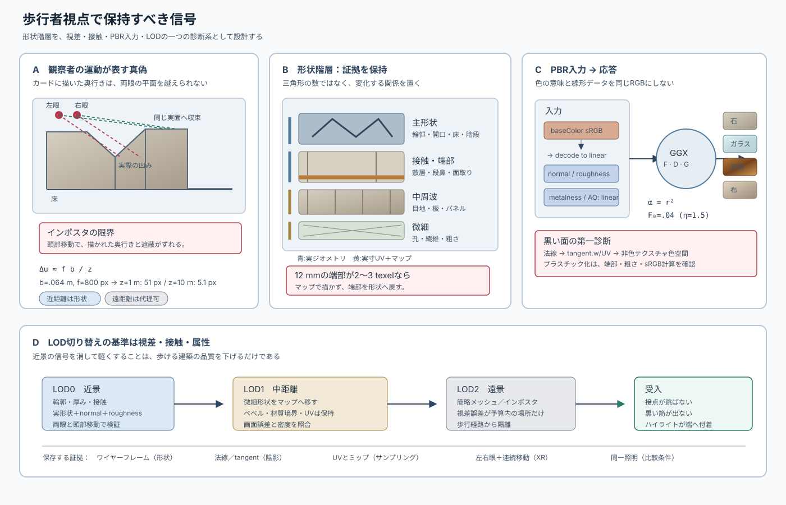

# 3. 造形と材質

## 歩ける建築を「本物らしい」と判定する単位

建築の形状を評価するときは、手すりや戸へ近づき、頭を横へ動かす。形状・接触・遮蔽・反射が同じ寸法から説明できれば、視点が変わっても物体の厚みや材の見え方が連続する。設計の出発点は、単位、基準面、接点、最短の観察距離である。

Lumen PilgrimageのワールドはThree.jsでYを上下、X/Zを床面として扱う。住戸の壁は[平面データ](../../src/coast/world/residence/residencePlan.ts)から参照できる。間仕切り0.14 m、外周や住戸境界の基準厚0.26 mといった関係を先に決めると、壁、引戸、台座、歩行判定を同じ物差しで照合できる。GLBのメートル単位と、家具を床へ下ろすためのピボットの位置は、資産の取り込み時に境界箱と合わせて確認する。

ここで扱うのは形状、表面、テクスチャのサンプリング、LODである。材質の見え方は視点と光の条件で変わるため、[透視投影](image-reading.md)と[光環境](lighting.md)の仕組みを合わせて読む。



## 形状階層は「どの証拠をどこへ置くか」で決める

形状を大・中・小へ分類するだけでは、設計判断にならない。各階層が観察者へ返す証拠を定義する。

| 階層 | 保持する証拠 | 第一の表現 | 省略してよい条件 |
| --- | --- | --- | --- |
| 主形状 | シルエット、空間の幅・高さ、開口、階段、屋根、地形の連続 | 実ジオメトリ | 対象が画面上で単一の背景形になり、歩行・遮蔽・視差へ影響しない遠景 |
| 接触・端部 | 床と壁の取り合い、敷居、段鼻、巾木、台座、薄い縁、ガラスの端 | 実ジオメトリと小さな面取り | 観察距離が遠く、接触の影も輪郭も画素に現れない場合だけマップへ移す |
| 中周波 | 石の割付、板の目地、パネル、柱の分節、繰返し部材 | 実ジオメトリまたはUVで実寸配置したマテリアル | 遮蔽・反射の境界・足の接触を変えず、画面上で一つの面として読まれる場合 |
| 微細 | 孔、繊維、木の導管、微小な凹凸、塗膜の変動 | base color、normal/bump、roughness のマップ | 輪郭、厚み、他物体との遮蔽、手触りの接点を変えない場合 |
| 遠景代理 | 大きな塊と色面の分布 | 簡略メッシュ、インポスタ、カード | 両眼視差、頭部移動、近接遮蔽が許容誤差内に収まる場合 |

次のいずれかの手掛かりが変わる箇所には実形状を残す。

1. 輪郭が変わる。
2. 片目ともう片目の見え方が変わる。
3. 他の面との遮蔽、接触、足元の支持、衝突が変わる。
4. 自身または他物体へ落ちる影、反射の境界が変わる。

例えば、石段の段鼻は数センチでも実形状である。頭を下げたときに段鼻の上面と蹴上げ面が別々に見え、歩行の支持面と接触影も変わるからだ。反対に、石の面にある 0.3 mm の粒子は通常、法線と粗さへ置く。粒子を一粒ずつモデリングしても、接触や輪郭という証拠は増えない。

この規則は住戸だけでなく、海岸の岩棚、丘陵展望台の敷石、映画館の段床にも同じように適用する。展望台の階段は描画形状と `groundHeight` を共有し、住戸の引戸は壁内へ収まる実際の厚みと歩行可能な開口を持つ。接触をテクスチャへ描いただけでは、位置、遮蔽、歩行、反射のすべてが同時には成立しない。

地形を高さの解析関数から作る場合も、関数を共有するだけでは接地は保証されない。描画する地面は、関数を有限個の頂点で標本化し、その間を三角形の平面でつないだ面である。曲がった解析面の途中の高さと、同じ位置で三角形を補間した高さは一般に一致せず、頂点では合っていても植物が途中で浮いたり埋まったりする。支持高さは描画に使う頂点と三角形の分割を参照し、その三角形内の重心座標で補間する。Three.js の `Triangle.getBarycoord` と `getInterpolation` は、この座標と補間の意味を定義している。 [Three.js・Triangle](https://threejs.org/docs/pages/Triangle.html)

支持計算の検査では、支持関数をもう一度呼んで同じ値になることだけを確かめない。実際に描画へ渡す地形メッシュへ下向きのレイを当て、独立した交差計算の高さと根元を比較すれば、別の三角形を選ぶ誤りや座標変換の不一致も検出できる。頂点の間、急斜面、三角形の境界を含めて調べ、小木の根元や地被の両端が表示面に沿うことを確認する。湖畔での支持面と回帰確認は[地形の支持計算](../../src/coast/world/lake/lakeBankSupport.ts)と[植生の検査](../../scripts/lake-vegetation.test.mjs)を参照する。

### 植物の基部だけを動かす

表示三角形に合わせるとき、葉先を含む全頂点を地面へ押し付けると株の形が変わる。支持に使うのは幹下部、株元や岩の下部である。各支持点の世界座標をp、表示面の高さをHとすると、基部の最高離隔は `c=max(p.y-H(p.x,p.z))` で求められる。例えば10 mmを土へ入れる制作値なら、`c>−0.01 m` のとき個体全体を `c+0.01 m` だけ下げる。頂点形状とXZを保つため、地形へ合わせたことによる樹形の変化を避けられる。

この数値は地下リングの支持条件であり、幹が地表へ自然に続くことの視覚証明ではない。傾斜した岩は複数の基部点で支え、露出する本体が残ることを確かめる。高い位置から見た小木と岩、低い姿勢で見た幹の接点を合わせて読み、別の前景の株を検査対象と取り違えない。実装例は [展望台の配置](../../src/coast/world/overlook/overlookHillside.ts)、補間の検査は [地形テスト](../../scripts/coast-terrain.test.mjs)を参照する。

### 道路の高さと地盤の高さを分ける

橋を地面へ合わせるため、全道路を常に「地表+一定値」へ持ち上げると、地形を戻しただけで長大な高架と柱列が生まれる。道路の設計縦断と、構造が支持される実地盤は別の入力にする。区間を橋、切土、トンネルに分け、同じstationから路面、車両、坑口、覆工と支持を作る。FHWAの道路トンネル技術資料は、坑口を斜面、覆工、車両包絡と関連付け、cut-and-coverの施工順を説明している。ここでは空間の接続原理を採り、現実の道路規格や耐荷重を保証する値として使わない。 [FHWA 2009, §1.3.5・§2.1・Figure 2-2](https://www.govinfo.gov/content/pkg/GOVPUB-TD2-PURL-gpo93381/pdf/GOVPUB-TD2-PURL-gpo93381.pdf)

地表と屋根の頂点だけを比べても土被りは保証できない。二つの三角形面をXZへ投影し、交差polygonの頂点で高さ差を調べる。双方の高さが一次式なら、その差の最小値は交差polygonの頂点に現れる。地表の谷が覆工の頂点間へ入る場合も、この検査なら捉えられる。垂直な壁はXZ投影が退化するので、3Dの壁と地表prismの交差を別に処理する。橋脚も中心点だけでなく、実footprint内の地盤とslabの全交差領域を調べる。

実際の切土を作ったら、配置へ渡すsamplerもその三角形へ同期する。一方、坑口背面の土被りは掘削前の地表から測る。同じ場所でも、路床を探す問いとroofを覆う地面を探す問いは異なる。見た目を描画し直さず支持関数だけ変えると二つの正本が残る。 [展望台の実装例と生成順](../overlook/road-terrain-design.md)

### 曲面の余裕は、面までの距離で読む

カメラの余裕を半径として扱う場合、ドームの高さごとの水平半径を広げるだけでは頂部の余裕を表せない。回転軸を含む断面にカメラ中心を写し、輪郭をつなぐ各線分への最短距離を求める。線分の端点をa、b、中心をpとすれば、`t=clamp(dot(p-a,b-a)/|b-a|²,0,1)` で最近点を求め、内部判定と半径以内の距離判定を合わせる。Three.jsの `Line3.closestPointToPoint` も、線分の範囲へ制限した最近点の意味を定義している。 [Three.js・Line3](https://threejs.org/docs/pages/Line3.html#closestPointToPoint)

例えば断面の線分a=(0,6.0)、b=(1,5.9)に対し、中心p=(0.7,6.11)の最短距離は約0.179 mである。余裕半径0.25 mなら、中心は輪郭より上にあっても停止対象になる。実際の外殻に立はぜや盛上りがあれば、その寸法もモデルへ含める。箱の各軸を半径分だけ広げる近似は角で保守的になり、曲面の正確な距離判定とは適用範囲が異なる。

移動経路はX/ZだけでなくYを含めて検査し、衝突後に未検査の目的高度を適用しない。標本間隔で調べる方式と連続衝突判定を区別し、上下・斜め・頂部・側面で同じ形状との対応を確認する。描画と衝突が寸法を共有していても、実際の操作が止まる位置を観察する工程は残る。 [亭の共有形状](../../src/coast/world/overlook/overlookPavilionPlan.ts) · [飛行の検査](../../scripts/coast-controls.test.mjs)

## 植物を形態の階層で作り分ける

植物の外見は、幹と主枝の骨格、細枝を含む葉群の配置、個々の葉の三段階で読む。樹種名を先に決めると、横に広い冠をすべて同じ松へ寄せるような誤りが起こる。写真からはまず、幹の分岐高、主枝の向き、冠の幅と厚さ、葉群の粒度、枝間の空隙を記録する。葉序や花・果実を読めなければ、広葉樹型や松型という制作上の分類に留め、樹種の同定と分ける。植物の識別には樹形だけでなく葉身、葉序、花や果実などの特徴を用いる。 [Oregon State University・Plant Identification「Broad vs. narrow leaves」「Leaf attachment」](https://landscapeplants.oregonstate.edu/plant-identification-examining-leaves)

形態の参考例として、ケヤキは低い位置から分岐する杯状の樹形を持ち、単葉が互生する。一方、クロマツは成木で広がり、不規則な枝を持ち、針葉は2本ずつ束生する。ここでいう束生は、幹の節で葉が向かい合う「対生」とは別である。これらの性質から制作へ採るのは、前者では分かれた主枝と小さな葉面の広がり、後者では裸の横枝と針葉群の段という違いである。葉の寸法や成長条件を別の景観へそのまま移さず、対象画像から観察した冠の形と照合する。 [同・Zelkova serrata「樹形・葉」](https://landscapeplants.oregonstate.edu/plants/zelkova-serrata) · [同・Pinus thunbergii「樹形・針葉」](https://landscapeplants.oregonstate.edu/plants/pinus-thunbergii)

幹と大枝の分岐、隣の冠との前後関係は実形状へ置き、末端の細枝と葉は透過付き素材へまとめられる。ただし、葉群を厚い一塊にすると枝間の空隙が消え、薄い冠も球状に見える。広葉樹型へ針葉素材を使い、冠の幅だけを変えても、輪郭の粒度と葉群の内部は一致しない。葉群の端を異なる高さと奥行きへずらし、素材の透明な部分が枝間の抜けにつながるように配置する。低木と地被にも同じ階層を使うが、低木は地際から分かれる短い枝、地被は岩や土に沿う低い連続面として設計する。これは描画上の造形方針であり、特定の自然群落を復元する方法ではない。

冠が浅い外形を持つことと、葉群を水平な面だけに置くことは異なる。上からは十分に覆われていても、低い視線では面の投影が縮んで裸枝だけが残ることがある。内部と側縁にも高さと向きの違う葉群を置き、上面とは別に見上げる視線で冠を確かめる。面の投影面積を足し合わせる検査は、葉群同士の重なりや遮蔽を判定しないため、密度や自然な見え方の合格証明にはせず、実描画による照合と組み合わせる。

LODでも冠の外形と大きな枝間の空隙を残す。近景の葉を減らすときは、同じ画角で冠の厚さと空隙が変わらないことを先に確かめ、その後に細かな葉の省略を判断する。正面の静止画で輪郭と葉群の粒度を比べ、横へ歩いて冠の重なりと裸枝の見え方を確認する。湖畔での形態の観察、推論、制作上の仮定は[植生の設計](../lake/lake-hall-design.md#植生の形態と配置)へ分けて記録する。

## 真のジオメトリ、テクスチャ、インポスタ

### 実形状・法線マップ・遠景の代理表現

実ジオメトリは位置を変える。面の向き、境界、遮蔽、反射の出発点、両眼の視差を変えられる。normal map は面の位置を変えず、フラグメントの法線を変えて照明応答だけを変える。Three.js の `MeshStandardMaterial` でも、normal map は実形状を変えず、bump map は照明にだけ作用し、displacement map は頂点位置を変えて影や遮蔽へ影響すると明記されている。[Three.js `MeshStandardMaterial` の仕様](https://threejs.org/docs/pages/MeshStandardMaterial.html) はこの境界を実装上の契約として扱う。

インポスタは、遠い対象を少ない形状や板で置き換える手段である。遠景の街区や地平線の岩塊では有効だが、歩行者の近くに突然置くと、頭を動かしたときに「面に貼った絵」であることが露出する。Lumen のような WebXR 探索では、デスクトップの一枚の静止画だけで採否を決めてはいけない。

WebXR の `XRViewerPose` は複数の `XRView` を持ち、各 view に固有の transform と projection matrix がある。すべての view を描画し、提供された projection matrix を使うことが仕様上の前提である。[W3C WebXR Device API](https://www.w3.org/TR/webxr/) は、投影行列を変更・分解して使うと歪みや位置ずれが生じ得ると明記する。したがって、深い窓の凹みを一枚のカードへ描いた場合、左目と右目が受け取るべき奥行き差はカードの平面に固定され、描かれた凹みの奥行きと一致しない。

視差の大きさは概算できる。両眼間隔を `b=0.064 m`、投影の画素焦点距離を `f=800 px` とすれば、対象距離 `z` に対する水平視差はおおむね

```text
Δu ≈ f b / z
```

となる。平行な二台のピンホールカメラで主点を揃えた計算上の視差は、1 mで約51 px、10 mで約5.1 pxである。1 mに置いた代理面と、その0.1 m奥で本来見える形の視差差分は約4.7 pxになる。10 mと10.1 mの差は約0.05 pxである。両眼で見える奥行きのずれを評価するには、平面の位置と、省いた立体の最前部・最奥部の視差を比べる。

### サンプリングは距離と角度の問題である

UV の模様は、画面に対して正面なら比較的安定するが、床や壁を斜めから見ると一つの画素が広い楕円状のテクセル領域を覆う。元画像をそのまま最近傍サンプルすると、ちらつき、縞、モアレが出る。glTF 仕様はミップマップを用いた minification と、三線形補間を含むサンプラの挙動を定義し、実行時にミップマップを生成できる実装を推奨している。[glTF 2.0 仕様 §3.8.4](https://registry.khronos.org/glTF/specs/2.0/glTF-2.0.html) を読み、対象の距離と斜め角に対応するレベルを用意する。

異方性フィルタは、斜めに伸びたテクスチャで一方向にだけ細長くなったサンプル領域を扱うために使う。異方性フィルタは、元のテクセル密度とミップマップが保持する情報を斜めから安定して読む補助になる。Lumen の現行コードでは、海岸の読み込みテクスチャに異方性 8、住戸の生成・読込素材に 4〜8 が設定されている。数字を増やすだけで、低いテクセル密度や壊れたUVは救えない。

## トポロジー、法線、UV、シーム

### 一つの位置に複数の頂点が必要な理由

頂点には位置に加えて法線やUVなどの属性がある。`POSITION`、`NORMAL`、`TANGENT`、`TEXCOORD_0`、色、材質境界などを一組として参照する。位置が同じでも、次の条件が違えば頂点を分ける。

- 平面の折れ角を保つため法線が不連続になる。
- UV の切れ目で座標が不連続になる。
- tangent の向きや `TANGENT.w` の手性が変わる。
- 同じ位置でも頂点色が不連続となる。材質の割り当ては、glTFではプリミティブの境界として表現される。

ここを無条件に weld すると、壁の角が丸く見え、木材の板目が隣の面へ回り込み、normal map の接線基底が反転する。逆に分けすぎると、LOD の簡略化が止まり、頂点数だけ増える。分ける理由を「法線」「UV」「材質」「接触」のどれかで記録する。

glTF の標準属性は `POSITION`、`NORMAL`、`TANGENT`、`TEXCOORD_n` などである。tangent が省略された場合、クライアントは位置・法線・normal texture のUVから MikkTSpace の既定アルゴリズムで計算することが推奨される。bitangent は `cross(normal, tangent.xyz) * tangent.w` で作られる。[glTF 2.0 仕様のメッシュ属性](https://registry.khronos.org/glTF/specs/2.0/glTF-2.0.html) を根拠に、LOD やUV変更の後には tangent を再生成し、`w` の符号を壊さない。

頂点法線の連続性によって、どの折れを照明で見せるかが変わる。石の大きな面を滑らかに平均しすぎれば、角のハイライトが消え、粘土のように見える。金属の薄い縁を平面法線のままにすれば、反射の帯が不自然に折れる。ベベルを実形状で作るか、法線だけで擬似化するかは、縁が画面上で何画素になるかと、手すりや段鼻として触れられるかで決める。

UV シームは、形状のシームとは違う。石板の四隅でUVを切っても石の物理的な割れ目にはならないが、ミップの色が境界からにじむ。シームの外側へ十分な余白を焼き、繰返し境界を実寸で合わせる。敷居、タイル目地、板材の端は、UV の線だけで済ませるか、実形状の溝を必要とするかを別に判定する。

## メートルで決めるテクセル密度

テクセル密度は「4Kなら高精細」という言い方で終わらせない。物理寸法に対して何テクセルを割り当てるかで定義する。

```text
T_x = texture_width  / physical_width   [texel/m]
T_y = texture_height / physical_height  [texel/m]
```

計算例では、2.7 m × 1.8 mの石面全体に512 × 512のマップを張る。横方向は `512 / 2.7 = 189.6 texel/m`、縦方向は `512 / 1.8 = 284.4 texel/m` である。12 mm の段鼻や見切りを色だけで描くと、横方向では `0.012 × 189.6 = 2.3 texel`、縦方向でも 3.4 texel しかない。ミップ、斜め視線、圧縮のいずれかで輪郭が崩れる密度なので、この 12 mm の端部は実ジオメトリへ置く。

同じ面を 2048 × 1024 で作るなら、密度は横 758.5、縦 568.9 texel/m、12 mm は 9.1 × 6.8 texel になる。これはマップで安定しやすいが、端部の遮蔽や足元の影を作る実形状の代わりにはならない。

画面上の大きさも確認する。縦 1440 px、垂直視野角 60° の投影では、画素焦点距離は

```text
f = 1440 / (2 tan(60°/2)) ≈ 1247 px
p ≈ f s / z
```

となる。`s=0.012 m` の段鼻は、距離 1.2 m で約 12.5 px、5 m で約 3.0 px に投影される。1.2 m で12.5 pxに見えるはずなのに、マップの段鼻が2〜3 texelしかないなら、画素へ届く情報が初めから足りない。距離ごとに「何 mm の境界を読む必要があるか」を決め、近距離の接触は形状、中距離の割付はUV、遠距離の変動はミップへ渡す。

なお `p` は正面に近い面の概算であり、床を斜めに見る場合の実際のテクセルフットプリントはUV微分と面の向きで変わる。この概算はテクセル密度と実形状の使い分けに役立つ。

## GGX、Fresnel、metal-roughness の意味

PBRのパラメータは、微小面の向きの分布、遮蔽、入射角による反射率を表す。glTF の金属・誘電体モデルは、正の値、相反性、エネルギー保存を満たすBRDFを基本原則としている。[glTF 2.0 仕様 Appendix B](https://registry.khronos.org/glTF/specs/2.0/glTF-2.0.html) には、GGX と Schlick の式が実装可能な形で掲載されている。

鏡面反射の基本形を、法線 `n`、光方向 `l`、視線方向 `v`、半角ベクトル `h=normalize(l+v)` で書くと、

```text
f_s = F(v·h) D(n·h, α) G(n,l,v,α) / (4 |n·l| |n·v|)
```

GGX（Trowbridge–Reitz）の正規分布関数は、

```text
D = α² / { π [ (n·h)²(α² − 1) + 1 ]² }
α = roughness²
```

である。`roughness=0.5` は、ハイライトの広がりに関与する分布のパラメーター `α=0.25` に対応する。

Schlick の Fresnel 近似は、

```text
F = F0 + (1 − F0)(1 − |v·h|)^5
```

で書ける。空気から屈折率 `η=1.5` のガラスへ垂直入射する誘電体では、

```text
F0 = ((1 − η) / (1 + η))²
   = ((1 − 1.5) / (1 + 1.5))²
   = 0.04
```

となる。`|v·h|=0.5` なら `F=0.04 + 0.96×0.5^5 = 0.07`、`|v·h|=0.1` なら `F≈0.607` である。正面でほぼ透明に見えるガラスの縁が、浅い角度で明るく反射する理由はここにある。ガラスを正面の色だけで薄くする設計は、浅い角度の反射を失わせる。

鏡面反射の入射角を `θ` と置く簡略試験では `|v·h|≈cosθ` と見なせる。`η=1.5` のガラスを同じ環境で動かすと、理想化した反射率は `0°: 0.04`、`60°: 0.07`、`80°: 約0.41`、`85°: 約0.65` になる。この変化を実際の画面で確認する。80°付近で縁の反射が無いなら、まずガラスの法線、IOR、透明描画の順、環境反射の供給を調べ、base color を濃くして補正しない。

metal-roughness の解釈も固定する。誘電体では `metalness=0`、base color は内部で散乱された拡散色、基本のglTF metallic-roughnessモデルでは、非金属の `F0` を0.04とする。金属では `metalness=1`、base color は法線入射の反射色 `F0` であり、拡散色としては使われない。中間値は、錆や塗膜のように一つの画素内で異なる材質が混ざるときのマスクとして使う。ブロンズを「金属っぽくするため `metalness=0.6`」とする判断は、材質の混合場所を説明していない。ブロンズの連続した面は `metalness=1` とし、研磨・酸化・指跡の変動を `roughness` と base color のマップへ置く。glTF では metallic-roughness texture の G が roughness、B が metalness で、両方とも線形エンコードである。[glTF §5.22](https://registry.khronos.org/glTF/specs/2.0/glTF-2.0.html)

## 石、ガラス、ブロンズ、布を作り分ける

### 石

石には `metalness=0` を与え、仕上げに応じて roughness を広い範囲で変える。鏡面研磨した石と、荒い花崗岩を同じ `roughness=0.5` で済ませない。大きな面の色変動は base color、孔や細かな打痕は normal/bump、磨耗や濡れは roughness の変動で分担する。段鼻、タイル厚、目地の深さは実形状で出す。現行実装の参道石材は `roughness=0.94`、normalScale を別に持ち、石面を「灰色の絵」だけにしない構成になっている。値はこのワールドの描画用の設定値である。

### 敷石から基壇までを一本の断面で読む

目地を浅くしても、石の下面と支持層の間に空隙があれば床は一体に見えない。平面の割付、石の厚み、敷きモルタル、下地、基壇までを同じ基準面から読む。Marshallsの天然石施工資料は、連続したモルタルbedと最小10 mmの目地を説明している。ここから採るのは点支持を避けて下層へ連続させる原理であり、個別の広場の耐荷重認証へ一般化しない。 [Marshalls, Natural Stone Paving Installation Guidelines, Issue5, pp.2–3](https://media.marshalls.co.uk/image/upload/v1680084210/Installation-Guides/Natural-Stone-Paving-Installation-Guidelines.pdf)

展望台の例では、主床0 mから石下面−0.050 m、bed下面−0.0785 m、既存cap上面−0.0785 mを揃える。石以外の床は以前の−0.0355 mを保ち、建物footprint内だけのbearingを−0.070..0 mに置く。このbearingはbackingへ34.5 mm重なり、bearing下面からcapまでの8.5 mmもbackingが埋める。同じ「床下」でも、石fieldと非石部を一枚の大きい箱で置換すると、露出面の高さを変えて新しい隙間や段差を作る。

支持される本体から少し張り出したplinthの下面と、独立した敷居が浮く状態は別である。荷重のつながる形を確かめ、装飾の持出しをすべて埋めない。実装の対応は [展望台の床断面](../worlds.md#舗装と建物の支持断面)を参照する。寸法検査と同条件の低い視線を組み合わせ、影を消した診断を仕上がりの代用にしない。

### ガラス

ガラスは `metalness=0`、屈折率は通常のソーダ石灰系の開始値として `ior≈1.5` を置く。板の厚み、縁、枠への入り方を実形状で作り、透明度だけで壁を消さない。透過と反射、内部の重なりはエンジンの transmission 機能と描画順の契約に従う。Walter らの研究は、粗い表面を通る反射・屈折をマイクロファセットとして扱い、エッチングガラスの伝送とサンプリングを検討している。[Walter, Marschner, Li, Torrance, *Microfacet Models for Refraction through Rough Surfaces*](https://www.cs.cornell.edu/~srm/publications/EGSR07-btdf.html) は、ガラスを単なるアルファブレンドへ還元しないための一次資料である。ただし、この論文は建築窓の具体的な複層構成や WebGL の透明描画を保証しない。

### ブロンズ

ブロンズは導体なので、連続面は `metalness=1` とする。base colorには法線入射時の反射色を与える。鏡面研磨、ヘアライン、酸化膜、手で触る部分を roughness の空間変化へ分け、取手の角には実際の小さな面取りを置く。面取りがなければ、光源の反射が一枚の平面から急に消え、塗装プラスチックに見える。

### 布

布は `metalness=0`、粗さは高く、繊維の細かな方向性や sheen は法線・sheen・roughness の組合せで作る。カーテンの裾、椅子の縁、クッションの折れは厚みと陰影を持つ実形状にする。織り目を normal map へ詰め込んでも、布の厚さや折りの接触は生まれない。布面へ金属のような硬いピークが出るなら、roughness、sheen、法線の強さ、環境反射の量を順番に切り分ける。

### 浅い角度を実際に通すテスト

材質は正面の静止画で合格にしない。各材質を同じ中立環境、同じ出力色空間、同じ光源設定で、面法線に対して 0°、30°、60°、75°の視線で確認する。光源の設計は `lighting.md` の試験条件を固定し、ここで都合よく位置を動かさない。

- 石は 60〜75°で段鼻・目地のエッジが面に接続し、ハイライトが面全体をプラスチックの帯にしないこと。
- ガラスは正面の透過を保ちつつ、75°で縁の反射が現れ、片目だけが黒い板を見ないこと。
- ブロンズは浅い角度で反射色が残り、拡散色の茶色い塊へ崩れないこと。粗さの境界が動かず、取手の縁へハイライトが付着すること。
- 布は浅い角度でもピークが広く、折りと端部が見え、硬い鏡面線を出さないこと。

次に頭部を面に対して左右へ 0.25〜0.30 m 移動させる。両眼で同じ接点と遮蔽が保たれ、テクスチャが泳がず、LODの境界で黒い帯が出ないことを記録する。問題が出たら、normal map を一時に外し、roughness を定数にし、base color だけにする三段階の診断を行う。三段階で症状が消える場所が、法線、粗さ、色空間のどこで壊れているかを示す。

### 透過面の奥にある商品が消えたとき

商品が正面や斜めから見えなくなったときは、まず視線に沿って、ガラスの枠、手前の台、商品、棚の背板の順序を調べる。ガラスを一時的に隠した画面と、棚板や背板を一枚ずつ隠した画面を同じ視点で比べれば、どの面が商品を隠しているかを特定できる。商品面が見えるようになったところで、反射の強さ、屈折や透過、描画順の影響を確認する。

商業アトリウムの小物売場では、棚の前寄りにあった背板が商品や棚の光を覆っていた。背板を棚の奥に納めて前縁の光を手前へ移すと、ガラスを保ったまま小瓶や箱を見通せた。奥へ引いた棚とガラス際の低卓を斜めから見ると、横移動に対する輪郭のずれから奥行きを読める。材質の見え方と立体の重なりを同じ角度で比べると、粗さや透明度を変える前に、手を入れる面を絞れる。 [棚の背板と前縁の実装](../../src/coast/world/atrium/atriumTenantEast.ts) · [売場の配置と検証](atrium-case.md#商業アトリウムの実装で確かめたこと)

## 色テクスチャと線形データ

表示用の画像と、計算用のデータは同じRGB値に見えても役割が違う。Three.js は線形 sRGB を作業色空間として、色テクスチャを sRGB、normal・roughness・metalness・AO を通常 `NoColorSpace`、HDR の環境や照明データを Linear-sRGB として扱う。[Three.js Color Management](https://threejs.org/manual/pages/color-management.html) は、線形空間で補間・描画し、出力時に表示色空間へ変換することを明示している。

glTFではbase colorとemissiveのRGBをsRGBで扱い、metallic-roughnessと法線には線形データを使う。sRGBで0.50の色は線形に直すと約0.214になる。これを無変換で0.50として照明計算すると反射率を大きく見積もる。一方、線形のroughness 0.50に誤ってsRGBの復号を適用すると約0.214になり、光沢が集まりやすくなる。法線成分も同様に偏る。 [Khronos, glTF 2.0材質仕様](https://registry.khronos.org/glTF/specs/2.0/glTF-2.0.html#materials)

Lumen の `coastSurface.ts` は色画像を `SRGBColorSpace`、起伏画像を `NoColorSpace` に分け、`residenceMaterials.ts` は色、bump、roughness を別のデータ経路へ置いている。この分離を、新しい GLB、生成 `DataTexture`、カスタムシェーダでも維持する。`MeshStandardMaterial` の map、normalMap、roughnessMap、metalnessMap の説明も、色データと非色データを分けている。[Three.js `MeshStandardMaterial`](https://threejs.org/docs/pages/MeshStandardMaterial.html)

色空間の不具合は「少し暗い」という感想で終わらせない。まずテクスチャの種類、エンコード、`texture.colorSpace`、ミップ生成の順を照合する。黒い面がシェーダのエラーなのか、誤った法線なのか、非色テクスチャの色変換なのかを分けてから、値を変える。

## LODで保つ輪郭、接点、属性

LODでは、観察距離に応じた形状と表面の情報を選ぶ。各レベルが、主形状、接触、法線境界、UV、材質境界、影を同じ意味で保持しているかを確認する。近距離のLOD0では、段鼻、巾木、枠、ガラスの厚み、家具の脚を実形状で残す。中距離では微細な孔や繊維の形状をマップへ移すが、シルエット、接点、主要なベベル、材質境界は維持する。遠距離では代理メッシュやインポスタを使えるが、両眼視差と頭部移動の誤差予算を満たす必要がある。

LODを生成する前に、面の意図を固定する。法線の鋭い境界、UVシーム、材質境界を無視して頂点を潰すと、低LODだけが黒くなったり、石と金属の境界が溶けたりする。公式の meshoptimizer は、簡略化時にトポロジー、属性の不連続、境界を考慮し、法線やUVを属性として重み付けできる。画面サイズを基準に正規化誤差を距離へ変換する例も公開されている。[meshoptimizer の simplification / LOD 説明](https://github.com/zeux/meshoptimizer#simplification) を使い、数値誤差と実際の視認性・歩行中の変化を照合する。

LOD生成後の診断は次の順で行う。

1. **黒い面・黒い筋**。裏返った三角形、ゼロ面積、欠落した法線、tangent の手性、normal map の色空間を確認する。normal map を外して明るさが戻るなら、法線経路を調べる。法線を再計算しただけで材質を合格にしない。
2. **プラスチック化**。ベベルが消え、粗さが一様になり、base color が表示値のまま計算されていないかを調べる。エッジの反射と接触影がLOD間で同じ場所にあるかを見る。
3. **シームとちらつき**。UVの境界にミップ余白があるか、異方性を上げても元の密度が足りているか、LOD間でUVの縮尺が変わっていないかを確認する。
4. **ポップ**。距離だけで切り替えず、投影された誤差、対象の画面占有率、ステレオ差、歩行経路を一緒に判定する。切替の一つ手前と一つ先を連続移動で撮り、接点が跳ばないことを確認する。

この工程を省いてポリゴン数だけを目標にすると、見た目は軽くなるが、歩行者が判断する手がかりを消す。軽量設定と高品質設定で座標、接地、ワールド間の着地点が共有される Lumen では、品質切替後も「同じ場所に立っている」と感じられる接触と尺度を残すことが受入条件になる。

## 適用例　住戸の窓とバルコニーの質感を読む

ここでは、実装へ渡せる一つの仕様を完成形で示す。外観・移動・検証を同時に成立させる設計文書の例である。

**対象と目的。** まずリビングの南窓から街を見る。次に主寝室へ移動し、東側の引戸からバルコニーへ出る。Lumenの参考例では、住戸から街路までの高低差は約246 mである。窓と欄干の設計値は[住戸の設計資料](../residence/residence-70f-design.md)を参照する。観察者は床、窓枠、ガラス、手すり、街の遠景を一続きの寸法として読む。窓外の都市や空の光量は `lighting.md` の条件を固定し、この仕様では材質と形状の差だけを検証する。

**形状仕様。** 壁、床スラブ、引戸枠、ガラスの端、手すりの固定部、床材の切替は実ジオメトリで作る。壁と引戸の開口は図面と歩行判定が同じ寸法を参照する。石床とオーク床をつなぐ部分には露出幅12 mmの見切りを床と同じ高さに納める。この章の計算値は両素材の境界の見え方を検証するために使う。石面の孔、木の導管、布の繊維はマップへ置き、ガラスの薄い縁やブロンズ取手の角は実形状へ置く。

**素材仕様。** 石は `metalness=0`、roughness の開始範囲を 0.78〜0.94、色を sRGB、normal/roughness を線形とする。ガラスは `metalness=0`、`ior=1.51`、低い roughness と transmission を使い、アルファ値だけで透明にしない。ブロンズ取手は `metalness=1`、法線入射の反射色を base color とし、研磨面を roughness 0.28、指が触る帯を 0.40 前後へ変化させる。布のカーテンは `metalness=0`、roughness 0.84 前後、法線と sheen を弱く組み合わせ、裾に厚みを作る。数値は同じ中立環境で試作を比較するための初期値である。

**移動軌跡。** 立位眼高 1.65 m で、窓から 1.2 m 内側を開始点とする。0.6 m/s 程度で見切りへ進み、見切りの手前 0.2 m で停止する。そこから頭部を左右へ各 0.30 m、前後へ 0.20 m 移動し、窓面を浅い角度で見る。引戸の横へ 0.5 m 進み、取手の面取りと枠の厚みを確認する。次に 1.15 m のしゃがみ姿勢で同じ見切りを通過し、床・窓下端・手すりの高さの連続を確認する。この経路で、両眼の視差、接触、光沢の広がり、細部のサンプリングを観察する。

**テクセル密度の判定。** 2.7 m × 1.8 m、512 × 512 の石マップなら 12 mm の見切りは 2.3〜3.4 texel であるため、色マップへ依存させず実形状へ置く。1.2 m の位置で 12 mm は概算 12.5 px、5 m で約 3 px になる。高品質設定では、見切りの実形状を維持し、石面の微細孔だけをミップ付きの normal/roughness へ渡す。軽量設定では、孔のマップを落としても見切りの支持面、影、輪郭は残す。

**実テストと合格条件。** デスクトップと Quest 3 の WebXR セッションで、同じ時刻、同じ照明、同じ描画品質を記録する。正面、30°、60°、75°の視線で石、ガラス、ブロンズ、布を撮影し、両眼で接点が一致することを確認する。頭部移動中にガラスの縁の反射が端へ付着し、取手の反射色が茶色の拡散塊にならず、布のハイライトが硬い線にならないことを合格とする。normal map、roughness map、base color を一つずつ無効にする診断版も保存し、症状の原因を法線・粗さ・色空間へ割り当てる。距離 4 m と 8 m のLODへ移るとき、見切り、枠、手すり固定部の位置が跳ばず、黒い帯、鏡面の突然の消失、テクスチャの泳ぎが出ないことを合格とする。自動ビルドの成功、GLB の読み込み、PNG の生成はこれらの視覚条件を証明しないため、ブラウザ上の連続移動と両眼表示の記録を別の証拠として残す。

観察者が近づくと接触・遮蔽・視差が変わる箇所には、厚みを持つ形状を使う。面の位置を保ったまま反射の広がりや細かな凹凸を変える箇所には、各チャンネルの物理量に応じたテクスチャを使う。遠景の代理表現には、移動できる経路から見た差が十分小さい距離を選ぶ。

## 参考資料

- [Khronos glTF 2.0 Specification](https://registry.khronos.org/glTF/specs/2.0/glTF-2.0.html)。base color の sRGB、metallic-roughness のチャンネル、normal の線形値、GGX、Fresnel、金属・誘電体の混合を規範とサンプル式で確認した。仕様は相互運用の意味を定めるが、各リアルタイムレンダラーが同じ光輸送近似を使うことまでは保証しない。
- [W3C WebXR Device API](https://www.w3.org/TR/webxr/)。複数 `XRView`、view ごとの transform と projection matrix、全 view の描画という契約を確認した。Candidate Recommendation の仕様はビューの供給方法を示すが、個々のヘッドセットの光学特性、快適性閾値、実機フレームレートを保証しない。
- [Three.js `MeshStandardMaterial`](https://threejs.org/docs/pages/MeshStandardMaterial.html) と [Three.js Color Management](https://threejs.org/manual/pages/color-management.html)。本プロジェクトの実装で使う map、normal、bump、roughness、metalness、displacement、色空間の意味を照合した。
- [Brent Burley, *Physically Based Shading at Disney*](https://www.disneyanimation.com/publications/physically-based-shading-at-disney/)。測定材質に対して、少数の制御で一貫したBRDFを作る設計思想を参照した。
- [Bruce Walter et al., *Microfacet Models for Refraction through Rough Surfaces*](https://www.cs.cornell.edu/~srm/publications/EGSR07-btdf.html)。粗い表面の反射・屈折とサンプリングの根拠に使った。実験ではエッチングガラスを扱う。
- [zeux/meshoptimizer — simplification and LOD](https://github.com/zeux/meshoptimizer#simplification)。属性-aware simplification、シーム保護、画面サイズに基づく誤差判定の実装資料として使った。実例では歩行経路を通して、両眼での接点と連続移動の見え方を確認する。

---

[前章　2. 建築と動線](architecture.md) · [目次](README.md) · [次章　4. 光環境](lighting.md)
