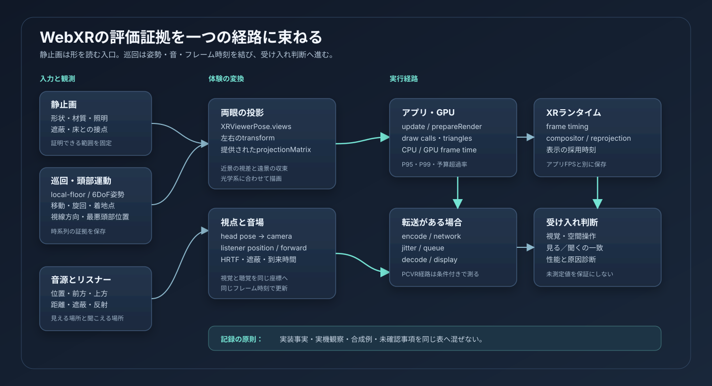

# 6. VRでの見え方と評価

VRでは、頭部が動いたときに世界の位置が保たれ、両眼に異なる適切な像が届く。耳には視点の位置と向きに応じた音場が届く。この時間変化を計測することで、材質や空間に加え、追跡・操作・フレーム更新の品質を判断できる。

この章は、WebXRを使う空間作品を実機で判断するための考え方を扱う。Lumen Pilgrimageの実装は、[検証と配布ビルド](../verification.md)と各節の参照先を使って追う。実装に記録された値、合成した例、性能や聴感を測った条件を分けて読む。

## 視覚、操作、定位、性能の評価軸

VRの受け入れ条件は、少なくとも四つの証拠に分かれる。視覚の証拠は、形状、材質、照明、両眼の投影、遮蔽、遠近の連続性を扱う。空間・操作の証拠は、床に立つ高さ、頭部の移動、身体の移動、旋回、衝突、着地点、メニューや近接操作の状態を扱う。知覚の証拠は、見えている対象と聞こえる対象が同じ場所を指し、移動中も方向・距離・遮蔽の手がかりが破綻しないことを扱う。性能の証拠は、アプリのCPU・GPU処理、XRランタイムの合成、必要な場合の転送・符号化・復号、表示までの時間を切り分ける。

一枚の画像は視覚の証拠を強くできる。頭部の動き、音の到来方向、フレーム落ちは画像から読めないため、形状・比率・材質・静止時の照明を確定し、残りを時系列の確認へ送る。

現行の検証文書も、ブラウザー試験の模擬WebXRとQuest 3などの実機確認を分けている。模擬試験は状態・入力・経路の回帰を捉え、レンズ越しの表示、追跡、音声、フレームレートは実機の証拠として記録する。

## 両眼の位置と投影行列

人が立体を判断する手がかりの中心は、左右の眼が少し異なる位置から同じ世界を見ることにある。頭部中心を `H`、眼間距離を `d`、頭部の右向き単位ベクトルを `r` とすれば、左右の眼の位置は概念上、

`E_left = H - (d/2) r`、`E_right = H + (d/2) r`

となる。実際の眼の位置、光学系、表示面、レンズの歪みはランタイムが扱う。固定カメラを使い続けると、頭の移動に伴う視差、遮蔽、床との接触、遠景の収束がずれる。この式は設計の直感を示す。

[W3C WebXR Device API](https://www.w3.org/TR/webxr/) は、`XRViewerPose` の `views` 配列を、問い合わせた参照空間に対する視点群として定義している。各 `XRView` は視点の剛体変換と投影行列を持ち、アプリは配列中の各ビューに対応する像を描画する。同仕様は、提供された `projectionMatrix` を変更せずに使うことを強く勧め、変更すると像が歪み、位置合わせが崩れ、利用者の不快感につながり得ると記載している。デスクトップ用の縦視野角と、ヘッドセット光学系から決まる投影を同じ設定値として扱わない。

`local-floor` は床を基準にした参照空間で、Y=0が床水準となる。原点と向きはプラットフォームの規約に従って初期化されるため、作品側は「床に置いた身体」と仮想空間の関係を最初の追跡姿勢で合わせる。[W3Cの参照空間の定義](https://www.w3.org/TR/webxr/#xrreferencespace) は、`local-floor` を、利用者が初期位置から大きく離れない想定で安定させる空間として説明する。

### 静止画から読める立体

静止画を読むときは、画面の中央だけを見ない。近距離の手すり・段鼻・家具、中距離の壁や樹木、遠距離の地形・建築・空を三つの距離帯に分け、各帯で次を確認する。

* 近距離の輪郭が、反対側の面を無理に突き抜けていないか。
* 床、段、手すり、机の厚みが視線と身体の高さに対して納得できるか。
* 遠景の地平、建物、雲が、前景の遮蔽物と連続したスケールを作っているか。
* 光の方向、接地影、反射、透過が左右の像で同じ物理的状況を示すか。

「片眼でも成立する形」と「頭を動かしても立体として保たれる形」を分けて記録する。片眼の遠近感だけでは、左右像の不一致、深度の飛び、焦点面と収束の無理を確定できない。

## 固定視点での比較と巡回

静止画試験は、同じ着地点・同じ時刻・同じ品質・同じ視線で保存する。昼夜の色、照明の切替、材料の粗さ、窓や水面の反射、暗転後に残る安全灯を比較する。スクリーンショットは、設計した視線が一枚の画面に収まっているかを判断する証拠になる。

巡回試験では、頭だけを左右・上下へ動かし、次に一歩ずつ移動し、最後に連続歩行・スティック旋回・スナップ旋回を試す。近景の遮蔽、床・壁・天井の拘束、ランドマークへの到達、着地点の眼高を記録する。

Lumen Pilgrimageでは、[ImmersiveSession](../../src/xr/ImmersiveSession.ts)が参照空間に `local-floor` を要求し、[CoastXR](../../src/coast/CoastXR.ts) が各XRフレームの `getViewerPose(reference)` を読む。頭部の横移動をナビゲーションへ渡し、スナップ旋回は追跡中の頭部を中心に回る。巡回では、追跡視点・身体位置・入力を同じ時系列で見る。

[CoastAppのフレーム処理](../../src/coast/CoastApp.ts)では、時計から経過時間を求め、視点とワールド、音響を更新してから、反射など描画前の処理と画面描画を行う。評価時は、どの段階で視覚・音・待ち時間が変わったかを分ける。

### 反射の実装と検証を切り分ける

商業アトリウムの研磨石の床は、通常画面ではカメラを鏡映し、別の描画先に映った建築を床材へ合成する。WebXRでは鏡映カメラの追加描画を省き、各眼の視線から反射方向を求め、回廊の庇、店先、天窓の光を近似する。追加描画を減らしても、横移動で反射が動き、光の位置が実物とつながることが設計条件になる。商品の輪郭まで映す場合は、どこまでを反射の再現対象にするかと、実機で使える描画時間を合わせて決める。 [床反射の実装](../../src/coast/world/atrium/atriumFloor.ts) · [Three.js Reflector](https://threejs.org/docs/pages/Reflector.html) · [WebXRの各ビュー](https://www.w3.org/TR/webxr/#xrview)

この事例の通常画面では、座位・立位・階段の移動、固定視点の点消灯、聴取位置での発音と足音の独立を検証した。模擬WebXRでは、両眼の描画、頭部の位置と向きに追従する音響の聴取点、上階での移動と通常画面への復帰を検証した。実機のレンズを通した像、耳元の定位、GPUとコンポジターのフレーム時間は実機で測る項目であり、この事例では未計測である。ブラウザーの描画通知間隔を記録するときも、GPUで描画した時間とは別の指標として扱う。 [商業アトリウムのブラウザー試験](../../scripts/atrium-browser.test.mjs) · [検証記録](https://github.com/stillshore-chirp/lumen-pilgrimage/pull/234)

## 目の応答と世界の安定性

壁の縁や柱を凝視してゆっくり首を振り、線の流れ、揺れ、二重像、距離の瞬間的な変化を記録する。近い手すりへ顔を近づけて戻り、片眼ごとの輪郭と床との接点も確認する。焦点の合い方に関する設計判断は実機の観察記録へ残す。

[Tolerance of temporal delay in virtual environments](https://www.eecs.yorku.ca/~rallison/papers/delay.pdf) は、頭部速度とエンドツーエンド遅延が増える条件で、仮想世界の知覚的安定性が低下し、頭部運動中の振動視を報告しやすくなることを心理物理実験で調べた原著論文である。この結果を、全ヘッドセットへ同じ閾値で適用しない。作品の受け入れ判断では「何msなら安全」と断定せず、同じ視線・同じ動作・同じ機器で、どの動きがどの程度の不安定感を生むかを記録する。

視点の遅れ、フレームの反復、旋回角度、移動速度、床の高さ、頭部の上下動、暗転からの復帰を分ける。乗り物のような演出では視覚運動と身体感覚が分かれる区間を記録し、症状は場所、視線、移動方法、継続時間、停止後の回復まで残す。

### 道具を指す方向と持つ位置

WebXRは、コントローラーで指し示すレイの基準を `targetRaySpace`、手で持つ物を配置する基準を `gripSpace` として提供する。前者には指す先を決める姿勢、後者には握った手の位置と向きが含まれる。行灯のように立てた状態で運ぶ道具では、握り位置を持ち手に合わせ、道具の上下はワールドの鉛直に合わせる。手が動いた場合と、スティックで利用者が移動した場合の両方で、持ち手と手の対応を確認する。 [W3C WebXR Device API・XRInputSource](https://www.w3.org/TR/webxr/#xrinputsource-interface)

追跡空間からワールドへ変換するときは、身体の移動や旋回を反映した同じ変換を手と頭に使う。掴む動作はグリップの開始をきっかけに成立させ、追跡できない間は最後に確認できた位置を使って解放する。再追跡で物が手元に飛ぶのを防ぐには、再び握るまで新しい保持を始めない。試験では入力イベントの発生に加え、描画された道具の位置、光源を持つ場合はその位置、床に置いたあとに動かないことを確かめる。 [W3C WebXR Device API・入力イベント](https://www.w3.org/TR/webxr/#input-events)

## 聞こえる位置を視点に結び付ける

空間音響では、音源の座標と聴取者の座標が同じワールドにある必要がある。Web Audio APIの `AudioListener` は聴取者の位置と、顔の向きを示す `forward`、頭頂方向を示す `up` を持つ。`PannerNode` はそのリスナーに対して音源を空間化し、`HRTF` は人の頭部で測ったインパルス応答を使う立体化モデルとして定義される。[W3C Web Audio API 1.1](https://www.w3.org/TR/webaudio/) は、位置・方向・距離モデル・HRTFの責務をこの単位で記述している。

現行の `src/coast/CoastApp.ts:792-799` はXR視点の前方・上方を `CoastAudio.update` へ渡し、`src/coast/CoastAudio.ts:508-537` は毎フレームリスナーを更新する。地形遮蔽・反射・水中フィルターの処理では、更新後に0.113秒が経ってから次の呼び出しを受け付ける。アプリのフレーム間隔によって実際の更新間隔は延び得る。仮想モニターの音は `src/monitor/monitorAudio.ts:227-247` が視聴カメラをリスナーへ反映し、空間モードは `HRTF` を選ぶ。

音の巡回では一部で目を閉じる。音源を正面、左右、後方、上下へ置き、頭を回して方向が一致するか、近づいて距離減衰・直接音・反射・遮蔽・到来遅れが連続するかを聞く。境界では音量、高域の減衰、残響を分けて記録する。

「見える滝」と「聞こえる滝」が同じ座標を示すことを静止時と歩行時に確認する。視界から消えた音が残る場合は、反射、距離、地形などの理由を記録する。方向と遮蔽の更新周期が異なる実装では、急旋回直後の過渡差を同じ区間で比較する。

## PCVRの描画、合成、転送

PCVRのフレームは、アプリ更新、左右ビューの描画、XRコンポジター、必要なら符号化・転送・復号、表示と光学という境界を持つ。無線ストリーミングではネットワーク待ち、ジッター、再送、デコード待ちが加わるため、PCレンダーのFPSだけで表示を代表させない。

[W3C WebXR Device API](https://www.w3.org/TR/webxr/#xr-compositor) は、XRコンポジターがページのグラフィックスコンテキストから分離されたコンテキストを持ち、別スレッドまたは別プロセスで表示能力を維持できると定義する。同仕様は、XRの `requestAnimationFrame` について、nominal frame rate、effective frame rate、target frame rateを区別し、`predictedDisplayTime` を表示される時点に合わせたシーン状態の計算に使える値として説明する。アプリのコールバック時刻、描画完了時刻、コンポジターが採用した時刻を混同しない。

レイヤーを使う構成では、シーン全体の投影レイヤーと、固定した矩形・円筒・映像などの合成レイヤーを別の更新単位にできる。[W3C WebXR Layers API Level 1](https://www.w3.org/TR/webxrlayers-1/) は、`XRProjectionLayer` を視界全体のレイヤーとして定義し、投影レイヤーを端末のネイティブ更新頻度に近く更新することを求める。性能はレイヤーの対応状況、深度、再描画、コンポジターの統計から機器ごとに確認する。現行コードはThree.jsの通常のXRレンダー経路を使い、この章ではレイヤー利用を実装済みとして扱わない。

圧縮経路では符号化と復号を測る。[W3C WebCodecs](https://www.w3.org/TR/webcodecs/) はAPIを定義するが、特定コーデックや実装方式を要求しない。機器固有の指標は一次資料と実測を要する。特定のMeta Link指標や、未統合のPCVR経路を現行の完了条件へ含めない。`docs/verification.md:119-121` はWindows配信元のPCVRを未検証として記録している。

各層を別の時計で測る。アプリは開始・更新・描画終了と [`WebGLRenderer.info`](https://threejs.org/docs/pages/WebGLRenderer) のdraw call、triangle、geometry、textureを記録し、[Chrome DevTools Performance](https://developer.chrome.com/docs/devtools/performance) はメインスレッドを記録する。XRランタイムの合成・再投影・表示、ストリーミングのencode・ネットワーク・decode待ちも別に保存する。

## フレーム予算を数値で読む――合成例

次の表はP95・P99と予算超過率の関係を示す合成例である。72 Hzの表示間隔は `1000 / 72 = 13.89 ms`、90 Hzは `1000 / 90 = 11.11 ms` になる。アプリのフレーム時間 `t_app` がこの間隔を越えた回数を「アプリ側の予算超過」と数える。ランタイムの合成・転送・表示の余裕は別途必要なので、この値をシステム全体の保証値へ置き換えない。

| 最悪視線・頭部位置の例 | P95 | P99 | 72 Hz予算超過 | 90 Hz予算超過 |
| --- | ---: | ---: | ---: | ---: |
| 開けた海面を正面に見る | 9.8 ms | 12.4 ms | 0.2% | 1.1% |
| 滝・植生・水面反射を同時に見る | 13.1 ms | 17.8 ms | 2.6% | 5.3% |
| 窓反射・家具影・遠景交通を同時に見る | 15.0 ms | 21.6 ms | 7.8% | 12.9% |

同じ作品でも頭の向きと身体位置で負荷が変わる。サンプルをワールド、品質、表示周波数、視線方向、頭部位置、移動方法に分け、P95、P99、予算超過率を残す。P95/P99は短い順に並べたフレーム時間の95%点・99%点、予算超過率は指定した時間を超える件数の割合である。たとえばP95が13.89 msを上回るときは、72 Hz予算を超えたフレームが少なくとも概ね5%ある。

表の三行目だけ影マップを無効にした合成結果を `P95=11.8 ms`、`P99=15.0 ms`、72 Hz超過2.1%、90 Hz超過6.1%と記録できれば、影の追加描画が原因候補として強くなる。反射、植生、解像度を一つずつ変え、メインスレッド・GPU・ランタイムのどこが変化したかを見る。これは候補を狭める実験設計である。

[CoastApp](../../src/coast/CoastApp.ts)では、デスクトップのピクセル比をビューポート更新時に設定する。XR表示中、同じメソッドは処理を早期終了する。両方の解像度を比較する際は、XRの実効的な描画バッファと通常画面の設定をそれぞれ取得する。

## 受け入れ条件を文章にする

受け入れ条件は「美しい」「滑らか」と書かず、観測点、動作、判定、証拠の順で書く。視覚なら「指定した三地点で、近景の手すり・中景の建物・遠景の地形を左右の視点で確認し、頭部を左右へ移動しても床との接点と遮蔽が連続する」。空間・操作なら「`local-floor` の開始姿勢から一歩移動、頭部の上下移動、30度のスナップ旋回、着地点移動を行い、支持面・壁・天井・メニューの停止条件が同じ座標を指す」。知覚なら「滝を正面・側面・背面から聞き、視線方向、距離減衰、地形遮蔽、反射の変化が同じ音源位置を説明する」。性能なら「各表示周波数と最悪視線集合で、アプリフレーム時間のP95/P99、予算超過率、draw call、triangle、ランタイム統計を同一条件で保存する」と書く。

数値は、ヘッドセット、表示周波数、安全余裕、利用者評価を測ってから決める。未測定の機器に保証値を書かず、模擬試験、画像、Chromeプロファイル、レンズ越し観察、耳元の音響記録が何を証明するかを明記する。

視覚は[画像を読む章](image-reading.md)、照明は[照明の章](lighting.md)、形状と素材は[モデリング・マテリアルの章](modeling-materials.md)、音場は[音響の章](acoustics.md)と接続する。VRでは各判断を視点、頭部運動、音源位置、フレーム時刻へ結び付ける。

---

[前章　5. 音環境](acoustics.md) · [目次](README.md) · [次章　7. 吹抜けを設計する](atrium-case.md)
