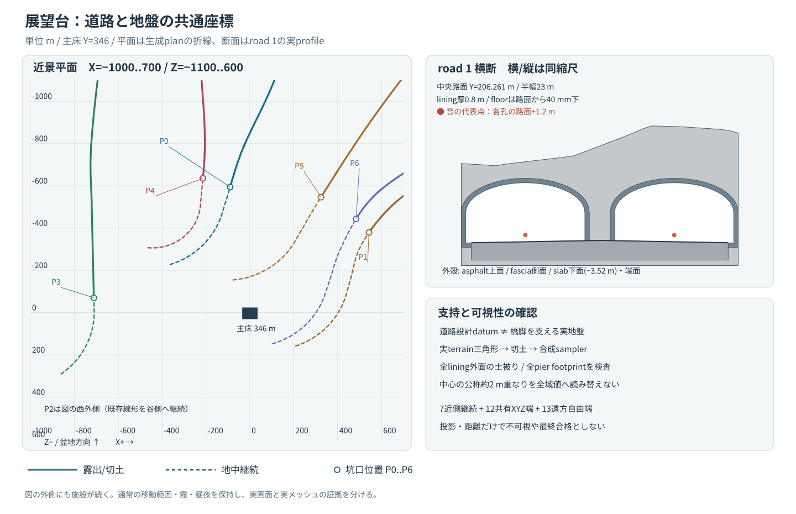
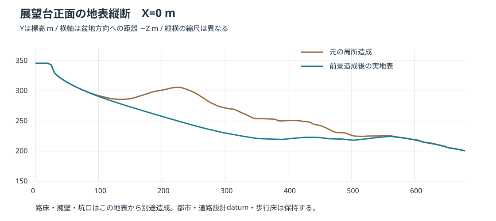

# 展望台の道路と地形の設計

展望台から盆地を見渡す用途を保ち、道路を地盤、橋、坑口から連続した施設として構成します。座標は世界座標のm、主床はY=346 mです。歩行・飛行の許可範囲と上限451 mは [ワールド仕様](../worlds.md#丘陵展望台-overlook) に従います。道路は遠景施設であり、新しい移動先は追加しません。

図の平面は生成planの折線を同縮尺で表示し、断面はroad 1の実profileです。平面の表示範囲外にも道路は継続します。断面右の支持関係図は寸法を読む模式図で、地盤の実形状や法線の代用にはしません。

## 高さの責務と生成順

| 入力・処理 | 意味とconsumer |
| --- | --- |
| [標高データ](../../public/coast-overlook/ATTRIBUTION.md)と `loadOverlookSurvey` | 元の地勢。配布グリッドの補間。 |
| `gradeBeforeLocalWorks` / `loadOverlookTerrain` | 施設の局所造成後、道路工事前の地表。施設直下のcutを保ち、周囲の元地勢へ2方向に戻す。住戸の共有景観はこの地表を使い、道路のない新しい溝を作らない。 |
| `gradeOverlookView` | 展望台に限り、正面の近い稜線を連続した斜面へ下げる。施設直下・背後・外側の地勢と住戸の共有景観を保つ。 |
| `createOverlookViewGrade` | 元地表から作る参照planの地下区間へ、低い連続土被りを接続する。元造成以下へ制限し、露出した路面だけが残る窓状の切土を避ける。 |
| `createOverlookRoadDatum` | 既存道路の縦断を保つ設計用高さ。現在の地盤や橋脚の支持高さとして使わない。 |
| `createOverlookSurface` | Float32頂点、同じ対角線からなる描画地面と `sampleHeight`。都市groundを重ねる順序もここで確定する。 |
| `createOverlookCorridorPlan` | 道路中心線、幅、標高、station、坑口と切土の共通plan。描画・交通・音響が参照する純粋なCPUデータで、GPU資源や音声graphを生成しない。 |
| `createOverlookEarthworks` | 描画地面の実三角形を切り、路床・擁壁・坑口背面の土断面をつなぐ。返す合成 `sampleHeight` を、この造成を持つ展望台の支持へ渡す。 |
| 静的道路 / 構造 / 交通 | [路面](../../src/coast/world/overlook/overlookRoadSurface.ts)、[閉鎖slabとトンネル](../../src/coast/world/overlook/overlookRoadStructures.ts)、[車両・橋脚・音源データ](../../src/coast/world/overlook/overlookTraffic.ts)を同じplanから生成する。 |

組み立ては [OverlookWorld](../../src/coast/world/overlook/OverlookWorld.ts) を正本とします。まず元地表のFloat32 surfaceと参照planをCPUで生成します。この地面はsceneへ追加せず、plan取得後に資源を解放します。参照planから低い土被りを接続した前景地表を作り、最終surfaceとsamplerでplanを再確定します。earthworksを適用してから都市、橋脚、植物、局所音源を配置します。実際に切った面の支持は合成samplerを使い、土被りは掘削前の面との関係を調べます。垂直な擁壁・坑口には同じXZで複数のYがあるため、高さ関数だけで壁の閉鎖を証明しません。

`sampleHeight` は非有限入力・field外で `undefined` を返します。planのfieldはX=−23000..23000、Z=−26000..11000 mで、必要な支持が外へ出た場合は生成を拒否します。毎frameのraycastは加えません。`createOverlookTraffic(heightAt)` のplan省略時は従来の配置を使います。共有consumerは新しい道路構造や音声を暗黙に生成しません。

## 正面の眺望と前景地表

前景は独立した山のmeshではなく、標高グリッドから作る一続きの地表です。正面Z=−100..−350 m付近の稜線を下げ、近い斜面が市街の前へ持ち上がる量を減らします。地面の三角形を削除せず、デッキの既存基礎と盆地へつながる低い斜面を造ります。

`gradeOverlookView` は既存造成後の高さを上限とし、既存cutと同じ指数曲線・0.30の下降勾配を持つ制作上の斜面へ下げます。デッキfootingからのXZ距離200..580 mでsmootherstepを使って元地表へ戻し、Z=−100..−24.45 mでも滑らかに効果をなくします。主床と基礎の地表、背後、距離580 m以遠は変えません。これは景観用の造成モデルであり、現地地形の再現や施工上の安定勾配を表す値ではありません。

現行のFloat32地表では(X,Z)=(0,−200) mの高さが元の局所造成約301.027 mから257.725 m、(400,−200) mでは275.440 mから238.528 mになります。施設の床Y=346 m、移動範囲、都市の配置と既存道路の設計datumは保持します。都市の支持、植物、橋脚、局所音源、遮蔽は、造成を反映した共通の実地表と道路造成後の合成samplerを使います。

地形を下げた場所で短い路面だけが露出し、その先が再び埋まる構成を避けるため、地下区間に必要な低い土被りを接続します。[共通造成](../../src/coast/world/overlook/overlookViewTerrain.ts)は参照planの覆工上面に2.5 mを加え、道路外幅から32 mの範囲で格子三角形全体を保護し、その外側35 mで斜面へ戻します。変更範囲の19 m格子の対角線は27 m未満です。高さは元造成以下へ制限し、元の高い稜線を復元しません。

この土被りから最終planを再生成し、自然な出口へ坑口と切土をつなぎます。坑口位置の固定を受け入れ条件にはしません。現データでは7坑口が前景造成前と同じ位置となり、road 5/6の長い新規開削を避けられます。土被りを補う点は1 mm超で368頂点、最大約14.515 mで、地表全体は元造成を超えません。主な眺望断面の低下は維持します。道路の元区間のXZ・縦断と幅を保ち、同じ最終planから地中継続、headwall、路面と支持、交通・道路音を生成します。

[USGS 3DEPの製品説明](https://www.usgs.gov/3d-elevation-program/about-3dep-products-services)の「Standard DEMs」「Bare Earth DEM Dynamic Service」を参照し、元資料が地表の標高であり、今回の削り下げと施設の形を含む資料ではないことを区別しました。元データの出典と利用条件は[標高の台帳](../../public/coast-overlook/ATTRIBUTION.md#地形と街路)に従います。造成範囲、曲線と閾値は独自の制作判断です。

回帰では実Float32三角形の高さ低下、施設・背後・外縁の保持、造成境界の連続を確認します。眺望の完成判定は、主床・上階・左右端・低姿勢・見下ろしの同条件画像と通常移動で行い、新しく露出する坑口、支持、植物と地表の接続を別に照合します。高さの計算やunit成功だけで見た目を合格にしません。

## 線形、役割と接続

既存16路のXZ線形と幅を保持します。縦断の勾配は実際の描画chordで測り、同じXYZの接点を揃えて5.8%以内へ小さく持ち上げます。現入力の最大持上げは約17.533 mmであり、元のY値を全点で同一に保つ契約ではありません。Float32丸めを含む測定には0.0001 percentage pointの許容を使います。

`CorridorFrame.y` は道路中央のasphalt上面です。端は中央より0.42 m低く、stationは奥の継続部から元道路へ増加します。`originalOffset` と `originalLength` で元区間を追跡します。`corridorRole` は地中継続、坑口前の切土、露出部を区別します。

近側7端を、実際の土被りのある曲がった継続へ接続します。road 0/1/4/5/6は元始点を覆う地形へつなぎ、road 2/3は谷側の低い線形を延ばして坑口を置きます。全線を地表より上へ持ち上げる方式は採りません。坑口から奥には内壁、roof、floorと曲線を置き、端の生の断面や車両の周回切替を開口の正面へ置きません。延長距離だけで端が不可視と判定せず、地形・lining・視線を照合します。

坑口が元始点より奥へ移った場合も、切土の路床を元始点で止めません。元線形の有限なframe列を前へ調べ、道路幅の地表がslab下面（中央路面−3.52 m）より低くなる位置まで同じapproachを継続します。元始点で打ち切ると、その先の道路が地面へ再埋没し、独立した矩形の路面だけが見えるためです。この経路は、局所覆いを持たない地表の回帰条件でも検査します。

局所覆いを持つ最終地表では、road 5の切土はstation 589.778..715.623 m、road 6は733.651..895.476 mです。路床と掘削前地表の実三角形を全面交差した最大の高さ差は、road 5が約24.134 m、road 6が約33.230 mです。地表の接合と支持だけで景観を合格とせず、合法な見下ろしと通常眼高の東端・正面から、切土・擁壁・地形頂部の接合を昼夜の実像で確認します。これらの値は制作形状の寸法であり、実施設の掘削・擁壁の安定性を認証する値ではありません。

全32端の幾何分類は、近側の地中継続7端、共有XYZの12端、遠方の自由端13端です。共有座標だけでlane、欄干開口、車両経路の連続まで保証しません。遠方13端はroad 0/1/2/7/8/9/10/11/12/13/14のendとroad 15のstart/endで、距離による不可視扱いをせず、通常の合法視点の原寸像・実投影・遮蔽で確認します。

## 地盤、坑口、支持

[Earthworks](../../src/coast/world/overlook/overlookEarthworks.ts) は元のindex付き三角形を切土polygonで分割し、影響しない頂点と属性を保ちます。切土上端は実格子・対角線との交点を含み、連続した擁壁と路床へつなぎます。坑口背面で地表がconcrete crestを越える部分は、実三角形に沿う土断面で閉じます。外挿した数点の最大値や、薄い板だけで地形の切断を隠しません。

トンネルは左右の孔と中央webを持ちます。[断面生成](../../src/coast/world/overlook/overlookTunnel.ts) は0.8 mのliningと実際の厚いheadwallを生成し、floorは路面から40 mm下へ入れます。車体・灯火の包絡、lining外面の土被り、隣接路との3D離隔を別々に検査します。土被りの制作条件は外面から2 m以上です。これは実施工の構造認証ではありません。

道路slabの支持volumeは、中央のasphalt上面と同じ高さ、端は中央−0.42 m、下面は中央−3.52 mで閉じます。外から描く面はasphaltの上面、既存fasciaの側面、slabの下面と両端面が所有します。支持volumeの上面・側面はgeometryに残し、内部の非描画groupへまとめます。これにより、近接する二つの不透明面が遠方の有限な深度精度で競合することを避けます。端面の上縁もasphaltへ一致させ、非描画による開口を残しません。slabは各道路につき一つの可視groupで描き、stationごとのdrawcallを増やしません。橋脚は実地盤の四隅から下へ入り、上部が実slabへ重なります。公称中心の約2 mの重なりをfootprint全域の最小値へ読み替えず、地盤とslabの両方を全footprintで交差検査します。曲線・勾配・地形の交点で浮きや支持切れがないことが条件です。

## 道路音の到来と範囲

道路音のある8路について、露出部8声と左右の実孔14声の最大22声へ分けます。覆われた各区間の源長を左右へ半分ずつ配り、旧 `soundWeight` を保ちます。保存するのは源長と放射weightであり、位置を変えた受音powerを旧方式へ再正規化しません。

孔の代表点は各bore内の局所路面+1.2 mで、中央のsolid webへ置きません。内側の道のりと各孔から聴取点への距離を一度だけ既存のmanual距離則へ入れ、Pannerの `rolloffFactor=0` とします。外部の地形遮蔽は孔から聴取点までを調べます。この経路長は減衰に使い、車両イベントへ同期する物理的な到達遅延は追加しません。露出部の道路幅は一つの重心音源へ縮約する近似が残ります。

元8路の再生率0.923..1とoffsetを保持し、追加の孔には範囲内の微小な率差とoffset差を与えます。これらは同じPCMの異なる時間・速度であり、統計的に独立した音源とは仮定しません。既存の高域・低域補正を保持しますが、坑内の反射、放射指向性や材料の測定値とは扱いません。実PCMの重なり、定位、音量とHRTF負荷は [検証手順](../verification.md#展望台の道路地形と道路音) で確認します。

## 原典の適用

[FHWA, Technical Manual for Design and Construction of Road Tunnels, 2009](https://www.govinfo.gov/content/pkg/GOVPUB-TD2-PURL-gpo93381/pdf/GOVPUB-TD2-PURL-gpo93381.pdf) の§1.3.5、§2.1とFigure 2-2、cut-and-coverの説明を読み、道路の役割、車両包絡、坑口、覆工と地盤の関係へ適用しました。本ワールドの幅、曲率、lining厚、土被りと勾配は制作値です。資料の道路規格や実物の構造性能を満たすとの主張はしません。

[ASJのトンネル音実験と予測の原著、pp.614–617・620–621](https://www.jstage.jst.go.jp/article/ast/41/3/41_E1947/_pdf/-char/ja) と [NCHRP 25-34 Appendix L、L1–2・L6–12](https://onlinepubs.trb.org/onlinepubs/nchrp/docs/NCHRP25-34_FRAppendixL.pdf) は坑口の位置・指向性と源powerの扱いを照合しました。道路・内面・車種を定めた予測条件を、汎用のPCM low-pass係数や固定の音量倍率へ転用しません。

設計・構造の検査、実画面の眺望、環境音、最終全域判定は分けます。合法視点から手前の地形に遮られる坑口の画像は、口内や地形接点を直接確認した証拠にはしません。版付きの実施結果と残件は関連Issue・PRに記録します。
